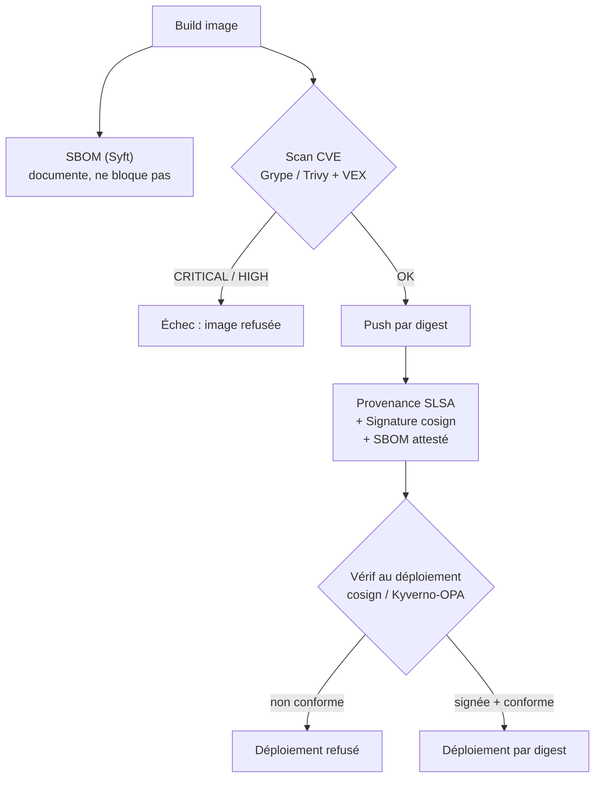

# DevSecOps — journal d'apprentissage

Tout ce que j'apprends et pratique **en dehors du projet FleetTrack** : outils, commandes, options, et
surtout le **pourquoi**. Tenu au fil de l'eau.

> **Rattachement au portfolio :** ce journal correspond au **Projet 00 — Socle : Linux + Docker +
> Réseau + AWS** (Phase 1) du parcours `devsecops-portfolio` (code dans `00-docker/`). Il consigne
> les fondations conteneur/OS/réseau/cloud avant l'automatisation (Ansible, CI/CD, K8s…).

> **Règle de rangement**
> - Par défaut, ce que je fais va **ici** (`docs/DevSecOps.md`).
> - Quand un message commence par **« projet : … »**, ça concerne FleetTrack et va dans
>   [`configurations.md`](configurations.md).
>
> **Format d'une entrée :** date → ce que j'ai fait → **pourquoi** → les **commandes** avec chaque
> **option** expliquée → pièges rencontrés → sources dans la section Ressources.
>
> **Sources, pour chaque entrée, toujours les deux :**
> 1. la **documentation officielle** de l'outil ;
> 2. la page correspondante du **guide de Stéphane Robert** (blog.stephane-robert.info), quand elle existe.

---

## Sommaire

1. [Environnement Docker — WSL2 sans Docker Desktop](#1-environnement-docker--wsl2-sans-docker-desktop)
2. [asdf — gestionnaire de versions d'outils](#2-asdf--gestionnaire-de-versions-doutils)
3. [`wsl` ou `ssh` : entrer dans une machine](#3-wsl-ou-ssh--entrer-dans-une-machine)
4. [Images multi-plateformes — `docker buildx`](#4-images-multi-plateformes--docker-buildx)
5. [Artefacts OCI — un registre ne stocke pas que des images](#5-artefacts-oci--un-registre-ne-stocke-pas-que-des-images)
6. [Concepts Docker — image, conteneur, couches, isolation](#6-concepts-docker--image-conteneur-couches-isolation)
7. [autoheal — redémarrer les conteneurs « unhealthy »](#7-autoheal--redémarrer-les-conteneurs--unhealthy-)
8. [Logs d'un conteneur : `docker logs` et les pilotes de logs](#8-logs-dun-conteneur--docker-logs-et-les-pilotes-de-logs)
9. [`docker stats` : quelles colonnes surveiller, et pourquoi](#9-docker-stats--quelles-colonnes-surveiller-et-pourquoi)
10. [PID 1 et les signaux : pourquoi `docker stop` met 10 secondes](#10-pid-1-et-les-signaux--pourquoi-docker-stop-met-10-secondes)
11. [Ressources](#ressources)

---

## 1. Environnement Docker — WSL2 sans Docker Desktop

**Date :** 2026-09-28

### 1.1 Décision

**Décision :** apprendre Docker sur un **Docker Engine natif installé dans WSL2 (Ubuntu-24.04)**, sans passer
par Docker Desktop.

**Alternatives considérées :**

| Option | Pourquoi pas (maintenant) |
|---|---|
| Docker Desktop | Cache le démon dans sa propre distribution (`docker-desktop`) : on ne voit ni systemd, ni `dockerd`, ni les namespaces/cgroups (chapitre 3 du guide Stéphane Robert). |
| VirtualBox / VM locale | Exclu volontairement. |
| Dual boot | Linux 100 % natif, mais redémarrage pour changer d'OS. |
| VM dans le cloud | Vraie IP publique, proche de la prod — **retenu pour la phase 4** (k3s sur 3 nœuds), pas pour apprendre Docker. |

**Pourquoi WSL2 :** vrai noyau Linux (Microsoft le fait tourner dans une VM légère qu'on n'administre pas),
gratuit, sans risque, déjà installé. Limites : une seule machine (pas de multi-nœuds), réseau NATé par Windows,
et le disque virtuel `ext4.vhdx` grossit sans rétrécir tout seul.

### 1.2 Coexistence avec Docker Desktop (constat du 2026-09-28)

Distributions WSL présentes (`wsl -l -v`) : `Ubuntu` (par défaut), `Ubuntu-24.04`, `docker-desktop`.

| Réglage Docker Desktop (`%APPDATA%\Docker\settings-store.json`) | Valeur | Conséquence |
|---|---|---|
| Intégration avec la distribution par défaut | activée | ne touche que `Ubuntu` |
| Intégration avec d'autres distributions | aucune | **`Ubuntu-24.04` n'est pas concernée** → pas de conflit |
| Démarrage automatique | désactivé | — |

- ⚠️ **Ne pas** faire `wsl --set-default Ubuntu-24.04` : l'intégration « distribution par défaut » s'y
  appliquerait et deux Docker se marcheraient dessus.
- Ouvrir la bonne distribution : `wsl -d Ubuntu-24.04` (nom **exact**, sensible à la casse : `ubuntu24.04`
  → `WSL_E_DISTRO_NOT_FOUND`). Astuce : `wsl -l -v` pour les noms, `Tab` pour compléter.
- Piège : avant l'installation, `docker` dans Ubuntu pointait sur le `docker.exe` **Windows**
  (`/mnt/c/Program Files/Docker/...`), injecté par l'interop WSL (PATH Windows ajouté). Après l'installation,
  `/usr/bin/docker` passe devant. Vérifier avec `which -a docker`. Option pour supprimer l'ambiguïté :
  `appendWindowsPath=false` dans `/etc/wsl.conf` (non fait).
- Toujours savoir à quel démon on parle : `docker context ls`, `docker info`.

### 1.3 Installation de Docker Engine

Source : dépôt apt **officiel Docker** (pas le paquet `docker.io` d'Ubuntu, souvent en retard), procédure
de la doc « Install Docker Engine on Ubuntu ».

1. Clé GPG de Docker dans `/etc/apt/keyrings/docker.asc` + dépôt dans `/etc/apt/sources.list.d/docker.sources`.
2. `sudo apt install docker-ce docker-ce-cli containerd.io docker-buildx-plugin docker-compose-plugin`

**Versions installées :** Docker Engine **29.8.1**, containerd **2.3.6**, Buildx **0.37.1**,
Docker Compose **v5.5.1** (+ `docker-ce-rootless-extras`, dépendance → mode rootless disponible).

**Vérifications faites :**

| Contrôle | Résultat |
|---|---|
| PID 1 | `systemd` (donc `systemctl` fonctionne dans WSL) |
| `systemctl is-active docker` | `active` ; service `enabled` (démarrage auto déjà activé par défaut sur Ubuntu) |
| `which -a docker` | `/usr/bin/docker` en premier (`/bin/docker` = même fichier, `/bin` → `/usr/bin`) |
| `systemctl status docker` | `/usr/bin/dockerd -H fd:// --containerd=/run/containerd/containerd.sock` → Docker s'appuie sur containerd |

**Avertissements `WARNING: No blkio…` au démarrage :** normaux sous WSL2 — le noyau n'expose pas certains
contrôleurs cgroups d'I/O disque ; Docker ne pourra pas limiter le débit disque d'un conteneur. Sans impact
pour apprendre.

**Leçons en passant :**
- Travailler dans `~` (`/home/lahigic`), pas dans `/mnt/c/WINDOWS/system32` (dossier de départ d'un terminal
  lancé depuis un PowerShell admin). `cd -` = dossier **précédent** (erreur `OLDPWD not set` s'il n'y en a pas) ;
  `cd ~` ou `cd` = dossier personnel.
- `systemctl status` ouvre un pager : `q` pour quitter.

### 1.4 Post-installation : groupe `docker`

```bash
sudo groupadd docker            # déjà existant (créé par le paquet docker-ce) → sans effet
sudo usermod -aG docker $USER   # -G : groupes secondaires ; -a : AJOUTER (sans -a, la liste est remplacée → perte de sudo !)
newgrp docker                   # nouveau shell qui connaît le groupe, dans CE terminal seulement
```

- Les groupes sont lus **à l'ouverture de session** → `newgrp` est temporaire (un `exit` en sort). Solution
  durable dans WSL : `wsl --terminate Ubuntu-24.04` puis rouvrir. Vérifier avec `id`.
- Pourquoi ça donne l'accès : `/var/run/docker.sock` est `srw-rw---- root docker`.
- ⚠️ **DevSecOps : groupe `docker` = équivalent root** (ex. `docker run -v /:/host …` monte tout le système).
  Acceptable sur une machine d'apprentissage ; sur un serveur, limiter ce groupe ou passer en **rootless**.
- Test : `docker run hello-world` sans `sudo` → OK. Le message décrit l'architecture : client → démon (via le
  socket) → pull depuis un registre (Docker Hub) → création du conteneur → sortie renvoyée au client.

### 1.5 Rotation des logs des conteneurs

**Pourquoi :** le pilote `json-file` écrit un fichier par conteneur qui grossit sans limite ; dans WSL2 le
`ext4.vhdx` ne rend pas l'espace libéré.

**Choix :** `json-file` **avec rotation** plutôt que `local` (rotation par défaut mais format interne) — car
les fichiers JSON sont lisibles par les collecteurs de logs → **prépare la phase 6 (Loki)**.

Fichier `/etc/docker/daemon.json` (créé sans éditeur, avec `sudo tee` + heredoc) :

```json
{
  "log-driver": "json-file",
  "log-opts": {
    "max-size": "10m",
    "max-file": "3"
  }
}
```

→ au plus 3 fichiers de 10 Mo par conteneur (30 Mo). `max-file` est une **chaîne** (entre guillemets).

**Leçons :**
- `sudo echo '…' > fichier` échoue : la redirection `>` est faite par **mon** shell, sans les droits root.
  `sudo tee fichier` : c'est le programme qui écrit qui a les droits. `> /dev/null` masque l'écho de `tee`.
  Heredoc `<<'EOF'` : les guillemets empêchent l'interprétation de `$` ; le `EOF` final seul sur sa ligne.
- Valider le JSON **avant** de redémarrer : `python3 -m json.tool /etc/docker/daemon.json`
  (une virgule de trop = démon qui ne redémarre plus → `sudo journalctl -u docker -n 20`).
- `sudo systemctl restart docker` puis `docker info --format '{{.LoggingDriver}}'` → `json-file`
  (ne prouve pas la rotation : c'était déjà le défaut).
- La config ne s'applique qu'aux **nouveaux** conteneurs. Preuve de la rotation, avec `docker create`
  (crée sans lancer) : `docker inspect --format '{{.HostConfig.LogConfig}}' testlog` →
  `{json-file map[max-file:3 max-size:10m]}` ✅
- `--rm` supprime le conteneur dès qu'il s'arrête (impossible de l'inspecter ensuite) ; sans `--rm`, les
  conteneurs arrêtés s'accumulent (`docker ps -a`, `docker rm <nom>`, `docker container prune`).
  `Exited (0)` = fin sans erreur ; noms aléatoires (`gracious_euclid`) quand on ne met pas `--name`.

### 1.6 Portainer (interface web) — ⏳ procédure prévue, pas encore installé

Guide **Linux** de Portainer (pas celui « Windows Container Service », voir 1.7).

```bash
docker volume create portainer_data
docker run -d -p 127.0.0.1:9443:9443 --name portainer --restart=always \
  -v /var/run/docker.sock:/var/run/docker.sock -v portainer_data:/data portainer/portainer-ce:lts
```

**Écarts volontaires par rapport à la doc :**
- `127.0.0.1:9443:9443` au lieu de `9443:9443` → UI accessible **seulement en local** (moindre privilège).
- Pas de `-p 8000:8000` : ce port ne sert qu'à l'**Edge Agent** (gérer à distance des hôtes Docker derrière
  NAT). Mes futures machines distantes (phase 4+) se gèreront avec SSH, kubectl, Helm, ArgoCD, Ansible.
  Si besoin un jour : recréer le conteneur avec le port en plus — les données restent dans le **volume**.

**Première connexion :** `docker logs portainer 2>&1 | grep setup_token` → jeton à usage unique
(protège l'instance contre une prise de contrôle par un tiers), valable 5 min d'inactivité
(sinon `docker restart portainer`). Puis `https://localhost:9443` (certificat auto-signé → avertissement
normal), création de l'admin avec un mot de passe fort.

⚠️ Portainer monte `docker.sock` → **mêmes pouvoirs que root**. Ne jamais l'exposer sur le réseau.

### 1.7 Incident : règles de pare-feu Windows ouvertes par erreur — ⏳ à nettoyer

**Ce qui s'est passé :** en suivant le guide Portainer « **Docker Swarm on Windows Container Service** »
(fait pour des **serveurs Windows avec conteneurs Windows**, pas pour mon cas), 6 règles entrantes ont été
créées avec `netsh advfirewall firewall add rule …`.

| Règle | Port | Rôle Swarm |
|---|---|---|
| `cluster_management` | TCP 2377 | communication avec le manager (join, ordres) |
| `node_communication_tcp` / `_udp` | TCP+UDP 7946 | découverte / santé des nœuds (gossip) |
| `overlay_network` | UDP 4789 | réseau overlay VXLAN entre conteneurs — **non chiffré, non authentifié** |
| `swarm_dns_tcp` / `_udp` | TCP+UDP 53 | **inutile** : le DNS de Swarm est interne (127.0.0.11) |

**Analyse (2026-09-28) :** règles actives, source `Any`, profils `Any` (y compris réseau **Public** — le
Wi-Fi Freebox est classé Public). Rien n'écoute sur 2377/7946/4789 → pas d'exposition réelle aujourd'hui.
**UDP 53** : un `svchost` (DNS du NAT WSL/Hyper-V) écoute sur `0.0.0.0:53` → joignable depuis le réseau local.
Le script `install-docker-ce.ps1` du même guide **n'a pas** été lancé (aucun service Docker Windows).

**Correctif (PowerShell admin, une commande par règle) :**

```bash
netsh advfirewall firewall delete rule name="cluster_management"
netsh advfirewall firewall delete rule name="node_communication_tcp"
netsh advfirewall firewall delete rule name="node_communication_udp"
netsh advfirewall firewall delete rule name="overlay_network"
netsh advfirewall firewall delete rule name="swarm_dns_tcp"
netsh advfirewall firewall delete rule name="swarm_dns_udp"
```

Vérif : `netsh advfirewall firewall show rule name=all | findstr /i "cluster_management node_communication overlay_network swarm_dns"` → vide.

**Leçon DevSecOps :** lire le **périmètre** d'un guide avant d'exécuter ses commandes ; ne jamais ouvrir un
port sans savoir **qui écoute derrière** et **depuis où** il doit être joignable (source, profil réseau).

### 1.8 Serveur dans le cloud : même chose ?

Pour Docker, oui (vrai Linux). Différences :

| | WSL2 | VM cloud |
|---|---|---|
| Coût | gratuit | quelques €/mois ou offre gratuite limitée |
| Accès | local | SSH |
| Réseau | NAT Windows | **IP publique** |
| Multi-nœuds (k3s) | ❌ | ✅ |
| Sécurité | rien d'exposé | **à durcir dès la 1re minute** |

Durcissement minimal d'une VM exposée : SSH par **clé uniquement** (pas de mot de passe, pas de root) ;
pare-feu minimal ; **ne jamais exposer l'API Docker (2375)** ; ⚠️ **Docker contourne `ufw`** : un
`-p 8080:80` est joignable depuis Internet même si `ufw` bloque 8080 (Docker écrit ses propres règles
iptables/nftables).

**Plan :** WSL2 maintenant pour Docker ; VM cloud (Hetzner / Scaleway / OVHcloud, ou offres gratuites —
vérifier prix et limites au moment du choix) pour la phase 4.

### 1.9 Questions du guide « Conteneurs » — mes réponses

**Environnement**
- *Linux, macOS ou Windows ?* Windows, mais je travaille **dans Linux** (WSL2). Nuance sur la fiche :
  Docker Desktop n'est **payant que pour les grandes entreprises** (gratuit pour usage perso, éducation,
  petites structures).
- *Docker Compose ?* Oui (FleetTrack local : API + PostGIS + front) → `docker compose` v5.5.1 installé.
- *Cluster Kubernetes ?* Oui en phase 4 : **k3s embarque son propre containerd** → pas de Docker sur les
  nœuds pour exécuter les pods ; Docker sert à **construire** les images (poste + CI).

**Sécurité**
- *Rootless obligatoire ?* Non pour apprendre ; atout pour banque/santé. `docker-ce-rootless-extras` est
  installé → exercice prévu en phase 8.
- *Groupe `docker` ≈ root ?* Compris (1.4) ; idem pour Portainer via `docker.sock` (1.6).

**Distinctions appliquées à ma stack**
- **Moteur vs runtime :** Docker Engine (build + run + UX) s'appuie sur **containerd** (exécution) — visible
  dans `--containerd=/run/containerd/containerd.sock`. Sur k3s : containerd seul.
- **Kubernetes ≥ 1.24 (dockershim supprimé) :** K8s ne parle plus à Docker, mais les **images construites
  avec Docker y tournent** (standard **OCI**).
- **Portabilité OCI :** l'image est portable ; le **réseau, les volumes et les contextes de sécurité** ne le
  sont pas → mon `docker-compose.yml` devra être traduit en manifests Kubernetes (phase 4).
- **LXC/Incus :** autre famille (conteneurs « système », proches d'une VM) — culture générale, hors feuille
  de route.

> **Docker pour construire, containerd pour exécuter, OCI pour relier les deux.**

---

## 2. asdf — gestionnaire de versions d'outils

**Date :** 2026-10-03

**Ce que c'est :** asdf installe **plusieurs versions d'un même outil** et choisit la bonne par projet, grâce
à un fichier `.tool-versions`. Un seul outil pour tout, via des plugins.

**Pourquoi (et pour quoi) :** utile pour les outils d'infrastructure à venir (`kubectl`, `helm`, `terraform`,
`k9s`…). **Pas** pour Python ni Node/pnpm : dans FleetTrack, c'est déjà le rôle d'uv et de corepack
(un seul gestionnaire par langage).

**Où :** dans **Ubuntu-24.04 (WSL)** — asdf ne tourne pas nativement sous Windows.

**Méthode retenue :** binaire précompilé (asdf ≥ 0.16 est un simple exécutable écrit en Go).
Alternatives : `brew install asdf`, `go install`.

**Guide suivi :** Stéphane Robert, « asdf-vm ». Sa page cite la v0.18.0 ; j'ai installé la **v0.20.2**,
dernière version publiée sur GitHub au 2026-10-03 (même méthode, même syntaxe de commandes).

### 2.1 Installation (état : ✅ binaire installé, v0.20.2)

```bash
sudo apt install git bash
curl -LO https://github.com/asdf-vm/asdf/releases/download/v0.20.2/asdf-v0.20.2-linux-amd64.tar.gz
tar -xzf asdf-v0.20.2-linux-amd64.tar.gz
sudo mv asdf /usr/local/bin/
type -a asdf        # → asdf is /usr/local/bin/asdf
asdf --version      # → v0.20.2
```

| Commande / option | Rôle |
|---|---|
| `apt install git bash` | Dépendances d'asdf (déjà présentes : « already the newest version ») |
| `curl -L` | Suit les **redirections** (GitHub redirige vers un autre serveur ; sans `-L` : fichier vide) |
| `curl -O` | Enregistre sous le **nom du fichier distant** |
| `tar -x` | e**x**traire |
| `tar -z` | décompresser le g**z**ip (`.gz`) |
| `tar -f <fichier>` | l'archive à traiter (**f**ile) — toujours en dernier dans `-xzf` |
| `sudo mv asdf /usr/local/bin/` | `/usr/local/bin` = dossier du PATH réservé aux programmes installés à la main (root requis) |
| `type -a asdf` | Montre **tous** les emplacements où bash trouve la commande, dans l'ordre de priorité |

**Piège rencontré :** `curl -LO asdf-v0.20.2-linux-amd64.tar.gz` → `curl: Remote file name has no length`.
curl attend une **URL complète** ; avec un simple nom de fichier, il le prend pour un nom de site.

**Réflexe DevSecOps — vérifier l'intégrité d'un téléchargement :** comparer l'empreinte du fichier à celle
publiée par l'éditeur.

```bash
md5sum asdf-v0.20.2-linux-amd64.tar.gz
curl -sL https://github.com/asdf-vm/asdf/releases/download/v0.20.2/asdf-v0.20.2-linux-amd64.tar.gz.md5
```

(`-s` = silencieux, sans barre de progression.) MD5 détecte une corruption, pas une attaque sérieuse :
quand l'éditeur publie un SHA-256 ou une signature, les préférer.

### 2.2 Reste à faire

- Ajouter les **shims** au PATH, à la fin de `~/.bashrc` (les shims sont les petits lanceurs qu'asdf crée
  pour chaque outil installé) :
  `export PATH="${ASDF_DATA_DIR:-$HOME/.asdf}/shims:$PATH"`
  — `${VAR:-défaut}` = valeur de `VAR` si elle existe, sinon `défaut`. La doc cite `~/.bash_profile` ; sur
  Ubuntu, le terminal lit `~/.bashrc`.
- Optionnel, complétion Tab : `. <(asdf completion bash)` dans `~/.bashrc`.
- Recharger : `source ~/.bashrc`.
- Supprimer l'archive devenue inutile : `rm ~/asdf-v0.20.2-linux-amd64.tar.gz`.

### 2.3 Commandes essentielles — ⏳ à pratiquer

Tirées du guide de Stéphane Robert et de la doc officielle (pas encore exécutées ici).

| Commande | Rôle |
|---|---|
| `asdf plugin add <outil>` | Ajoute le **plugin** qui sait installer cet outil (un plugin par outil : `kubectl`, `helm`, `terraform`…) |
| `asdf install <outil> <version>` | Télécharge et installe une version précise |
| `asdf set <outil> <version>` | Fixe la version **pour le projet courant** : écrit dans `./.tool-versions` |
| `asdf set --home <outil> <version>` | Fixe la version **par défaut de l'utilisateur** : écrit dans `~/.tool-versions` |
| `asdf list <outil>` | Versions installées |
| `asdf current <outil>` | Version active, et **quel fichier** l'a décidée |
| `asdf reshim` | Régénère les shims (à faire si une commande fraîchement installée reste introuvable) |
| `asdf plugin update --all` | Met à jour tous les plugins |

**`.tool-versions` :** fichier texte à la racine d'un projet, une ligne par outil (`kubectl 1.31.0`).
Versionné dans git → toute l'équipe et la CI utilisent les mêmes versions (reproductibilité).

**Point d'attention DevSecOps :** un plugin asdf est un dépôt git de scripts **exécutés sur ma machine**.
N'ajouter que des plugins connus et regarder leur dépôt source avant `plugin add`.

### 2.4 Première pratique : `crane` et `jq` (2026-10-03)

**État vérifié :**

| Outil | Version | Plugin (dépôt source) | Dans `~/.tool-versions` ? |
|---|---|---|---|
| `crane` | 0.21.7 | `github.com/dmpe/asdf-crane` | ✅ `crane 0.21.7` |
| `jq` | 1.8.2 | `github.com/lsanwick/asdf-jq` | ❌ pas encore |

Les deux plugins sont des dépôts **communautaires** (ni Google, ni jqlang) : le binaire téléchargé vient bien
du dépôt officiel (`github.com/jqlang/jq/releases/...`, affiché par asdf), mais le script d'installation est
celui d'un tiers.

```bash
asdf plugin add jq          # ajoute le plugin
asdf install jq latest      # "latest" = dernière version stable → 1.8.2
```

**Erreur rencontrée :**

```
$ crane manifest nginx:1.25 | jq -r '.mediaType'
No version is set for command jq
Consider adding one of the following versions in your config file at /home/lahigic/.tool-versions
jq 1.8.2
```

**Pourquoi :** `asdf install` **installe** une version mais ne l'**active** pas. Le shim `jq` cherche quelle
version lancer dans un `.tool-versions` (dossier courant, puis parents, puis `~`) et n'en trouve aucune.

**Correctif :**

```bash
asdf set --home jq 1.8.2    # écrit "jq 1.8.2" dans ~/.tool-versions (version par défaut de l'utilisateur)
asdf current                # vérifie : outil, version active, fichier qui l'a décidée
```

**⚠️ Shims non permanents :** la ligne `export PATH="…/.asdf/shims:$PATH"` n'est dans **aucun** fichier de
démarrage (`~/.bashrc`, `~/.profile`) → `crane` et `jq` ne marchent que dans le terminal où le PATH a été
exporté à la main. À ajouter à la fin de `~/.bashrc` (voir 2.2).

#### `jq` — c'est quoi ?

Un outil en ligne de commande pour **lire, filtrer et transformer du JSON** (« le `grep`/`sed` du JSON »).
Indispensable en DevOps : presque tous les outils et API répondent en JSON (`docker inspect`, `kubectl -o json`,
`glab api`, `gh api`, `crane`…).

```bash
crane manifest nginx:1.25 | jq -r '.mediaType'
```

| Élément | Rôle |
|---|---|
| `crane manifest nginx:1.25` | Demande au registre (Docker Hub) le **manifeste** de l'image, **sans la télécharger** — renvoie du JSON |
| `\|` | Envoie cette sortie à la commande suivante |
| `jq '<filtre>'` | Applique un filtre au JSON reçu |
| `.mediaType` | Le filtre : « donne-moi la valeur de la clé `mediaType` à la racine » |
| `-r` (*raw*) | Affiche la valeur **brute**, sans les guillemets JSON (utile dans un script) |

Filtres de base :

| Filtre | Effet |
|---|---|
| `.` | Tout le JSON, indenté et coloré |
| `.cle` / `.a.b` | Une clé / une clé imbriquée |
| `.[0]` / `.[]` | Le 1er élément d'un tableau / chaque élément |
| `.manifests[].platform.architecture` | Parcourir un tableau et extraire un champ |
| `select(.x == "y")` | Ne garder que les éléments qui vérifient une condition |
| `-c` | Sortie compacte, une ligne par objet |

**Résultat (vérifié le 2026-10-03) :** `application/vnd.oci.image.index.v1+json`.
`mediaType` donne le **type** du manifeste : ici un **index OCI**, c'est-à-dire une liste de manifestes
(16 entrées pour `nginx:1.25` : une par plateforme — amd64, arm64… — plus des attestations), et non le
manifeste d'une seule image. C'est ce qui permet à `docker pull nginx` de choisir tout seul la bonne
architecture — lien direct avec la norme **OCI** (section 1.9).

**`grep` ou `jq` ?**

| | `grep` | `jq` |
|---|---|---|
| Travaille sur | des **lignes de texte** | la **structure JSON** (clés, valeurs, tableaux) |
| Question posée | « quelles lignes contiennent ce motif ? » | « quelle est la valeur de cette clé ? » |
| Résultat | la ligne entière | la valeur exacte |
| Transformer | non | oui (filtrer, trier, reconstruire) |

Exemple avec `{"name":"nginx","tag":"1.25"}` : `grep name` renvoie toute la ligne ; `jq -r '.name'` renvoie
`nginx`.

- `grep` : texte libre — logs, fichiers de configuration, code source.
- `jq` : dès que c'est du JSON — réponses d'API, `docker inspect`, `kubectl -o json`.
- `grep` sur du JSON est fragile : JSON sur une seule ligne → tout est renvoyé ; mot présent dans une autre
  clé → faux résultats.

Déjà utilisé sans le savoir : `glab api … | jq -r '.[] | "\(.name) -> \(.full_path)"'` pour retrouver le
chemin du groupe GitLab.

#### `crane` — c'est quoi ?

Outil de Google (projet *go-containerregistry*) pour **interroger et manipuler les images dans un registre
sans démon Docker** : lire un manifeste, lister les tags, copier une image d'un registre à l'autre.
Sert à comprendre ce qu'est réellement une image (manifeste, config, couches).

---

## 3. `wsl` ou `ssh` : entrer dans une machine

**Date :** 2026-10-03

| Outil | Sert à | Exemple |
|---|---|---|
| `wsl -d <distribution>` | Entrer dans une distribution Linux **de mon PC** | `wsl -d Ubuntu-24.04` |
| `ssh utilisateur@adresse` | Se connecter à une machine **distante**, par le réseau | futurs serveurs cloud |

**Pièges rencontrés (depuis Git Bash) :**
- `ssh ubunt-24.04` → `Could not resolve hostname` : SSH cherche une **machine sur le réseau** portant ce
  nom ; une distribution WSL n'en est pas une.
- `ssh -b ubunt-24.04` → affiche l'aide : `-b` = *bind address* (adresse locale de départ), donc il ne
  reste plus de destination.
- `wsl -d ubuntu24.04` → `WSL_E_DISTRO_NOT_FOUND` : le nom doit être **exact** (`Ubuntu-24.04`).
  `wsl -l -v` liste les noms ; `Tab` complète.
- Préférer PowerShell ou le Terminal Windows à Git Bash (`MINGW64`) pour lancer `wsl`.

**Pour s'entraîner à SSH plus tard :** installer `openssh-server` dans Ubuntu puis `ssh lahigic@localhost`
(clés, `sshd_config`) — préparation de la phase « serveurs distants ».


### 3.1 Pourquoi `ssh <alias>` fonctionne : `~/.ssh/config`, clés, `known_hosts`

Un **alias** se déclare dans `~/.ssh/config` (ici celui de Windows). Forme générale :

```
Host mon-alias
    HostName <adresse IP ou nom du serveur>
    User <utilisateur distant>
    IdentityFile ~/.ssh/<clé privée>
    IdentitiesOnly yes
```

| Ligne | Rôle |
|---|---|
| `Host` | Le nom court que l'on tape |
| `HostName` | La vraie adresse du serveur |
| `User` | L'utilisateur distant |
| `IdentityFile` | La **clé privée** à présenter |
| `IdentitiesOnly yes` | N'essayer **que** cette clé (pas toutes celles de `~/.ssh`) |

`ssh mon-alias` équivaut donc à `ssh -i ~/.ssh/<clé> <utilisateur>@<adresse>`.

**Trois éléments doivent être réunis :**
1. l'**alias** dans `~/.ssh/config` (poste de travail) ;
2. la **paire de clés** : privée sur le poste, publique dans `~/.ssh/authorized_keys` de l'utilisateur distant —
   le serveur accepte celui qui prouve posséder la clé privée, sans mot de passe ;
3. l'**empreinte du serveur** dans `~/.ssh/known_hosts` : SSH vérifie à chaque connexion que c'est la même machine.

**À savoir :**
- `ssh ubunt-24.04` échouait (section 3) : ni alias, ni adresse réelle.
- Le `~/.ssh` de **Windows** et celui d'**Ubuntu WSL** sont deux dossiers différents : un alias défini dans l'un
  n'existe pas dans l'autre.
- Une clé privée ne se partage ni ne se commite jamais.
- J'ai un alias de ce type vers ma VM Oracle Cloud (ARM, partagée avec des sites en production → pas d'essais
  risqués dessus).

---

## 4. Images multi-plateformes — `docker buildx`

**Date :** 2026-10-03 (lu dans le guide, pas encore pratiqué)

**Pourquoi je n'ai jamais mis `--platform` ni `buildx` :** par défaut, Docker construit pour **la machine
qui construit** (`linux/amd64` sur mon PC), et `docker build` utilise déjà buildx/BuildKit en coulisses.

**Plateforme = `système/processeur` :** `linux/amd64` (PC, la plupart des serveurs — Intel/AMD) ;
`linux/arm64` (Mac M1 et suivants, Raspberry Pi, serveurs cloud ARM). Une image amd64 ne tourne pas sur arm64
→ on construit **une image par plateforme**, réunies sous un même nom par un **index** (voir 2.4, `crane manifest`).

```bash
docker buildx create --name multi-arch --driver docker-container --use
docker buildx build --platform linux/amd64,linux/arm64 --tag mon-registry/mon-app:v1.0 --push .
docker manifest inspect mon-registry/mon-app:v1.0
```

| Commande / option | Rôle |
|---|---|
| `buildx create` | Crée un nouveau **builder** (moteur de construction) |
| `--name multi-arch` | Nom du builder |
| `--driver docker-container` | Le builder (BuildKit) tourne dans un conteneur ; le builder par défaut (`docker`) ne produit pas d'image multi-plateforme avec le stockage d'images classique |
| `--use` | Le sélectionne pour les prochains builds |
| `buildx build --platform a,b` | Construit une version par plateforme |
| `--tag` | Nom et version de l'image |
| `--push` | Envoie au registre — nécessaire : le stockage local classique ne sait pas garder une image multi-plateforme |
| `.` | Contexte de build (dossier du Dockerfile) |
| `docker manifest inspect` | Affiche l'index : une entrée par plateforme |

**QEMU, c'est quoi ?** Un **émulateur** : il fait croire à un programme qu'il tourne sur un autre processeur,
en traduisant à la volée ses instructions (arm64 → amd64). Docker s'en sert pour exécuter les `RUN` d'un
Dockerfile arm64 sur un PC amd64. Fonctionne, mais lentement (souvent 5 à 10 fois plus).

**À savoir :**
- Construire de l'arm64 sur un PC amd64 passe par l'**émulation QEMU** (à installer sur Docker Engine, lente).
- Utile si les serveurs cibles sont ARM ou si l'image doit tourner sur un Mac récent. Pas nécessaire tant que
  tout est en amd64.

---

## 5. Artefacts OCI — un registre ne stocke pas que des images

**Date :** 2026-10-03 (lu dans le guide « Conteneurs »)

La norme OCI permet de ranger dans un registre (Docker Hub, GitLab Registry…) **d'autres fichiers que des
images**, avec le même système de noms, de versions et de droits.

| Artefact | Ce que c'est | À quoi ça sert | Outils |
|---|---|---|---|
| Helm charts | Paquet décrivant une application Kubernetes | Installer une application sur un cluster en une commande | `helm push` |
| SBOM | *Software Bill of Materials* : liste de tous les composants d'une image | Savoir si l'image contient une bibliothèque vulnérable | ORAS, Syft |
| Signatures | Preuve cryptographique de qui a construit l'image | Vérifier l'origine et l'intégrité | Cosign, Notation |
| Policies | Règles écrites en code (OPA / langage Rego) | Refuser automatiquement ce qui n'est pas conforme (ex. conteneur root) | Conftest |
| Modules WASM | Programmes WebAssembly | Exécuter du code de façon plus légère qu'un conteneur | ORAS |

**Pourquoi c'est important :** SBOM + signatures + policies = le cœur du **DevSecOps** (chaîne
d'approvisionnement logicielle) : savoir ce que contient une image, prouver d'où elle vient, bloquer ce qui
n'est pas conforme. À pratiquer plus tard.

---

## 6. Concepts Docker — image, conteneur, couches, isolation

**Date :** 2026-10-04 (lecture du guide « Concepts Docker »)

| Concept | L'essentiel | Déjà vu en pratique |
|---|---|---|
| Image / conteneur | Image = **modèle immuable** fait de couches, stocké sur disque. Conteneur = **instance en exécution** avec une couche lecture/écriture éphémère. 1 image → N conteneurs indépendants | `hello-world` : une image, plusieurs conteneurs |
| `docker run` | Enchaîne `docker pull` → `docker create` → `docker start` | `docker create` seul pour `testlog` (1.5) |
| Cycle de vie | created → running ↔ paused → exited → removed | `Exited (0)` dans `docker ps -a` |
| `docker stop` | Envoie **SIGTERM** (arrêt propre), puis **SIGKILL** après 10 s | — |
| `docker kill` | **SIGKILL** immédiat | — |
| Code de sortie 137 | 128 + 9 (SIGKILL) : arrêt forcé — `docker kill` ou manque de mémoire (OOM) | — |
| Couches (layers) | Partagées entre images : moins de disque, cache de build, téléchargements plus courts | — |
| Copy-on-Write | Modifier un fichier le **copie** d'abord dans la couche R/W du conteneur ; cette couche **disparaît** à la suppression du conteneur | D'où le **volume** `portainer_data` (1.6) |
| Namespaces | Isolent ce que le conteneur **voit** : PID, réseau, mount, UTS (nom d'hôte), IPC, user | — |
| Cgroups | Limitent ce qu'il **consomme** : `--cpus`, `--memory` | Avertissements `No blkio` (1.3) |
| PID 1 | Le processus principal du conteneur ; c'est lui qui reçoit les signaux | — |
| Architecture | Client `docker` → API REST → démon `dockerd` (root) via `/var/run/docker.sock` ; registres : Docker Hub, Harbor, ECR… | Message de `hello-world`, `systemctl status docker` |
| Sécurité | Accès au socket ou groupe `docker` = équivalent **root** sur l'hôte | `usermod -aG docker` (1.4), `docker.sock` de Portainer (1.6) |

### 6.1 Namespaces et cgroups en détail

Deux mécanismes du **noyau Linux** (Docker ne les a pas inventés, il les assemble).

**Namespaces — ce que le conteneur *voit*** (des murs) : chaque namespace donne au processus sa propre vue
d'une partie du système.

| Namespace | Isole | Effet dans le conteneur |
|---|---|---|
| PID | les processus | ne voit que les siens ; son programme principal est le n° 1 |
| net | cartes réseau, IP, ports | sa propre IP, ses propres ports |
| mnt | les points de montage | son propre système de fichiers |
| UTS | le nom d'hôte | son propre hostname |
| IPC | la mémoire partagée | pas de communication avec les processus des autres conteneurs |
| user | les utilisateurs | le root du conteneur peut être un utilisateur ordinaire sur l'hôte (**rootless**) |

**Cgroups — ce que le conteneur *consomme*** (un compteur avec un plafond) : limitent et mesurent CPU,
mémoire, I/O disque, nombre de processus d'un groupe de processus.

```bash
docker run --memory 256m --cpus 0.5 nginx
```

| Option | Rôle |
|---|---|
| `--memory 256m` | Plafond de mémoire ; dépassement → le noyau tue le conteneur (**OOM**, code de sortie 137) |
| `--cpus 0.5` | Au plus la moitié d'un cœur |

**Pour l'observer (à pratiquer) :**

```bash
docker run --rm alpine ps      # un seul processus, PID 1 → namespace PID (comparer avec `ps aux` sur l'hôte)
docker stats --no-stream       # consommation et limites par conteneur → cgroups
```

`--no-stream` : affiche une seule mesure au lieu de rafraîchir en continu.

### 6.2 La couche R/W (lecture/écriture) par l'exemple

**R/W** = *Read/Write*. Les couches d'une image sont en **lecture seule**. Au lancement d'un conteneur, Docker
ajoute par-dessus une couche fine où le conteneur peut écrire. Image = livre imprimé ; couche R/W = feuille
de calque posée dessus : on écrit sur le calque, jamais sur le livre.

**Exemple 1 — ce qu'on écrit disparaît avec le conteneur**

```bash
docker run --name test1 alpine sh -c 'echo bonjour > /monfichier.txt'
docker rm test1
docker run --rm alpine cat /monfichier.txt      # → No such file or directory
```

Le fichier vivait dans la couche R/W de `test1`, supprimée avec lui. L'image `alpine` n'a pas changé.

**Exemple 2 — voir le contenu de la couche R/W**

```bash
docker run --name test2 alpine sh -c 'echo bonjour > /monfichier.txt; rm /etc/hostname'
docker diff test2
docker rm test2
```

| Sortie de `docker diff` | Sens |
|---|---|
| `A /monfichier.txt` | **A**jouté |
| `D /etc/hostname` | supprimé (**D**eleted) |
| `C /etc` | modifié (**C**hanged) |

**Exemple 3 — deux conteneurs, deux couches R/W**

```bash
docker run -d --name a nginx
docker run -d --name b nginx
```

`a` et `b` partagent les mêmes couches de l'image (stockées une seule fois) mais ont chacun leur couche R/W :
modifier un fichier dans `a` ne change rien dans `b`.

| Élément | Rôle |
|---|---|
| `sh -c '<commandes>'` | Lance un shell dans le conteneur pour exécuter plusieurs commandes |
| `docker diff <conteneur>` | Liste les changements du conteneur par rapport à son image |

**Conséquence :** une base de données sans **volume** perd tout à la suppression du conteneur. Un volume vit
en dehors de la couche R/W (`-v portainer_data:/data`).

### 6.3 Volumes : stocker en dehors du conteneur

Un **volume** est un espace de stockage **hors de la couche R/W** : les données survivent à la suppression du
conteneur.

| Type | Où sont les données | Usage | Exemple |
|---|---|---|---|
| Volume nommé | Dossier géré par Docker (`/var/lib/docker/volumes/`) | Données d'application (base, fichiers envoyés) | `-v portainer_data:/data` |
| Bind mount | Dossier **de l'hôte** que je choisis | Développement : le conteneur voit mes modifications tout de suite | `-v /home/lahigic/monprojet:/app` |
| tmpfs | Mémoire vive, jamais sur disque | Données temporaires ou sensibles | `--tmpfs /tmp` |
| Volume anonyme | Volume sans nom, identifiant aléatoire | À éviter (difficile à retrouver) | `-v /data` |

- Distinguer dans `-v` : `nom:/chemin` (pas de `/` au début) = **volume nommé** ; `/chemin/hote:/chemin` = **bind mount**.
- `:ro` à la fin = lecture seule (`-v /home/lahigic/conf:/conf:ro`).
- ⚠️ Un bind mount donne un accès direct aux fichiers de l'hôte ; `-v /:/host` donne **toute** la machine.

### 6.4 Capabilities : ce que le conteneur a le droit de faire

Sous Linux, root a tous les droits. Les **capabilities** découpent ce pouvoir en petits droits séparés, qu'on
donne ou retire un par un.

| Capability | Autorise |
|---|---|
| `NET_BIND_SERVICE` | Écouter sur un port < 1024 (80, 443) |
| `CHOWN` | Changer le propriétaire d'un fichier |
| `NET_ADMIN` | Modifier la configuration réseau et le pare-feu |
| `SYS_ADMIN` | Une très large part des pouvoirs de root (montages…) — la plus dangereuse |
| `SYS_TIME` | Changer l'heure du système |

**Par défaut**, Docker ne laisse au conteneur qu'une liste réduite de capabilities, même si le processus est
root dedans (`SYS_ADMIN`, `NET_ADMIN`, `SYS_TIME`… sont retirées).

```bash
docker run --cap-drop ALL --cap-add NET_BIND_SERVICE nginx
```

| Option | Rôle |
|---|---|
| `--cap-drop ALL` | Retire toutes les capabilities |
| `--cap-add <nom>` | En rend une seule (moindre privilège) |
| `--privileged` | ⚠️ Donne **toutes** les capabilities et l'accès au matériel : équivalent root sur l'hôte. À éviter |

**Les trois protections :** namespaces = ce qu'il **voit** ; cgroups = ce qu'il **consomme** ; capabilities =
ce qu'il a le **droit de faire**.

### 6.5 seccomp et AppArmor

**seccomp** — filtre les **appels système** (les demandes d'un programme au noyau : ouvrir un fichier, créer
un processus, changer l'heure… plus de 300). Le profil par défaut de Docker en bloque une quarantaine, les
plus dangereux (charger un module noyau, redémarrer la machine, changer l'heure…).

**AppArmor** — associe à un programme un **profil** listant les fichiers et actions autorisés ; même root
dans le conteneur ne peut pas en sortir. Profil Docker : `docker-default` (interdit par ex. d'écrire dans
`/proc` et `/sys`). Équivalent sur Red Hat et dérivés : **SELinux**.

**Vérifié sur ma machine (2026-10-04) :**

```bash
docker info --format '{{.SecurityOptions}}'      # → [name=seccomp,profile=builtin]
```

seccomp est actif (profil intégré). AppArmor **n'apparaît pas** : le noyau de WSL2 ne l'active pas — il le
serait sur un vrai serveur Ubuntu.

**Défense en profondeur — les 5 protections d'un conteneur :**

| Protection | Contrôle |
|---|---|
| Namespaces | ce qu'il **voit** |
| Cgroups | ce qu'il **consomme** |
| Capabilities | les **pouvoirs de root** qu'il garde |
| seccomp | les **appels au noyau** permis |
| AppArmor / SELinux | les **fichiers et actions** autorisés par profil |

### 6.6 `dockerd`, `containerd`, `runc` : qui fait quoi

« Démon Docker » = `dockerd` (c'est le nom du programme).

| | `dockerd` | `containerd` |
|---|---|---|
| Rôle | Chef d'orchestre de Docker | Exécutant des conteneurs |
| Fait | Reçoit les commandes `docker` (API), construit les images, gère réseaux et volumes | Télécharge les images, démarre / arrête / surveille les conteneurs |
| Qui lui parle | le client `docker` | `dockerd`, ou Kubernetes directement (CRI) |

```
docker (client) → dockerd → containerd → containerd-shim → runc → conteneur
```

- **`runc`** : crée réellement le conteneur (namespaces, cgroups, capabilities, seccomp), lance le programme,
  puis se termine.
- **`containerd-shim`** : un par conteneur, reste à côté pour le surveiller → on peut redémarrer `dockerd`
  sans arrêter les conteneurs.

**Vérifié sur ma machine :** `ps -eo comm | grep -E "dockerd|containerd"` → 1 `dockerd`, 1 `containerd`,
3 `containerd-shim` (donc 3 conteneurs en marche) ; runtime par défaut `runc` v1.5.1.

**Pourquoi ça compte :** Kubernetes n'a pas besoin de `dockerd` ; il parle directement à containerd — ce que
fera k3s.

### 6.7 Lire `systemctl status docker` ligne par ligne

Sortie observée le 2026-10-04 (`sudo systemctl status docker`).

**En-tête**

| Ligne | Signification |
|---|---|
| `● docker.service - Docker Application Container Engine` | Nom et description du service ; point vert = en marche |
| `Loaded: loaded (/usr/lib/systemd/system/docker.service; enabled; preset: enabled)` | Fichier d'unité lu par systemd ; `enabled` = démarre automatiquement ; `preset` = réglage par défaut de la distribution |
| `Active: active (running) since …; 23h ago` | État et durée de fonctionnement |
| `TriggeredBy: ● docker.socket` | **Activation par socket** : systemd écoute `/run/docker.sock` et lance `dockerd` à la première connexion |
| `Main PID: 283 (dockerd)` | Processus principal |
| `Tasks: 17` | Fils d'exécution du service |
| `Memory: 149.7M` | Mémoire du démon lui-même (hors conteneurs) |
| `CGroup: /system.slice/docker.service` | cgroup où systemd range le service (même mécanisme que pour les conteneurs) |
| `└─283 /usr/bin/dockerd -H fd:// --containerd=/run/containerd/containerd.sock` | Commande exacte : `-H fd://` = écouter sur le socket transmis par systemd ; `--containerd=` = socket pour parler à containerd |

**Journal** — format `date machine programme[PID]: message`

| Message | Signification |
|---|---|
| `level=info` | Information, pas une erreur |
| `image pulled digest="sha256:…"` | Image téléchargée ; **digest** = empreinte unique de son contenu |
| `sbJoin: gwep4 ''->'91c9…', gwep6 ''->'' … ep=pedantic_chatelet net=bridge` | Un conteneur est branché au réseau : `ep` = son nom, `net=bridge` = réseau par défaut, `gwep4` = passerelle IPv4, `gwep6` vide = pas d'IPv6 |
| `received task-delete event from containerd container=…` | containerd signale à dockerd qu'un conteneur s'est terminé |

Lignes coupées (`>` en fin de ligne) → `journalctl -u docker --no-pager -n 20`
(`-u` = unité ; `--no-pager` = sans défilement ; `-n 20` = 20 dernières lignes).

**Lecture sécurité**

| Élément | Ce qu'il faut vérifier |
|---|---|
| `-H fd://` | ✅ écoute locale seulement. `-H tcp://0.0.0.0:2375` = API ouverte au réseau **sans authentification** = root offert |
| `Main PID … (dockerd)` | Le démon tourne en **root** : qui lui parle a le pouvoir de root |
| `docker.socket` | Tout repose sur les droits du socket (`root:docker`, `660`) |
| `digest` | Un tag (`nginx:1.25`) peut changer de contenu ; un digest jamais → en production, épingler `image@sha256:…` |
| Journal | Révèle noms de conteneurs, images, horaires ; lisible par root et les groupes `adm` / `systemd-journal` |

**`runc` et `containerd-shim` (rappel de 6.6) :** `runc` crée le conteneur puis se termine ;
`containerd-shim` reste à côté de chaque conteneur (garde ses entrées/sorties et son code de fin) et permet
de redémarrer `dockerd` sans arrêter les conteneurs.

### 6.8 Le fichier `docker.service` ligne par ligne

`/usr/lib/systemd/system/docker.service` (lu le 2026-10-04) = la fiche d'instructions de systemd : comment
lancer `dockerd`, dans quel ordre, quoi faire s'il plante. Le lire montre comment Docker démarre réellement
sur un serveur, et permet de vérifier qu'il n'est pas configuré dangereusement.

**`[Unit]` — identité et dépendances**

| Ligne | Signification |
|---|---|
| `Description=`, `Documentation=` | Texte et lien affichés par `systemctl status` |
| `After=network-online.target nss-lookup.target docker.socket firewalld.service containerd.service time-set.target` | **Ordre** : démarrer après le réseau, la résolution de noms, le socket, le pare-feu, containerd, l'heure |
| `Wants=network-online.target containerd.service` | Demande leur démarrage ; s'ils échouent, Docker démarre quand même |
| `Requires=docker.socket` | **Exige** le socket ; s'il échoue, Docker ne démarre pas |
| `StartLimitBurst=3`, `StartLimitIntervalSec=60` | Au plus 3 démarrages en 60 s, puis systemd abandonne (anti-boucle) |

**`[Service]` — lancement**

| Ligne | Signification |
|---|---|
| `Type=notify` | `dockerd` prévient systemd quand il est prêt (`Daemon has completed initialization`) |
| `ExecStart=/usr/bin/dockerd -H fd:// --containerd=/run/containerd/containerd.sock` | Commande lancée ; `-H fd://` = socket transmis par systemd |
| `ExecReload=/bin/kill -s HUP $MAINPID` | `systemctl reload docker` : signal HUP → relit la configuration sans s'arrêter |
| `TimeoutStartSec=0` | Pas de délai maximal de démarrage |
| `Restart=always`, `RestartSec=2` | Relance toujours, après 2 s |
| `LimitNPROC=infinity`, `LimitCORE=infinity`, `TasksMax=infinity` | Aucune limite de processus, de fichiers *core*, de tâches (sinon le nombre de conteneurs serait plafonné) |
| `Delegate=yes` | systemd laisse Docker gérer les cgroups de ses conteneurs |
| `KillMode=process` | À l'arrêt du service, ne tue que `dockerd`, **pas les conteneurs** |
| `OOMScoreAdjust=-500` | En cas de manque de mémoire, le noyau tue d'autres programmes avant `dockerd` |

**`[Install]`** : `WantedBy=multi-user.target` → `systemctl enable docker` rattache le service au démarrage
normal (lien `multi-user.target.wants/docker.service` vu à l'installation).

**Lecture sécurité**

| Ligne | À regarder |
|---|---|
| `ExecStart … -H fd://` | La plus importante : un `-H tcp://0.0.0.0:2375` ajouté = API ouverte sans authentification |
| Pas de `User=` | `dockerd` tourne en **root** |
| `…=infinity` | Aucune limite sur le démon → les limites se posent **par conteneur** (`--memory`, `--cpus`, `--pids-limit`) |
| `Restart=always` | Bon pour la disponibilité, mais un plantage en boucle se lit dans le journal |

**Ne jamais modifier ce fichier** (écrasé à chaque mise à jour du paquet) : utiliser `sudo systemctl edit docker`
(fichier de surcharge) ou `/etc/docker/daemon.json`.

### 6.9 `journalctl -u docker.service` : le journal du démon

**À quoi ça sert :** comprendre une panne (Docker ne démarre pas après une erreur dans `daemon.json`), vérifier
un changement après un `restart`, retracer ce qui s'est passé (image tirée, conteneur arrêté, à quelle heure).

**Séquence de démarrage observée** (deux démarrages : 28/09 21:27:30, PID 7732, à l'installation ; 21:49:11,
PID 275, après redémarrage de WSL) :

| Message | Étape |
|---|---|
| `Starting up` | Démarrage |
| `OTEL tracing is not configured` | Pas d'export de traces OpenTelemetry (normal) |
| `CDI directory does not exist, skipping` | Pas de matériel spécial (GPU…) déclaré |
| `Creating a containerd client address=/run/containerd/containerd.sock` | Connexion à containerd |
| `Loading containers: start.` … `done.` | Restauration des conteneurs existants |
| `Deleting nftables IPv4/IPv6 rules` | Remise à zéro des règles réseau de Docker avant de les recréer |
| `Docker daemon commit=… storage-driver=overlayfs` | Version et pilote de stockage (couches) |
| `Initializing buildkit` / `Completed buildkit initialization` | Moteur de build prêt |
| `Daemon has completed initialization` | Prêt (notifié à systemd) |
| `API listen on /run/docker.sock` | Écoute sur le socket local |

**Avertissements sans gravité sous WSL2 :** `No blkio throttle…` (pas de limitation du débit disque),
`failed check for fsverity support` (vérification d'intégrité non proposée par le système de fichiers),
`cgroup v1 is deprecated` (WSL2 utilise encore l'ancienne version des cgroups).

Options utiles : `-u <unité>`, `-n 50` (dernières lignes), `-f` (suivre en direct), `--since "1 hour ago"`,
`-p warning` (à partir du niveau warning), `--no-pager`.

### 6.10 Pourquoi le groupe `docker` équivaut à root — la démonstration

```bash
docker run -v /:/hostroot -it alpine chroot /hostroot      # → shell root sur l'hôte
```

| Élément | Rôle |
|---|---|
| `-v /:/hostroot` | Bind mount de **tout le disque de l'hôte** dans le conteneur |
| `-i` | Garde l'entrée standard ouverte |
| `-t` | Crée un terminal |
| `chroot /hostroot` | Change la racine : le shell prend `/hostroot` pour `/` → on est « dans » l'hôte |

**Pourquoi ça marche :** le processus du conteneur est **root** par défaut ; le montage est fait par `dockerd`
(root), qui ne vérifie pas les droits de l'utilisateur qui le demande. Résultat : accès à tous les fichiers de
l'hôte (`/etc/shadow`, `/etc/sudoers`, clés SSH de root…) sans `sudo` ni mot de passe.

**Démonstration sans risque (lecture seule, `:ro`) :**

```bash
cat /etc/shadow                                                        # → Permission denied
docker run --rm -v /:/hostroot:ro alpine cat /hostroot/etc/shadow       # → affiche le fichier
```

**Règles :**
- N'ajouter au groupe `docker` que des personnes à qui on donnerait `sudo`.
- Ne pas monter `docker.sock` dans un conteneur sans nécessité (même pouvoir) — cas de Portainer (1.6).
- Sur un serveur : **mode rootless** (`dockerd` sous un utilisateur ordinaire) → l'attaque ne donne plus root.

### 6.11 Le client `docker` : `DOCKER_HOST` et `~/.docker/config.json`

Le client `docker` et le démon `dockerd` sont **deux programmes** : le client envoie des requêtes à l'API du
démon — par défaut via `/var/run/docker.sock`, mais aussi vers un démon **distant**.

```bash
export DOCKER_HOST=tcp://remote-host:2376
docker ps
cat ~/.docker/config.json
```

| Élément | Rôle |
|---|---|
| `export` | Définit une variable pour ce terminal et les programmes qu'il lance |
| `DOCKER_HOST` | Adresse du démon que le client doit contacter |
| `tcp://` | Par le réseau, au lieu du socket local |
| `2376` | Port de l'API Docker **chiffrée (TLS)** ; `2375` = sans chiffrement ni authentification (dangereux) |
| `~/.docker/config.json` | Configuration du **client** : identifiants de registres, proxy, format d'affichage… |

**Ce que j'ai obtenu (2026-10-04) et pourquoi :**

| Sortie | Explication |
|---|---|
| `cat: …/config.json: No such file or directory` | Normal : le fichier n'est créé qu'au premier `docker login` ou réglage du client |
| `failed to connect … lookup remote-host on 10.255.255.254:53: no such host` | `remote-host` est un **nom d'exemple** du guide ; le DNS de WSL (`10.255.255.254`) ne le connaît pas |

**Piège :** après l'`export`, **toutes** les commandes `docker` du terminal échouent (le client cherche le
serveur distant). Annuler avec `unset DOCKER_HOST`.

**Lecture sécurité :**
- `config.json` peut contenir les **mots de passe de registre en base64** (encodage, pas chiffrement) quand
  aucun gestionnaire d'identifiants n'est configuré → ne jamais le commiter ni le copier dans une image.
- Ne jamais ouvrir le port 2375.
- Méthode recommandée pour un démon distant : **SSH** + **contexte**, sans port supplémentaire ni variable à annuler :

```bash
docker context create monserveur --docker "host=ssh://utilisateur@adresse"
docker context use monserveur
docker context use default        # retour au Docker local
```

### 6.12 Socket Unix ou réseau — `/var/run/docker.sock` et le port 2375

Un **socket** est un point de connexion entre deux programmes.

| | Socket Unix | Socket réseau (TCP) |
|---|---|---|
| Forme | Un **fichier** : `/var/run/docker.sock` | Une **IP + un port** : `192.168.1.10:2375` |
| Qui peut s'y connecter | Les programmes de **la même machine** | Toute machine qui peut joindre l'adresse |
| Contrôle d'accès | Droits du fichier (propriétaire, groupe) | Pare-feu, mot de passe ou certificat — sinon rien |

**Le fichier `/var/run/docker.sock`** = la porte d'entrée de `dockerd`.

```bash
ls -l /var/run/docker.sock     # srw-rw---- 1 root docker 0 … /var/run/docker.sock
```

| Partie | Signification |
|---|---|
| `s` | Type **socket** (ni fichier `-`, ni dossier `d`) |
| `rw-` `rw-` `---` | Propriétaire : lecture/écriture ; groupe : lecture/écriture ; autres : rien |
| `root` / `docker` | Propriétaire / groupe → d'où l'accès donné par le groupe `docker` |
| `0` | Taille nulle : un point de passage, pas un contenu |

- `/var/run` → lien vers `/run` : `/run/docker.sock` est le même fichier (`API listen on /run/docker.sock`).
- Créé par systemd (`docker.socket`) ; `/run` est en mémoire, il disparaît à l'arrêt.
- Ce qui y circule est une **API HTTP** — on peut lui parler sans le client `docker` :

```bash
curl --unix-socket /var/run/docker.sock http://localhost/version      # même requête que `docker version`
```

`--unix-socket <fichier>` : curl passe par ce socket au lieu du réseau.

**Pourquoi ne jamais ouvrir le port 2375 :**
1. C'est la même API en version réseau, **sans chiffrement ni authentification** : les droits du fichier
   (`root:docker`) n'existent plus.
2. Parler à `dockerd` = être **root** sur la machine (6.10).
3. Une seule commande à distance suffit : `docker -H tcp://serveur:2375 run -v /:/hostroot alpine …`.
4. Des robots scannent Internet en permanence pour ce port (usage typique : minage de cryptomonnaie).

**Alternatives sûres :** contexte Docker par **SSH** (`host=ssh://…`, aucun port en plus) ; ou port **2376**
avec **TLS et certificats client**.

### 6.13 `docker debug` n'existe pas dans Docker Engine — alternatives

`docker debug web` → `docker: unknown command: docker debug` : la commande est une fonction de **Docker
Desktop** (abonnement payant), absente de Docker Engine.

| Besoin | Commande |
|---|---|
| Shell dans un conteneur en marche | `docker exec -it web sh` |
| Conteneur sans shell (image minimale) | `docker run --rm -it --pid=container:web --network=container:web busybox sh` |

| Option | Rôle |
|---|---|
| `exec -it <conteneur> <commande>` | Lance une commande dans un conteneur déjà en marche, avec un terminal |
| `--pid=container:web` | Partage le **namespace PID** de `web` : on voit ses processus |
| `--network=container:web` | Partage son **namespace réseau** : même IP, mêmes ports |

Le second cas applique directement les namespaces (6.1) : un conteneur d'outils « entre » dans les namespaces
d'un autre.

### 6.14 `exec: "ps": executable file not found` — voir les processus d'un conteneur minimal

**Erreur rencontrée (2026-10-05) :** `docker exec web ps aux` →
`OCI runtime exec failed: … exec: "ps": executable file not found in $PATH`.

**Pourquoi :** l'image `nginx:1.25` ne contient pas `ps`. Les images officielles sont réduites au minimum
(moins de programmes = moins de failles, image plus légère). `docker exec` ne lance que ce qui **existe dans
le conteneur**.

```bash
docker top web                                                    # 1. processus lus depuis l'hôte
docker run --rm --pid=container:web nicolaka/netshoot ps aux      # 2. conteneur d'outils dans le même namespace PID
docker inspect --format '{{.State.Pid}}' web                      # 3. PID côté hôte (→ 10607 chez moi)
ps -fp 10607                                                      #    détail de ce processus sur l'hôte
sudo ls -l /proc/10607/ns                                         #    ses namespaces (pid, net, mnt, uts, ipc…)
```

| Élément | Rôle |
|---|---|
| `docker top <conteneur>` | Liste les processus du conteneur sans rien exécuter dedans |
| `.State.Pid` | PID du processus principal **vu de l'hôte** ; dans le conteneur, c'est le **PID 1** (namespace PID) |
| `ps -f -p <pid>` | `-p` = ce processus seulement ; `-f` = format complet |
| `/proc/<pid>/ns` | Un lien par namespace auquel appartient le processus |
| `nicolaka/netshoot` | Image communautaire remplie d'outils de diagnostic (898 Mo) — pour dépanner, jamais comme base d'application |

**Colonnes de `docker images` :** `DISK USAGE` = place réelle sur le disque (décompressée) ; `CONTENT SIZE` =
taille compressée téléchargée ; `EXTRA` `U` = image **u**tilisée par au moins un conteneur.

### 6.15 Rootless et userns-remap : ne pas confondre (et ne pas installer maintenant)

**Deux approches différentes**, souvent mélangées :

| | Classique (le mien) | userns-remap | Rootless |
|---|---|---|---|
| `dockerd` tourne en | root | root | **utilisateur ordinaire** |
| root du conteneur = | vrai root de l'hôte | utilisateur ordinaire (traduit) | utilisateur ordinaire |
| Mise en place | — | `daemon.json` | `dockerd-rootless-setuptool.sh install` |
| Protection | faible | moyenne | forte |

**Vérifier si les user namespaces sont actifs :**

```bash
docker info | grep -i userns      # aucune ligne chez moi → non activé (root conteneur = root hôte)
```

**⚠️ Pourquoi je n'installe PAS le rootless maintenant (vérifié 2026-10-05) :**
- Prérequis **manquants** : paquet `uidmap` (fournit `newuidmap`/`newgidmap`) et `slirp4netns` (réseau)
  → `dockerd-rootless-setuptool.sh install` échouerait sur `newuidmap: command not found`.
- Le rootless crée un **second Docker séparé** : le conteneur `web`, les images et la config de logs du Docker
  classique n'y seraient pas visibles.
- Sujet de la **phase 8**, pas de l'apprentissage de base — à faire plus tard, sur une machine/VM dédiée.

**À quoi servent les user namespaces, et pourquoi rootless / userns-remap**

Problème de base : par défaut, **root dans le conteneur = root réel de l'hôte** (prouvé en 6.10). Invisible
tant que tout va bien ; dangereux dans deux cas :
- **évasion de conteneur** (une faille permet de « sortir ») → l'attaquant est root sur toute la machine ;
- **image piégée** téléchargée depuis Internet, dont le code root agit via un volume monté.

Question résolue : « si le conteneur s'échappe ou si l'image est piégée, l'attaquant devient-il root sur ma
machine ? »

Un **user namespace** traduit les utilisateurs : root du conteneur (0) → utilisateur **ordinaire** de l'hôte
(ex. 100000). C'est ce que décrit `/etc/subuid` (`lahigic:100000:65536` = UID 0–65535 du conteneur →
100000–165535 sur l'hôte). Dans le conteneur, le programme se croit root ; sur l'hôte, il n'a aucun privilège.
Analogie : un faux coffre de banque — même « réussir » le braquage ne vole rien de réel.

Buts concrets : serveur **partagé** (empêcher une prise de contrôle totale via Docker) ; secteur **réglementé**
(banque/santé exigent souvent que rien ne tourne en root — case d'audit) ; **moindre privilège** (fil rouge du
DevSecOps : une app web n'a aucune raison d'être root sur l'hôte).

Nuance entre les deux : **userns-remap** protège les conteneurs mais `dockerd` reste root (faille de `dockerd`
= problème entier) ; **rootless** fait tout tourner sans root, y compris `dockerd` (protection maximale, au
prix de limites : ports < 1024, overlay…).

Le jour venu : `sudo apt install uidmap slirp4netns`, puis arrêter le Docker classique avant d'installer le rootless.

**À retenir :**
1. Une image ne change jamais ; un conteneur est jetable.
2. Tout ce qui doit survivre va dans un **volume**.
3. Un conteneur n'est pas une machine virtuelle : c'est un **processus Linux isolé** (namespaces) et **limité** (cgroups).

---

## 7. autoheal — redémarrer les conteneurs « unhealthy »

**Date :** 2026-10-04 (notion lue, pas encore pratiquée)

**Le problème :** Docker sépare deux mécanismes.
- `HEALTHCHECK` : teste régulièrement si l'application répond → état `healthy` / `unhealthy`.
- Politique de redémarrage (`--restart=always`) : relance le conteneur **seulement quand son programme s'arrête**.

Une application **bloquée mais pas arrêtée** est marquée `unhealthy`… et Docker ne fait rien. **autoheal**
(conteneur communautaire `willfarrell/autoheal`) surveille les conteneurs et redémarre ceux qui passent
`unhealthy`.

```bash
docker run -d --name autoheal --restart=always -e AUTOHEAL_CONTAINER_LABEL=autoheal   -v /var/run/docker.sock:/var/run/docker.sock willfarrell/autoheal
docker run -d --label autoheal=true --health-cmd "curl -f http://localhost/ || exit 1" --health-interval 30s nginx
```

| Option | Rôle |
|---|---|
| `-e AUTOHEAL_CONTAINER_LABEL=autoheal` | Nom du label à surveiller (`all` = tous les conteneurs) |
| `-v /var/run/docker.sock:…` | Lui permet de piloter Docker pour redémarrer les conteneurs |
| `--label autoheal=true` | Marque le conteneur comme « à surveiller » |
| `--health-cmd` | Commande de test : code 0 = sain, 1 = malade |
| `--health-interval 30s` | Fréquence du test |

**À savoir :**
- ⚠️ Monte `docker.sock` → **pouvoir de root** sur l'hôte (comme Portainer) ; projet communautaire, pas officiel
  Docker → lire son code avant usage.
- Redémarrer ne répare pas la cause : une application malade toutes les heures a un vrai problème → lire les logs.
- Inutile sur **Kubernetes** (les *liveness probes* redémarrent nativement un conteneur malade : self-healing)
  et sur Docker Swarm. Utile avec Docker seul ou Docker Compose.

---

## 8. Logs d'un conteneur : `docker logs` et les pilotes de logs

**Date :** 2026-10-04 (lecture du guide)

Ce qu'un conteneur écrit sur sa sortie est récupéré par Docker et confié à un **pilote de logs** (*log driver*),
qui décide **où** vont les lignes.

| Pilote | Destination | `docker logs` ? |
|---|---|---|
| `json-file` | Fichier sur l'hôte, géré par Docker | ✅ |
| `local` | Idem, format compact | ✅ |
| `journald` | Journal de systemd | ✅ (Docker sait le relire) ; aussi `journalctl CONTAINER_NAME=<nom>` |
| `syslog` | Service de journalisation du système | ❌ chercher dans syslog |
| `fluentd` | Collecteur de logs externe | ❌ chercher dans le collecteur |

Avec un pilote qui envoie les logs ailleurs, Docker n'en garde pas de copie → `docker logs` vide. (Les versions
récentes gardent par défaut une petite copie locale, le *dual logging*, qui peut être désactivée.)

```bash
docker inspect --format='{{.HostConfig.LogConfig.Type}}' mon_conteneur
```

| Élément | Rôle |
|---|---|
| `docker inspect` | Toute la configuration du conteneur, en JSON |
| `--format='{{…}}'` | N'affiche qu'un champ (modèle Go) |
| `.HostConfig.LogConfig.Type` | Chemin du champ : le pilote de logs du conteneur |

**Chez moi :** `json-file` (réglé dans `daemon.json`, voir 1.5) → `docker logs` fonctionne. Le cas se posera
quand les logs partiront vers Loki.

**Quoi chercher dans des logs :**

| Message | Indique en général |
|---|---|
| `permission denied` | Droits : fichier, volume, port < 1024, utilisateur non root |
| `connection refused` | Service visé injoignable : mauvais port ou nom d'hôte, ou pas encore démarré |
| *stack trace* | Fonctions en cours au moment du plantage ; l'erreur réelle est en première ou dernière ligne |

---

## 9. `docker stats` : quelles colonnes surveiller, et pourquoi

**Date :** 2026-10-04 (lecture du guide)

```bash
docker stats --no-stream        # une seule mesure (sans --no-stream : rafraîchi en continu)
```

| Colonne | Pourquoi la surveiller | Si ça dérape |
|---|---|---|
| **MEM USAGE / LIMIT** | La plus critique : la mémoire ne se « ralentit » pas | À la limite, le noyau **tue** le conteneur (OOM, code 137). Une courbe qui monte sans redescendre = **fuite de mémoire** |
| **CPU %** | Travail normal, boucle infinie ou saturation | Le conteneur est **ralenti**, pas tué ; 100 % en continu sans raison = alerte |
| **NET I/O** | Le conteneur communique-t-il, et combien | Zéro sur un serveur web = il ne reçoit rien ; sortant énorme inattendu = boucle d'appels ou conteneur **compromis** |

**Différence clé :** le CPU est une ressource **compressible** (on étrangle, le conteneur continue) ; la mémoire
est **incompressible** (on refuse, le conteneur est tué).

**Autres colonnes :** `MEM %` (même info en pourcentage) ; `BLOCK I/O` (lectures/écritures disque — bases de
données) ; `PIDS` (nombre de processus — une explosion = programme qui se multiplie sans fin).

**Piège :** sans `--memory`, la colonne `LIMIT` affiche **toute la mémoire de l'hôte** → aucune limite réelle.
Toujours fixer `--memory` (et `--cpus`, `--pids-limit`).

### 9.1 Le swap et `--memory-swap`

**Swap** = une partie du **disque** utilisée comme mémoire de secours quand la RAM est pleine : Linux y déplace
les données les moins utilisées. Le programme n'est pas tué, mais le disque est des milliers de fois plus lent
que la RAM.

```bash
docker run -d --memory=512m --memory-swap=1g mon_app
```

| Option | Rôle |
|---|---|
| `--memory=512m` | RAM maximale |
| `--memory-swap=1g` | **Total** RAM + swap (pas la quantité de swap) → ici 512 Mo de swap |

| Réglage | Résultat |
|---|---|
| `--memory=512m --memory-swap=1g` | 512 Mo RAM + 512 Mo swap |
| `--memory=512m --memory-swap=512m` | 512 Mo RAM, aucun swap |
| `--memory=512m` seul | Par défaut, autant de swap que de RAM |
| `--memory-swap=-1` | Swap illimité |

**Déconseillé en production :** masque le manque de mémoire (lenteur silencieuse au lieu d'un OOM clair, code
137) ; ralentit toute la machine (disque partagé) ; Kubernetes demande traditionnellement de désactiver le
swap sur les nœuds. Vraie réponse : augmenter `--memory` ou corriger la fuite.

---

## 10. PID 1 et les signaux : pourquoi `docker stop` met 10 secondes

**Date :** 2026-10-04 (lecture du guide ; exemples à pratiquer)

**Vocabulaire**
- **Signal** : message envoyé par le système à un programme. `SIGTERM` = « arrête-toi proprement » ;
  `SIGKILL` = tué immédiatement, impossible à intercepter.
- **Handler** : la partie du programme qui réagit à un signal (finir les requêtes, fermer les fichiers…).
- **PID 1** : premier programme du conteneur. Règle du noyau : PID 1 **ignore** un signal pour lequel il n'a
  pas de handler (un processus ordinaire, lui, serait arrêté).

**Conséquence :** `docker stop` envoie SIGTERM → ignoré → Docker attend le délai de grâce (10 s) → SIGKILL.
Pas d'arrêt propre : connexions et écritures en cours coupées net.

**Démonstration**

```bash
docker run -d --name lent alpine sleep 1000
time docker stop lent            # ≈ 10 s : sleep (PID 1, sans handler) ignore SIGTERM, puis SIGKILL

docker run -d --init --name rapide alpine sleep 1000
time docker stop rapide          # < 1 s : tini (PID 1) reçoit SIGTERM et le relaie à sleep

docker rm lent rapide
```

| Élément | Rôle |
|---|---|
| `--init` | Place un mini-init (`tini`) en PID 1 : il relaie les signaux et nettoie les processus zombies |
| `time <commande>` | Mesure la durée d'exécution |

**Cas réels**

| Cas | Ce qui se passe sans arrêt propre |
|---|---|
| Base de données (PostgreSQL) | Pas le temps d'écrire les données en attente → réparation au redémarrage, perte possible |
| API web (FastAPI) | Requête en cours coupée → le client reçoit une erreur pendant le déploiement |
| Kubernetes | Délai de grâce de 30 s attendu **pour chaque** conteneur remplacé → mises à jour très lentes |
| Script `start.sh` qui lance `./mon_app` | Le **shell** est PID 1, sans handler, et ne transmet rien à l'application |
| `CMD python app.py` (forme shell) | PID 1 = `/bin/sh -c`, même piège |

**Solutions**

| Solution | Quand |
|---|---|
| `docker run --init` | Image non modifiable, ou programme qui ne gère pas les signaux |
| `exec ./mon_app` dans le script | `exec` **remplace** le shell par l'application, qui devient PID 1 |
| `CMD ["python", "app.py"]` (forme exec) | PID 1 = l'application directement — forme à préférer |
| `STOPSIGNAL SIGINT` (Dockerfile) | L'application s'arrête proprement sur un autre signal que SIGTERM |

**Diagnostic :** `docker stop` qui dure toujours ~10 s et code de sortie **137** → l'application n'a pas reçu
(ou pas traité) SIGTERM.

---

## 11. User namespaces — opt-in, feature gates et Kubernetes

**Date :** 2026-10-05 (lecture du guide)

### 11.1 L'opt-in expliqué

| Terme | Ce que ça veut dire |
|---|---|
| **Alpha** | Expérimental, peut être retiré sans préavis |
| **Beta** | Prêt à tester, mais l'API peut encore changer ; pas garanti stable |
| **Feature gate** | Un interrupteur dans Kubernetes (flag à passer à `kube-apiserver`, `kubelet`…) à activer manuellement pour débloquer une fonction expérimentale |
| **Activé par défaut** | Depuis v1.33, le feature gate `UserNamespacesSupport` est `true` sans rien faire |
| **Opt-in au niveau du pod** | Même si la fonction est disponible, **chaque pod doit l'activer** dans sa spec |

Le pod doit écrire dans son YAML :
```yaml
spec:
  hostUsers: false   # false = activer le user namespace pour ce pod
```
Sans cette ligne : comportement classique, root dans le conteneur = UID 0 sur le nœud.

### 11.2 Cgroups v1 vs v2 — ce qui change concrètement

**v1 = une hiérarchie par contrôleur.** CPU, mémoire, blkio (I/O disque) : chacun a son propre arbre séparé.
Un processus peut figurer dans plusieurs arbres en même temps, parfois de façon incohérente.

**v2 = un seul arbre unifié.** Tout est cohérent, et ça ouvre des fonctions nouvelles, notamment les métriques
PSI (*Pressure Stall Information*) : Docker peut dire « ce conteneur a manqué de mémoire pendant 200 ms cette
minute », pas juste « il utilise 512 Mo ».

| | v1 (ma machine) | v2 |
|---|---|---|
| `--memory-swap` | ✅ | ✅ |
| Limitation débit disque (`blkio throttle`) | ❌ non supporté dans WSL2 (les 4 warnings de `docker info`) | ✅ |
| Métriques mémoire PSI | ❌ approximatives | ✅ précises |
| Kubernetes 1.25+ | Mode maintenance | Standard recommandé |

### 11.3 Pourquoi ma machine montre les deux

`mount | grep cgroup` montre cgroup v1 **et** v2 en même temps → mode **hybride** du noyau WSL2 :
- `cgroup2 on /sys/fs/cgroup/unified` → le noyau supporte v2
- `cgroup on /sys/fs/cgroup/memory` etc. → il monte quand même v1 en parallèle

`docker info` indique `Cgroup Version: 1` → `dockerd` utilise v1, malgré la disponibilité de v2.
Les 4 avertissements dans `docker info` indiquent que la migration vers v2 sera obligatoire (avant mai 2029).

**À faire sur ma machine :** rien. La migration v2 se fait au niveau du noyau et du démon. C'est un sujet de
production, pas d'apprentissage maintenant.

---

## 12. Seccomp — profils et filtrage des syscalls

**Date :** 2026-10-05 (lecture du guide)

### 12.1 Structure d'un profil personnalisé

```json
{
  "defaultAction": "SCMP_ACT_ERRNO",
  "architectures": ["SCMP_ARCH_X86_64"],
  "syscalls": [
    { "names": ["read", "write", "exit", "exit_group"], "action": "SCMP_ACT_ALLOW" }
  ]
}
```

| Champ | Rôle |
|---|---|
| `defaultAction: SCMP_ACT_ERRNO` | Tout syscall non listé est **refusé** — renvoie une erreur au processus |
| `SCMP_ACT_ALLOW` | Le syscall est autorisé |
| `SCMP_ACT_KILL` | Le processus est tué immédiatement (sans signal) |
| `architectures` | Limiter à une ou plusieurs ABI (x86_64, ARM64…) |

Ce profil ultra-restrictif est un exemple. En production, le profil par défaut de Docker (`moby/moby`)
autorise ~300 syscalls et en bloque une quarantaine.

### 12.2 Les syscalls bloqués par défaut — pourquoi

| Syscall | Ce qu'il fait | Pourquoi bloqué |
|---|---|---|
| `reboot` | Redémarre la machine | Inutile dans un conteneur ; dangereux |
| `mount` / `umount` | Monte / démonte des systèmes de fichiers | Permettrait d'échapper à l'isolation |
| `ptrace` | Surveille/contrôle un autre processus | Permet de lire ou modifier la mémoire d'autres processus |
| `clock_settime` | Change l'heure système | Affecte toute la machine |
| `kexec_load` | Charge un nouveau noyau | Remplacement de l'OS en cours d'exécution |
| `bpf` | Charge des programmes eBPF | Peut surveiller ou modifier tous les processus |
| `add_key` / `keyctl` | Gère le trousseau de clés du noyau | Accès aux secrets d'autres processus |
| `acct` | Active la comptabilité BSD des processus | Accès fichier root-only |
| `pivot_root` | Change la racine du système de fichiers | Sortie potentielle de l'isolation |
| `swapon` / `swapoff` | Active/désactive le swap | Affecte la machine entière |

### 12.3 Appliquer un profil personnalisé

```bash
docker run --security-opt seccomp=/chemin/vers/profil.json nginx
```

Pour désactiver complètement seccomp (⚠️ ne pas faire en prod) :
```bash
docker run --security-opt seccomp=unconfined nginx
```

---

## 13. Réseau Docker — bridge, NAT et isolation

**Date :** 2026-10-05 (lecture du guide)

### 13.1 Ce qui se passe par défaut

```
docker run nginx    # sans --network = réseau bridge par défaut
```

Docker branche le conteneur sur un réseau virtuel interne appelé **bridge** (`docker0`). Par défaut :
1. **Tous** les conteneurs sur ce bridge se voient **entre eux par adresse IP** (172.17.0.x)
2. Ils peuvent sortir vers Internet grâce à une règle **NAT** (comme ta box Internet pour tes appareils)
3. Aucun port n'est ouvert vers l'extérieur, sauf si on passe `-p host:conteneur`

### 13.2 Exemple concret — deux conteneurs qui se voient

```bash
# Lancer deux conteneurs sur le bridge par défaut
docker run -d --name serveur nginx
docker run -d --name client  alpine sleep 1000

# Trouver l'IP du serveur
docker inspect --format '{{.NetworkSettings.IPAddress}}' serveur
# → 172.17.0.2

# Depuis client, accéder au serveur par IP (aucun port publié, pourtant ça marche)
docker exec client wget -qO- http://172.17.0.2
# → la page d'accueil de nginx s'affiche
```

Résultat : deux conteneurs sans aucun lien configuré, mais ils se parlent directement par IP.
Si mon API et ma base de données sont sur le bridge par défaut, n'importe quel autre conteneur
peut **attaquer la base par IP**.

### 13.3 Contre-exemple — réseaux séparés

```bash
docker network create reseau_a
docker network create reseau_b
docker run -d --name serveur --network reseau_a nginx
docker run -d --name client  --network reseau_b alpine sleep 1000

docker exec client wget -qO- http://172.18.0.2
# → connexion refusée : les deux réseaux sont isolés
```

### 13.4 Contre-exemple — couper l'accès Internet

```bash
docker run --rm --network none alpine curl https://example.com
# → Network unreachable : aucune carte réseau, aucun accès
```

### 13.5 Bonne pratique

Créer un réseau dédié par application, n'y placer que les conteneurs qui doivent se parler :

```bash
docker network create fleettrack_network
docker run -d --name api --network fleettrack_network mon_api
docker run -d --name db  --network fleettrack_network postgres
# → api peut joindre db par nom (DNS interne Docker) ; aucun autre conteneur ne peut les joindre
```

Dans Docker Compose, chaque `docker-compose.yml` crée un réseau dédié automatiquement → les
conteneurs d'un projet ne voient pas ceux d'un autre projet.

### 13.6 NAT et sortie vers Internet

Docker ajoute une règle **iptables/nftables** sur l'hôte : tout trafic sortant d'un conteneur est
traduit vers l'IP de la machine (MASQUERADE). C'est pour ça qu'un conteneur peut faire
`curl https://example.com` sans aucune configuration supplémentaire.

Corollaire de sécurité : si un conteneur est compromis, il peut contacter l'extérieur (exfiltration,
téléchargement de code malveillant). Pour bloquer la sortie : `--network none`, ou des règles
iptables avancées (`--icc=false`, politiques sortantes).

### 13.7 Nettoyage des conteneurs de test

```bash
docker rm -f serveur client
docker network rm reseau_a reseau_b
```

---

## 14. Protocoles réseau, adressage IP et calculs de sous-réseaux

**Date :** 2026-10-05 (lecture + exercices)

### 14.1 TCP vs UDP

| | TCP | UDP |
|---|---|---|
| Connexion | Oui (handshake 3 voies) | Non |
| Fiabilité | Garantit livraison et ordre | Envoie et oublie |
| Vitesse | Plus lent (accusés de réception) | Plus rapide |
| Usage | HTTP, SSH, base de données | DNS, vidéo, VXLAN overlay |

**Handshake TCP :**
```
Client → Serveur : SYN        (« je veux me connecter »)
Serveur → Client : SYN-ACK    (« ok, je t'entends »)
Client → Serveur : ACK        (« parfait, on commence »)
```
Toute donnée perdue est retransmise automatiquement.

**Contre-exemple UDP :** un appel vidéo. Si un paquet est perdu, l'image pixelise une
fraction de seconde. Mieux vaut perdre un paquet que d'attendre sa retransmission et figer
l'image pendant 300 ms.

### 14.2 Ports Docker Swarm — pourquoi TCP *et* UDP pour 7946

| Port | Proto | Rôle |
|---|---|---|
| 2377/TCP | TCP | Gestion du cluster (ordres orchestrateur → nœuds) — fiabilité requise |
| 7946/TCP | TCP | Découverte fiable (liste des membres) |
| 7946/UDP | UDP | Gossip rapide (est-il encore en vie ?) |
| 4789/UDP | UDP | Trafic overlay VXLAN (paquets conteneurs encapsulés) — volume élevé, latence faible |

### 14.3 Adressage IPv4 — structure

Une adresse IPv4 = **32 bits**, écrite en 4 octets décimaux (0–255) séparés par des points.

```
192   .  168  .   1  .  42
11000000.10101000.00000001.00101010
```

**Plages privées (RFC 1918) — jamais routées sur Internet :**

| Plage | CIDR | Usage typique |
|---|---|---|
| 10.0.0.0 → 10.255.255.255 | 10.0.0.0/8 | Réseaux d'entreprise |
| 172.16.0.0 → 172.31.255.255 | 172.16.0.0/12 | Docker (172.17.x.x, 172.18.x.x…) |
| 192.168.0.0 → 192.168.255.255 | 192.168.0.0/16 | Box domestique |

**Contre-exemple :** `8.8.8.8` est publique (DNS Google). Si tu la mets dans un fichier de
config comme IP locale, les paquets partent sur Internet — le noyau ne la traite jamais comme
locale.

### 14.4 Notation CIDR et calculs

`/N` = les N premiers bits identifient le réseau. Les `32 − N` bits restants identifient les hôtes.

**Formule :**
- Adresses totales = **2^(32−N)**
- Hôtes utilisables = **2^(32−N) − 2** (−1 adresse réseau, −1 broadcast)

| CIDR | Masque | Adresses | Hôtes utilisables |
|---|---|---|---|
| /8 | 255.0.0.0 | 16 777 216 | 16 777 214 |
| /16 | 255.255.0.0 | 65 536 | 65 534 |
| /24 | 255.255.255.0 | 256 | **254** |
| /25 | 255.255.255.128 | 128 | 126 |
| /26 | 255.255.255.192 | 64 | 62 |
| /28 | 255.255.255.240 | 16 | 14 |
| /30 | 255.255.255.252 | 4 | **2** (liaison point à point) |
| /32 | 255.255.255.255 | 1 | 0 (une seule adresse, une interface) |

### 14.5 Calcul pas à pas — 192.168.10.0/26

```
/26 → 32 − 26 = 6 bits pour les hôtes
2^6 = 64 adresses

Adresse réseau    : 192.168.10.0   (bits hôtes = 000000)
Broadcast         : 192.168.10.63  (bits hôtes = 111111)
Plage utilisable  : 192.168.10.1 → 192.168.10.62  (62 hôtes)
```

**Découper 192.168.10.0/24 en 4 sous-réseaux /26 égaux :**

| Sous-réseau | Réseau | Plage hôtes | Broadcast |
|---|---|---|---|
| #1 | 192.168.10.0 | .1 → .62 | .63 |
| #2 | 192.168.10.64 | .65 → .126 | .127 |
| #3 | 192.168.10.128 | .129 → .190 | .191 |
| #4 | 192.168.10.192 | .193 → .254 | .255 |

**Contre-exemple :** `192.168.10.63` n'est **pas** un hôte — c'est le broadcast du sous-réseau #1.
Un paquet envoyé à cette adresse est reçu par **tous** les hôtes du réseau.

### 14.6 Protocoles applicatifs courants

| Protocole | Port | TCP/UDP | Rôle |
|---|---|---|---|
| SSH | 22 | TCP | Accès shell sécurisé |
| DNS | 53 | UDP (TCP si > 512 octets) | Résolution de noms |
| HTTP | 80 | TCP | Web non chiffré |
| HTTPS | 443 | TCP | Web chiffré (TLS) |
| PostgreSQL | 5432 | TCP | Base de données |
| Redis | 6379 | TCP | Cache |
| ICMP | — | ni TCP ni UDP | Ping, traceroute (messages de contrôle) |

**Contre-exemple DNS :** DNS utilise UDP par défaut. Si la réponse dépasse 512 octets, le client
refait la requête en TCP. Si le pare-feu bloque TCP/53, certaines résolutions DNS échouent
silencieusement — piège classique de configuration.

### 14.7 Ce que ça donne dans Docker

```bash
docker network inspect bridge
# "Subnet": "172.17.0.0/16"
# "Gateway": "172.17.0.1"   ← l'hôte, pont vers l'extérieur
```

- `172.17.0.1` = la passerelle (l'hôte Docker)
- `172.17.0.2`, `172.17.0.3`… = les conteneurs
- `/16` → 65 534 conteneurs max théoriques sur ce réseau

Quand on crée un réseau custom (`docker network create fleettrack`), Docker prend le prochain
bloc disponible dans `172.16.0.0/12` → `172.18.0.0/16`, `172.19.0.0/16`, etc.

---

## 15. Docker standalone vs Docker Swarm — toutes les différences

**Date :** 2026-10-05 (lecture + comparaison)

### 15.1 La différence fondamentale

| | Docker standalone | Docker Swarm |
|---|---|---|
| **Quoi** | Un seul moteur sur une seule machine | Plusieurs machines (nœuds) = cluster |
| **Qui décide** | Toi, à la main | Le **manager** Swarm (orchestrateur) |
| **Unité de base** | Le conteneur | Le **service** |
| **Résilience** | Si le conteneur meurt, il est mort | Swarm en recrée un automatiquement |

### 15.2 Conteneur vs Task vs Service

```
Service  = la définition (« je veux 3 nginx »)
Task     = une instance du service = un conteneur en cours d'exécution
Conteneur = ce que runc exécute réellement

docker service create --name web --replicas 3 nginx
→ 1 service  "web"
→ 3 tasks    "web.1", "web.2", "web.3"
→ 3 conteneurs, un par nœud disponible
```

| Commande standalone | Équivalent Swarm |
|---|---|
| `docker ps` | `docker service ps web` |
| `docker run` | `docker service create` |
| `docker stop` | `docker service rm` |
| `docker logs mon_conteneur` | `docker service logs web` |
| `docker inspect` | `docker service inspect web` |

### 15.3 Image — identique, mais doit être dans un registre

L'image est la même. Ce qui change : chaque nœud doit pouvoir la télécharger.

**Contre-exemple :** `docker build` local crée une image **uniquement sur ta machine**. Les
autres nœuds ne l'ont pas. Il faut la pousser dans un registre avant de la déployer en Swarm.

### 15.4 Réseau — bridge local vs overlay distribué

| | bridge (standalone) | overlay (Swarm) |
|---|---|---|
| Portée | Une seule machine | Tous les nœuds du cluster |
| Technologie | Pont virtuel Linux | VXLAN : encapsule les paquets dans UDP/4789 |
| DNS interne | Par nom de conteneur | Par **nom de service** |
| Chiffrement | Non | Optionnel (`--opt encrypted`) |

```bash
docker network create --driver overlay mon_overlay
# Les services se joignent par nom de service :
# dans "api", "db" résout vers l'IP virtuelle (VIP) de "db"
# → Swarm fait le load balancing entre les tasks automatiquement
```

**Réseau ingress (automatique) :** quand on publie un port (`-p 80:80`), n'importe quel nœud
du cluster peut recevoir le trafic, même sans task locale → **routing mesh**.
```
Utilisateur → nœud 3 (port 80) → Swarm redirige vers nœud 1 (qui a la task)
```

### 15.5 Volume — le piège principal de Swarm

Un volume `driver: local` reste **sur le nœud courant**. Si la task migre, le volume ne suit pas.

| Solution | Principe |
|---|---|
| NFS | Dossier réseau monté sur tous les nœuds |
| Pilote distribué (Longhorn, Portworx) | Plugin Docker qui synchronise |
| Serveur externe | Base de données hors Swarm, les tasks s'y connectent |

**Contre-exemple critique :** PostgreSQL en Swarm avec `--replicas 2` et volume local → deux
instances écrivent chacune dans leur propre volume → **corruption de données garantie**.
PostgreSQL n'est pas conçu pour s'exécuter en deux instances sur deux volumes différents.

### 15.6 Stack — l'équivalent Swarm de docker compose up

| | Docker Compose | Docker Stack |
|---|---|---|
| Commande | `docker compose up` | `docker stack deploy -c fichier.yml mon_stack` |
| État | Conteneurs sur une machine | Services distribués sur le cluster |
| Mise à jour | Downtime | Rolling update (zéro downtime) |

Section `deploy:` dans le compose : ignorée par `docker compose`, utilisée par Swarm :

```yaml
services:
  web:
    image: nginx
    deploy:
      replicas: 3
      update_config:
        parallelism: 1          # mettre à jour 1 replica à la fois
        delay: 10s
      restart_policy:
        condition: on-failure
      placement:
        constraints:
          - node.role == worker # ne pas déployer sur le manager
```

### 15.7 Nœuds — concept absent en standalone

| Rôle | Fonction |
|---|---|
| **Manager** | Prend les décisions, maintient l'état (Raft consensus), peut exécuter des tasks |
| **Worker** | Exécute les tasks, ne prend pas de décisions |

```bash
docker node ls
docker node update --availability drain mon_noeud   # vider un nœud pour maintenance
```

Pour la HA : **au moins 3 managers** (quorum Raft : tolère 1 panne). Avec 1 seul manager,
si il tombe, le cluster est en lecture seule.

### 15.8 Secrets et configs — spécifiques à Swarm

```bash
# Secret : données sensibles
echo "mot_de_passe" | docker secret create db_password -
docker service create --secret db_password postgres
# → monté en lecture seule dans /run/secrets/db_password dans le conteneur
```

En standalone, les secrets passent par `-e` (variable d'environnement) → visible dans
`docker inspect` et les logs du démon. Pas sécurisé.

```bash
# Config : fichier de configuration
docker config create nginx_conf ./nginx.conf
docker service create --config nginx_conf nginx
```

### 15.9 Résumé en tableau

| Élément | Standalone | Swarm |
|---|---|---|
| Unité déployée | `container` | `service` → `tasks` |
| Commande déploiement | `docker run` | `docker service create` |
| Fichier config | `docker compose up` | `docker stack deploy` |
| Réseau | `bridge` (local) | `overlay` (cross-nœuds) |
| Volume | Local à la machine | Doit être partagé (NFS/plugin) |
| Secrets | Variable d'environnement | `docker secret` (chiffré, monté) |
| Ports | Publiés sur l'hôte | Routing mesh (n'importe quel nœud répond) |
| Résilience | Manuelle | Automatique |
| Mise à jour | Downtime | Rolling update (zéro downtime) |
| Nœuds | Aucune notion | Managers + Workers |

---

## 16. Réseau macvlan — conteneur avec une vraie IP sur le réseau physique

**Date :** 2026-10-05 (lecture + comparaison)

### 16.1 Le problème que macvlan résout

Tous les réseaux Docker vus jusqu'ici utilisent du **NAT** : le conteneur a une IP privée
(`172.17.0.x`) masquée derrière l'IP de la machine hôte.

Avec **macvlan**, le conteneur a une **vraie IP du réseau local** et une **vraie adresse MAC**.
Les autres appareils (box, serveurs) le voient comme un appareil physique indépendant.

```
Sans macvlan : Conteneur (172.17.0.2) → NAT → Hôte (192.168.1.10) → Réseau
Avec macvlan : Conteneur (192.168.1.50, MAC propre)                → Réseau directement
```

### 16.2 D'où viennent subnet, parent, gateway

`ip -br link` et `ip route` donnent les valeurs à copier.

```bash
ip -br link
# eth0  UP  52:54:00:ab:cd:ef   ← la carte réseau → valeur de --opt parent

ip route
# default via 192.168.1.1 dev eth0   ← box/routeur → valeur de --gateway
# 192.168.1.0/24 dev eth0            ← réseau local → valeur de --subnet
```

```bash
docker network create \
  --driver macvlan \
  --subnet 192.168.1.0/24 \
  --gateway 192.168.1.1 \
  --opt parent=eth0 \
  mon_macvlan

docker run --rm --network mon_macvlan --ip 192.168.1.50 nginx
# → nginx visible sur 192.168.1.50 depuis tout le réseau local
```

### 16.3 Quand l'utiliser (et quand ne pas l'utiliser)

| Cas utile | Cas inutile |
|---|---|
| Appliance réseau (firewall, routeur) dans un conteneur | API web → bridge + `-p 80:80` |
| Système legacy qui attend une IP fixe du réseau physique | Base de données → réseau interne |
| Pi-hole, AdGuard (domotique / home lab) | Stack applicatif complet → Compose |
| Monitoring SNMP | **FleetTrack → pas de macvlan** |

### 16.4 Limitation sur WSL2

Macvlan exige de mettre la carte en **mode promiscuous**. Hyper-V bloque ça sur ses
adaptateurs virtuels → macvlan ne fonctionne pas correctement dans WSL2.

**Contre-exemple :** la création du réseau ne donne pas d'erreur, mais les paquets ne
sortent pas de WSL2 vers le réseau physique. Pour tester macvlan, il faut une VM
VirtualBox avec adaptateur en mode **Bridged/Promiscuous**, ou une vraie VM cloud.

### 16.5 À retenir

```
ip -br link  → nom de la carte (eth0, ens3…)  → "parent"
ip route     → ton réseau (192.168.1.0/24)    → "subnet"
             → ta box (192.168.1.1)            → "gateway"

macvlan = conteneur avec une vraie IP sur le réseau physique, sans NAT
→ cas spécifiques (appliances, legacy, home lab)
→ pas utile pour FleetTrack
→ ne fonctionne pas dans WSL2 sans config Hyper-V
```

---

## 17. Apprendre les réseaux hors Docker — plan et ressources

**Date :** 2026-10-05

### 17.1 Ce que macvlan/ipvlan suppose de connaître

| Notion | Ce que c'est |
|---|---|
| Adresse MAC | Identifiant physique d'une carte réseau (couche 2) |
| L2 / L3 | Couche liaison (MAC, switch) vs couche réseau (IP, routeur) |
| VLAN | Réseau local virtuel — segmentation L2 |
| Bridge / switch | Connecte des appareils au niveau MAC |
| Routage | Décision de vers où envoyer un paquet |
| NAT | Traduction d'adresse (ce que fait la box) |
| iptables / nftables | Pare-feu Linux (manipulé automatiquement par Docker) |

### 17.2 ipvlan vs macvlan

| | macvlan | ipvlan |
|---|---|---|
| MAC par conteneur | Propre MAC distincte | Partage la MAC de l'hôte |
| Quand | Réseau qui autorise plusieurs MAC par port | Cloud providers, commutateurs stricts (1 seule MAC autorisée par port) |

Sur une VM cloud (AWS, Oracle, GCP), macvlan échoue souvent car la carte n'accepte qu'une MAC.
ipvlan L3 fonctionne car il n'en ajoute pas de nouvelle.

### 17.3 Plan d'apprentissage

```
Maintenant        → Stéphane Robert Docker network (lecture en cours)
Semaine suivante  → Professor Messer : OSI, IP Addressing, Routing (3-4h)
Ensuite           → Julia Evans "Networking!" zine (pratique, visuel)
Ensuite           → iproute2 : pratiquer ip link, ip route, ip addr
Ensuite           → Revenir à macvlan/ipvlan : tout sera clair
```

Pour FleetTrack : bridge + overlay (Swarm) suffisent. Le reste est de la culture réseau
utile pour comprendre les pare-feux, load balancers et CNI Kubernetes.

---

## 18. Volumes partagés — entre services et entre clusters

**Date :** 2026-10-20

### 18.1 Le problème

Un volume `local` vit **sur un seul nœud**. Dès que plusieurs services (ou clusters)
doivent lire/écrire les mêmes données, il faut un stockage **accessible depuis
l'extérieur des nœuds**.

### 18.2 Plusieurs services du même cluster — NFS (le plus simple)

Docker crée un volume NFS nativement :

```bash
docker volume create --driver local \
  --opt type=nfs \
  --opt o=addr=192.168.1.100,rw \
  --opt device=:/export/partage \
  vol_partage

docker service create --name api --mount source=vol_partage,target=/data nginx
```

Tous les réplicas, sur n'importe quel nœud, voient le même `/data`.

| Autre solution | Quand |
|---|---|
| CIFS/SMB | Partage Windows/NAS déjà en place |
| AWS EFS (via NFS) | Sur EC2 — managé, scalable, zéro serveur à maintenir |
| GlusterFS / Ceph | Redondance (éviter le serveur NFS unique = point de panne) |
| Portworx / Longhorn / REX-Ray | Stockage distribué avancé (snapshots, réplication) |

### 18.3 Entre plusieurs clusters

Le volume Docker ne suffit plus : stockage réseau atteint par tous les clusters.

| Solution | Principe |
|---|---|
| NFS / EFS partagé | Les deux clusters montent le même export réseau |
| Ceph / GlusterFS | Cluster de stockage séparé, accessible par les deux |
| Object storage (S3 / MinIO) | Les apps lisent/écrivent via l'API S3, pas via un montage disque — idéal fichiers, backups, artefacts |

### 18.4 Piège majeur : l'écriture concurrente

Partager un volume ≠ partager n'importe quelle donnée.

- ✅ **Fichiers statiques, configs, uploads, assets** → NFS parfait, plusieurs
  lecteurs/écrivains OK.
- ❌ **Bases de données** (PostgreSQL, MySQL) → **jamais** deux instances sur le même
  volume NFS, elles se corrompent mutuellement. Pour scaler une DB, utiliser sa
  **réplication native** (streaming replication Postgres), pas un volume partagé.

**Règle :** le volume partagé sert aux données « plates » (fichiers). Les données
transactionnelles (DB) se répliquent au niveau applicatif, pas au niveau stockage.

### 18.5 Préparer un export NFS — pourquoi `chown 65534`

```bash
sudo mkdir -p /srv/nfs/partage /srv/nfs/projets   # -p : crée aussi les dossiers parents
sudo chown 65534:65534 /srv/nfs/partage /srv/nfs/projets
```

`65534` = l'utilisateur **`nobody`** (groupe `nogroup`), l'identité « anonyme » Linux.

**Pourquoi.** Par défaut NFS applique le **root squash** : un client connecté **en root**
qui écrit dans le partage ne reçoit pas les droits root réels — le serveur « écrase »
(*squash*) son identité vers `nobody` (UID 65534). Protection : sans ça, root sur une
machine cliente = root sur les fichiers du serveur NFS.

Comme les clients écrivent *en tant que* `nobody`, le dossier doit **appartenir à
`nobody`** pour qu'ils puissent y écrire. Laissé à `root:root` en `755`, ils ne
pourraient que lire.

**D'où vient le chiffre.** UID sur 16 bits → max 65535. Réservés : `65535` = `-1`
(invalide), `65534` = `nobody` juste en dessous. Vérifier : `id 65534`.

**⚠️ Nuance.** `65534` partout = tout le monde partage la même identité anonyme : aucune
séparation entre clients (A peut écraser les fichiers de B). Pour de vrais droits par
utilisateur : conserver les UID réels (`no_root_squash`, ou mappage NFSv4 `idmapd` /
Kerberos) — plus complexe, à ouvrir seulement quand le besoin arrive.

### 18.6 Volume plugins (pilotes de stockage tiers)

Un volume plugin = un pilote tiers branché sur Docker pour parler à un stockage externe
que le pilote `local` ne sait pas gérer.

```bash
docker plugin install vieux/sshfs
docker plugin ls
docker volume create -d vieux/sshfs \
  -o sshcmd=user@serveur:/data -o password=xxx  mon_volume
```

| Plugin | Cible |
|---|---|
| REX-Ray | AWS EBS, GCP, OpenStack (historique) |
| Portworx | Stockage distribué d'entreprise (snapshots, chiffrement, réplication) |
| vieux/sshfs | Dossier distant via SSH (simple, pour tester) |
| local-persist | Volume local à un chemin fixe |
| GlusterFS / Ceph RBD | Stockage distribué redondant |

**Plugin vs `--opt type=nfs` :** le NFS via `--driver local --opt type=nfs` utilise le
pilote **intégré** (pas de plugin, suffit dans 90 % des cas). Le plugin sert quand Docker
ne sait pas gérer le stockage nativement (EBS, Portworx, snapshots, chiffrement…).

**En 2026 :** côté Docker Swarm l'écosystème de plugins stagne (beaucoup abandonnés), on
reste souvent sur NFS/`local`. Côté Kubernetes, les volume plugins sont remplacés par le
**CSI** (*Container Storage Interface*), le standard moderne — c'est en CSI que
s'installent les drivers EBS/EFS, Longhorn, Ceph.

### 18.7 Où installer le plugin, où créer le volume

| Élément | Où |
|---|---|
| Backend de stockage (serveur NFS, Ceph…) | Une machine **joignable par tous les nœuds** |
| Plugin / pilote de volume | Sur **CHAQUE nœud** qui exécutera une task utilisant le volume |
| Création du volume | Déclarée **une fois** (dans la stack) — matérialisée sur chaque nœud où une task atterrit |

⚠️ **En Swarm, aucune distribution automatique des plugins** : les installer à la main
sur chaque nœud (ou via Ansible).

**Cas 1 — une seule machine, plusieurs services :** tout au même endroit. Plugin installé
1 fois, `docker volume create` 1 fois, tous les services partagent. Le pilote `local`
suffit, pas besoin de NFS.

**Cas 2 — 3 machines (vrai cluster) :**
1. Monter le backend (NFS/Ceph) sur une machine à part joignable par les 3 (ne pas le
   coloc sur un nœud Swarm → point de panne unique).
2. Installer le plugin — ou `nfs-common` si NFS intégré — sur les **3** nœuds.
3. **Ne pas** faire `docker volume create` à la main sur un seul nœud. Déclarer le volume
   dans la **stack** pour que la définition (`driver_opts`) soit distribuée :
   ```yaml
   services:
     api:
       image: nginx
       deploy: { replicas: 3 }
       volumes:
         - partage:/data
   volumes:
     partage:
       driver: local
       driver_opts:
         type: nfs
         o: "addr=192.168.1.100,rw"
         device: ":/srv/nfs/partage"
   ```
   Chaque nœud monte le même export → `api.1/2/3` voient le même `/data`.

**Piège :** un `docker volume create` manuel sur un seul nœud → les tasks des autres
nœuds ne voient rien (ou créent un volume local vide). D'où la déclaration dans la stack.

### 18.8 Équivalent Kubernetes

Même logique sous un autre nom : les **PersistentVolumes**, avec des modes d'accès :

| Mode | Signification |
|---|---|
| `ReadWriteOnce` (RWO) | Monté en lecture/écriture par **un seul** nœud |
| `ReadWriteMany` (RWX) | Lecture/écriture par **plusieurs** nœuds (nécessite NFS/Ceph/EFS) |
| `ReadOnlyMany` (ROX) | Lecture seule par plusieurs nœuds |

---

## 19. SSH : WSL ≠ Git Bash — deux environnements séparés

**Date :** 2026-10-20

Sur une même machine Windows, **Git Bash (MINGW64)** et **WSL** sont deux mondes
indépendants, chacun avec son propre `~/.ssh/` (clés, `config`, `known_hosts`).

| | Git Bash (MINGW64) | WSL (Ubuntu) |
|---|---|---|
| `~` pointe vers | `C:\Users\lahig` | `/home/lahigic` |
| `~/.ssh/` | `C:\Users\lahig\.ssh\` | `/home/lahigic/.ssh/` |
| Accès à l'autre | — | les fichiers Windows via `/mnt/c/Users/lahig/.ssh/` |

**Conséquence :** un alias ou une clé qui marche dans l'un **n'existe pas** dans l'autre.
`ssh aws-vm1` qui fonctionne dans Git Bash échouera dans WSL si la clé et le bloc `Host`
ne sont pas aussi présents dans `/home/lahigic/.ssh/config`.

**Symptôme vécu :** `Identity file /c/Users/lahig/.ssh/vm1.pem not accessible: No such
file or directory` → la clé n'était pas à ce chemin dans cet environnement ; le vrai
chemin était défini dans le `~/.ssh/config` de l'autre shell.

**Règle pratique :**
- Docker tourne dans **WSL** → pour tout ce qui touche Docker (volume sshfs, plugins,
  déploiement SSH), c'est la clé et la config **côté WSL** qui comptent.
- Pour partager une clé Windows vers WSL :
  ```bash
  cp /mnt/c/Users/lahig/.ssh/<cle> ~/.ssh/ && chmod 600 ~/.ssh/<cle>
  ```
- Toujours vérifier dans **quel** shell on est avant de débugger un « Permission denied
  (publickey) » : le prompt `MINGW64` = Git Bash, un prompt Linux classique = WSL.

---

## 20. Clés SSH : emplacement, permissions, config, EC2

**Date :** 2026-10-23

### 20.1 Le piège de l'emplacement

`ssh-keygen` sauve la clé **là où tu réponds au prompt**. Si tu tapes un nom seul
(`id_ed25519_gitlab`) au lieu d'un chemin complet, la clé atterrit dans le **dossier
courant**, pas dans `~/.ssh/`.

```bash
# ✅ chemin complet → va dans ~/.ssh/
ssh-keygen -t ed25519 -C "mail@ex.com" -f ~/.ssh/id_ed25519_github
```

### 20.2 Permissions (et pourquoi)

| Cible | Droits | Pourquoi |
|---|---|---|
| Dossier `~/.ssh/` | `700` (`rwx------`) | Un dossier a besoin de `x` pour qu'on « entre » dedans ; personne d'autre |
| Clé **privée** | `600` (`rw-------`) | Secret absolu ; SSH **refuse** une clé privée trop ouverte |
| Clé **publique** | `644` (`rw-r--r--`) | Faite pour être partagée, aucun risque |

Lecture : chaque chiffre = `r(4)+w(2)+x(1)`, pour **propriétaire · groupe · autres**.

### 20.3 Config multi-hôtes (`~/.ssh/config`)

```
Host gitlab.com
    User git
    IdentityFile ~/.ssh/id_ed25519_gitlab
    IdentitiesOnly yes

Host github.com
    User git
    IdentityFile ~/.ssh/id_ed25519_github
    IdentitiesOnly yes
```

`IdentitiesOnly yes` force SSH à n'essayer **que** la clé indiquée pour cet hôte (évite
le « Too many authentication failures » quand tu as plusieurs clés). ⚠️ Ne jamais éditer
ce fichier avec `sudo` : il appartiendrait à root et SSH l'ignorerait.

### 20.4 Se connecter à une VM EC2 (AWS)

| Point | Détail |
|---|---|
| Clé | AWS fournit un `.pem` (clé privée) ; `chmod 400` obligatoire |
| Utilisateur | `ubuntu` (Ubuntu), `ec2-user` (Amazon Linux), `admin`/`debian` (Debian) |
| IP publique | Visible dans la console EC2 (**Public IPv4**) ; **change à chaque stop/start** |
| IP fixe | Attacher une **Elastic IP** (gratuite tant qu'attachée à une instance active) |
| Échec `Permission denied (publickey)` | Clé non fournie (`-i`), mauvaise clé, ou mauvais utilisateur |
| Échec `timed out` | Security Group : port 22 fermé, ou instance stoppée |

```bash
ssh -i ~/.ssh/ma-cle.pem ubuntu@13.37.224.250
```

### 20.5 Copier une clé de Windows vers WSL

```bash
cp /mnt/c/Users/lahig/.ssh/<cle> ~/.ssh/ && chmod 600 ~/.ssh/<cle>
```
Voir [[docs-two-journals]] et la section 19 : WSL et Git Bash ont des `~/.ssh/` séparés.
`gh` n'est pas installé dans WSL (il l'est côté Windows) → on peut appeler `gh.exe`
depuis WSL, ou installer `gh` via le dépôt officiel.

---

## 21. Voir les adresses réseau par couche + `ss` + sockets

**Date :** 2026-10-23

### 21.1 Modèle en couches

Sur une machine Windows+WSL+Docker, les réseaux sont **emboîtés** :
```
Windows (vraie machine)
  └── WSL2 = VM Linux cachée        ← IP: ip -br addr → eth0
        ├── Docker (docker0, br-*)  ← 172.17/18/19…
        └── libvirt/KVM (virbr0)    ← 192.168.122.x
```

| Couche | Commande |
|---|---|
| Windows | `ipconfig` |
| Linux/WSL/VM/EC2 | `ip -br addr`, `ip route`, `ip -br link` |
| Docker (réseaux) | `docker network ls`, `docker network inspect <net>` |
| Docker (conteneur) | `docker inspect <c> -f '{{.NetworkSettings.Networks.<net>.IPAddress}}'` |

Lire `ip route` : la ligne `default via X dev eth0` = la sortie ; `src Y` = l'IP portée
par la machine sur cette interface ; `linkdown` = bridge sans conteneur connecté.

### 21.2 `ss -tlnp` : qu'est-ce qui écoute (= surface d'attaque)

| Option | Rôle |
|---|---|
| `-t` | TCP · `-u` | UDP |
| `-l` | sockets en écoute (LISTEN) |
| `-n` | numérique (garde les numéros de port) |
| `-p` | le processus (**nécessite `sudo`**) |

Colonne décisive = **Local Address** :

| Adresse | Qui peut se connecter |
|---|---|
| `127.0.0.1` / `%lo` | la machine elle-même → sûr |
| `0.0.0.0` / `*` | **toutes les interfaces** → exposé à l'extérieur ⚠️ |
| `[::]` | idem en IPv6 |

`Recv-Q` sur un LISTEN = connexions en attente d'acceptation ; `Send-Q` = taille max de
la file (backlog). Tout ce qui est en `0.0.0.0` est à questionner (NFS 2049, Swarm
2377/7946… à restreindre par pare-feu).

### 21.3 Socket ≠ réseau ≠ protocole

| Notion | Analogie téléphone | En vrai |
|---|---|---|
| Réseau | câbles, central | IP, routeurs, NAT |
| Protocole | la langue | TCP, UDP, HTTP, SSH |
| Port | le numéro de poste | quel service (80, 22…) |
| **Socket** | le combiné d'un programme | point de communication qu'un programme ouvre |

Deux familles de sockets :
- **Socket réseau** (TCP/UDP) : identifié par **IP:port**, entre machines.
- **Socket Unix** : identifié par un **chemin de fichier**, même machine.

**`docker.sock` n'est PAS un fichier texte** : c'est un **socket Unix**
(`srw-rw----`, le `s` le prouve), la porte d'entrée du démon. Le client écrit une requête
HTTP dedans, le démon lit et répond. Qui peut écrire dessus = **root** sur la machine.

---

## 22. L2 vs L3 et ipvlan (complète la section 16)

**Date :** 2026-10-23

### 22.1 La notion

| | Couche 2 (L2) | Couche 3 (L3) |
|---|---|---|
| Adresse | MAC | IP |
| Équipement | switch | routeur |
| Portée | un même réseau local | **entre** réseaux |
| Résolution | ARP (IP→MAC) | routage |

Règle : même sous-réseau → échange direct en L2 (ARP). Sous-réseaux différents → il faut
un routeur (L3). Preuve : `docker exec c ip neigh` (table ARP = L2) vs `ip route`
(route par défaut = le routeur L3).

### 22.2 macvlan vs ipvlan L2 vs ipvlan L3

| | macvlan | ipvlan L2 | ipvlan L3 |
|---|---|---|---|
| MAC | 1 par conteneur | partagée (hôte) | partagée (hôte) |
| Broadcast/ARP | oui | oui | **non** |
| Sous-réseaux multiples | non | non | **oui** |
| Rôle de l'hôte | pont L2 | pont L2 | **routeur L3** |
| Cas typique | home lab, appliance | **cloud (1 MAC/port)** | grande échelle, sans broadcast |

```bash
docker network create -d ipvlan -o parent=eth0 -o ipvlan_mode=l2 … ipvlan_l2
docker network create -d ipvlan -o parent=eth0 -o ipvlan_mode=l3 … ipvlan_l3
```

**Piège ipvlan L3 :** le reste du réseau ne connaît pas tes sous-réseaux → il faut
ajouter une **route statique** sur le routeur physique vers l'IP de l'hôte, sinon les
réponses ne reviennent jamais.

**Mode host — preuve vécue :** `docker run --network host … hostname -I` affiche **toutes**
les IP de l'hôte (les `.1` = gateways de l'hôte, pas des conteneurs). Un `.2`+ signalerait
du bridge. Sur WSL, « hôte » = la VM WSL, pas Windows.

---

## 23. Débugger méthodiquement : étude de cas WordPress + MySQL

**Date :** 2026-10-23

Un WordPress Compose renvoyait *« Error establishing a database connection »* (HTTP 500).
Méthode : **lire l'erreur exacte, éliminer les causes une par une avec des preuves.**

### 23.1 Lire le message mysqli — chaque erreur a un sens précis

| Erreur mysqli | Signification |
|---|---|
| `Access denied for user X@host` | TCP OK, **auth** refusée (mauvais mot de passe / user@host) |
| `Unknown database 'X'` | connecté mais la base n'existe pas |
| `Unknown MySQL server host` / getaddrinfo | **DNS** : le nom ne résout pas |
| `Connection refused` | le nom résout, mais **rien n'écoute** sur le port par ce chemin |
| `Can't connect` / timeout | réseau / pare-feu |

### 23.2 Le piège socket ≠ TCP

`docker compose exec mysql mysql -uwordpress -p… -e "SELECT 1"` **passe** → mais via le
**socket Unix local** du conteneur. Ça **ne prouve pas** que le port 3306 est joignable en
**TCP** depuis un autre conteneur. Le vrai test reproduit ce que fait l'app :
```bash
docker compose exec wordpress php -r '$m=@mysqli_connect("mysql","wordpress","PWD","wordpress"); echo $m?"OK\n":mysqli_connect_error()."\n";'
```

### 23.3 Le vrai coupable : l'init MySQL ne se fait qu'une fois

MySQL (et Postgres, Mongo…) ne crée l'utilisateur / la base / le mot de passe qu'au
**premier démarrage, sur un volume vide**. Preuve dans les logs :
- volume **neuf** → `Initializing database files` + `Creating user wordpress`
- volume **réutilisé** → `XA crash recovery` et **aucune** ligne `Creating…`

Si le volume existe déjà (d'un essai précédent, d'un autre fichier compose), les variables
`MYSQL_USER`/`MYSQL_PASSWORD` sont **ignorées** → l'utilisateur garde son **ancien** mot de
passe → `Access denied`. D'où une erreur qui **change** d'un test à l'autre quand on relance
sans cesse (`Connection refused` au boot, puis `Access denied` sur vieux volume).

**Règle d'or :** quand on change les identifiants d'une base en dev → **repartir d'un
volume vide** :
```bash
docker compose down -v        # supprime conteneurs ET volumes
docker volume ls | grep <projet>   # vérifier qu'ils ont disparu
docker compose up -d
```
⚠️ `down -v` ne supprime que les volumes **déclarés dans le compose actuel** ; les volumes
d'un ancien fichier (`db` vs `db_data`) restent orphelins → `docker volume rm` à la main.

### 23.4 La vraie correction : healthcheck + `service_healthy`

`depends_on: - mysql` attend que mysql **démarre**, pas qu'il soit **prêt**. D'où un
`Connection refused` au boot (l'app tente trop tôt, puis le navigateur garde le 500 en
cache).

```yaml
  mysql:
    healthcheck:
      test: ["CMD", "mysqladmin", "ping", "-h", "127.0.0.1", "-uroot", "-p$$MYSQL_ROOT_PASSWORD"]
      interval: 5s
      timeout: 5s
      retries: 15
  wordpress:
    depends_on:
      mysql:
        condition: service_healthy
```

### 23.5 Ce qui ne change RIEN à la connexion (à savoir)

- `MYSQL_ROOT_PASSWORD` / `MYSQL_RANDOM_ROOT_PASSWORD` → concernent **root** ; WordPress se
  connecte en `wordpress`, pas root.
- `volumes: - wordpress:/var/www/html` → persiste les **fichiers** PHP, aucun lien avec la DB.

---

## 24. Registre d'images : bake, format de référence, GHCR

**Date :** 2026-10-23

### 24.1 `docker buildx bake` : `type=docker` vs `type=registry`

| `output` | Effet |
|---|---|
| `type=docker` | charge l'image **en local uniquement** ; ne supporte pas le multi-plateforme |
| `type=registry` | **pousse** sur le registre ; gère le multi-archi (OCI index) |

Conséquence : avec `type=docker`, Swarm avertit *« image could not be accessed on a
registry »* car l'image n'est que locale → sur un cluster multi-nœuds, les autres nœuds
ne peuvent pas la tirer. En Swarm, l'image **doit** vivre dans un registre.

### 24.2 Format de référence : un seul `:tag`

Erreur `invalid reference format` sur un cache :
```hcl
ref=${REGISTRY}/app:buildcache:${TAG}   # ghcr.io/lobgif/app:buildcache:dev → DEUX tags ❌
```
Une référence OCI = `registre/namespace/nom:UN_seul_tag`. Corriger en mettant l'étiquette
**dans** le tag : `app:buildcache-${TAG}` (= `buildcache-dev`, un seul tag) ✅.

### 24.3 Pousser sur GHCR

- Namespace = ton **compte GitHub** (`ghcr.io/lobgif`, pas l'email `lahigic`). On ne peut
  pousser que dans un compte/org qu'on possède.
- Auth : `gh auth token | docker login ghcr.io -u <compte> --password-stdin` (après
  `gh auth refresh -s write:packages`), ou un PAT classique avec `write:packages`.
- Vérifier sans navigateur : `docker buildx imagetools inspect ghcr.io/<compte>/<image>:<tag>`
  → s'il répond (archis + attestations SBOM/provenance), c'est publié.

### 24.4 Pourquoi « je ne vois pas mon package »

- Le package GHCR est **privé par défaut** → un visiteur **non connecté** (ou un autre
  compte) voit une page vide. Indice : le profil montre « Follow » / « Block or report user »
  au lieu de « Edit profile » = **pas connecté au bon compte** dans ce navigateur.
- Il se voit sur le **profil → onglet Packages** (`github.com/<compte>?tab=packages`), **pas**
  dans `Settings → Packages` (qui ne gère que permissions et paquets supprimés).
- Pour l'afficher sur la page du dépôt (comme GitLab le fait nativement dans
  *Deploy → Container Registry*) : page du package → **Connect repository** + *Change
  visibility* pour le rendre public.

---

## 25. Secrets Compose par fichier (`_FILE`) sans les pousser

**Date :** 2026-10-23

### 25.1 Le pattern `_FILE`

Les variables en `_FILE` disent à l'image de **lire le mot de passe dans un fichier**, pas
dans une variable d'environnement en clair. Compose monte chaque fichier dans le conteneur
à `/run/secrets/<nom>`.

```yaml
services:
  wordpress:
    environment:
      WORDPRESS_DB_PASSWORD_FILE: /run/secrets/WORDPRESS_DB_PASSWORD
    secrets:
      - WORDPRESS_DB_PASSWORD
  mysql:
    environment:
      MYSQL_PASSWORD_FILE: /run/secrets/MYSQL_PASSWORD
      MYSQL_ROOT_PASSWORD_FILE: /run/secrets/MYSQL_ROOT_PASSWORD
    secrets:
      - MYSQL_PASSWORD
      - MYSQL_ROOT_PASSWORD

secrets:
  WORDPRESS_DB_PASSWORD:
    file: ./secrets/wordpress_db_password.txt
  MYSQL_PASSWORD:
    file: ./secrets/mysql_password.txt
  MYSQL_ROOT_PASSWORD:
    file: ./secrets/mysql_root_password.txt
```

**Gain sécurité :** le mot de passe n'est plus en clair dans le `docker-compose.yml` ni
visible dans `docker inspect` / l'environnement du conteneur (Shift Left).

### 25.2 Où vivent les fichiers

| | Sur la machine | Dans le dépôt |
|---|---|---|
| `secrets/*.txt` (vrais) | ✅ obligatoire (Compose les lit au `up`) | ❌ jamais |
| `secrets/*.txt.example` | optionnel | ✅ modèles versionnés |
| `docker-compose.yml` | ✅ | ✅ (plus de mot de passe dedans) |

Le dossier `secrets/` vit **à côté** du `docker-compose.yml`, en local.

### 25.3 Créer les fichiers — deux pièges

```bash
mkdir -p secrets
printf 'MotDePasseFort123' > secrets/wordpress_db_password.txt
printf 'MotDePasseFort123' > secrets/mysql_password.txt       # MÊME valeur
printf 'RootTresFort456'   > secrets/mysql_root_password.txt
```

- ⚠️ **`printf` / `echo -n`, jamais `echo` seul** : `echo` ajoute un `\n` qui ferait partie
  du mot de passe → `Access denied` incompréhensible.
- ⚠️ `wordpress_db_password.txt` = `mysql_password.txt` (même mot de passe du même
  utilisateur `wordpress`, côté app et côté base).

### 25.4 Ne jamais pousser les vrais secrets

```gitignore
secrets/*.txt
!secrets/*.example
```
→ les `.example` (valeurs factices) partent dans le dépôt comme modèles, les vrais `.txt`
restent locaux.

### 25.5 Changer le mécanisme = volume à vider

Passer de `MYSQL_PASSWORD` à `MYSQL_PASSWORD_FILE` change la source du mot de passe. Si le
volume existe déjà, il garde l'**ancien** → `Access denied`. Repartir d'un volume vide
(voir section 23) :
```bash
docker compose down -v && docker compose up -d
```

> Note : ce sont les secrets **Compose** (montage d'un fichier local dans `/run/secrets/`),
> à ne pas confondre avec les secrets **Swarm** (`docker secret create`, chiffrés dans le
> Raft), voir section 15.8.

---

## 26. Réseaux Compose : qui doit parler à qui (moindre privilège)

**Date :** 2026-10-23

### 26.1 La règle absolue

**Deux conteneurs ne peuvent communiquer que s'ils partagent au moins un réseau.**
La bonne question pour chaque service : « avec qui a-t-il besoin de parler ? » → le mettre
sur le(s) réseau(x) qui couvre(nt) ces interlocuteurs, **et rien de plus** (moindre privilège).

Exemple de chaîne : `web → api → db`. `api` est au milieu → il lui faut un réseau commun
avec `web` **et** un réseau commun avec `db`.

### 26.2 « public » ≠ exposé à Internet

Piège de nom : `public` et `internal` ne sont que **deux réseaux bridge**, les noms sont une
**convention**. Mettre un service sur le réseau `public` ne l'expose **pas** au monde. Un
conteneur n'est joignable de l'extérieur **que** s'il a `ports:` (publication sur l'hôte).

### 26.3 Trois topologies valables pour `web → api → db`

```
Option A (simple) — api sur les deux
  public   : web, api
  internal : api, db          → db reste privé ✅

Option B — web aussi en interne
  public   : web
  internal : web, api, db     → api reste internal-only

Option C (prod, reverse proxy) — le plus sûr
  public   : proxy (Traefik/nginx)   ← seul à publier des ports
  internal : proxy, web, api, db      → rien d'autre n'est joignable de l'extérieur
```

| Moment | Choix |
|---|---|
| Apprentissage | Option A (direct, ça marche) |
| Durcissement / prod | Option C (surface minimale, cf. agoraci + Traefik) |

### 26.4 Grille de revue d'un compose (checklist)

- [ ] **Secrets jamais commités** : `secrets/*.txt` dans `.gitignore`, seuls les `.example` versionnés (section 25).
- [ ] **Réseaux cohérents** : chaque service partage un réseau avec ses interlocuteurs (sinon `Connection refused`).
- [ ] **Base non exposée** : pas de `ports:` sur la DB si seule l'app la joint (elle passe par le réseau interne).
- [ ] **Healthcheck compatible `_FILE`** : `${VAR}` est une interpolation **hôte** (vide si la valeur n'est qu'en secret) → lire `/run/secrets/<nom>` dans le conteneur.
- [ ] **Config DB sur l'app** : le service applicatif a bien ses variables de connexion (sinon migrations/app ne savent pas où est la base).
- [ ] **`depends_on` en forme longue** avec `condition: service_healthy` (attendre prêt, pas démarré).
- [ ] **Chemins relatifs** résolus depuis le dossier du compose (attention aux `./infra/...` quand le compose est déjà dans `infra/`).
- [ ] **Mot de passe non vide** (ex : Postgres refuse de s'initialiser sans `POSTGRES_PASSWORD`).

---

## 27. Quatre pièges d'images/versions (stack multi-services)

**Date :** 2026-10-23 (rencontrés en montant un stack Compose db+redis+rabbitmq+minio+api+web)

### 27.1 MinIO : les images communautaires ont disparu

`minio/minio` (Docker Hub) et `quay.io/minio/minio` ne sont **plus téléchargeables** (MinIO
Inc a verrouillé la communauté en 2025). Symptôme : `pull access denied ... repository does
not exist` **même après `docker login`** (« repository does not exist » = ce n'est pas de
l'auth, le dépôt n'est plus là).

**Solution :** le fork libre **`pgsty/silo`** (AGPL, par Pigsty), compatible à 100% (mêmes
variables `MINIO_*`, même commande `server /data`). Épinglé :
```yaml
image: pgsty/silo:RELEASE.2026-09-16T00-00-00Z@sha256:635197cb9f36d01bee221d34d1c7d7960f6a95c48b0b6c01d99cd13bdae51a46
```

### 27.2 RabbitMQ 4 : les variables `_FILE` ne marchent plus

`RABBITMQ_DEFAULT_USER_FILE` / `RABBITMQ_DEFAULT_PASS_FILE` sont **indisponibles depuis la
3.9** → en v4 le conteneur **sort en erreur** (`deprecated environment variables detected`).
Les variables **plaines** `RABBITMQ_DEFAULT_USER` / `RABBITMQ_DEFAULT_PASS`, elles, marchent
encore.

**Solution (garder les secrets en fichiers)** — un entrypoint qui lit le secret et exporte
la variable plaine :
```yaml
  rabbitmq:
    image: rabbitmq:4-management-alpine@sha256:...
    entrypoint: ["/bin/sh", "-c"]
    command:
      - |
        export RABBITMQ_DEFAULT_USER="$$(cat /run/secrets/rabbitmq_user)"
        export RABBITMQ_DEFAULT_PASS="$$(cat /run/secrets/rabbitmq_password)"
        exec docker-entrypoint.sh rabbitmq-server
    secrets: [rabbitmq_user, rabbitmq_password]
```
`$$` = échappe l'interpolation Compose → `$(cat …)` exécuté dans le conteneur. Avantage sur
un `rabbitmq.conf` : **pas de duplication** du mot de passe (une seule source, les fichiers
secrets lus aussi par l'app). Alternative officielle v4 : `rabbitmq.conf` avec `default_user`
/ `default_pass` dans `/etc/rabbitmq/rabbitmq.conf`.

### 27.3 PostgreSQL 18 : monter `/var/lib/postgresql`, pas `/data`

PG 18 range les données dans un sous-dossier par version majeure et attend le montage sur le
**parent**. Monter `/var/lib/postgresql/data` (layout ≤ 17) → le conteneur **refuse de
démarrer** (« PostgreSQL data in /var/lib/postgresql/data (unused mount/volume) »).
```yaml
volumes:
  - pgdata:/var/lib/postgresql    # et non /var/lib/postgresql/data
```
Breaking change lié à la version → d'où l'importance de lire les notes de version d'une image.

### 27.4 Contexte de build en monorepo

Un Dockerfile qui fait `COPY backend/…` (avec préfixe de dossier) a besoin que le **contexte
englobe `backend/`** → le contexte est le **parent**, pas le dossier du service :
```yaml
  api:
    build:
      context: ..                  # racine qui contient backend/ et frontend/
      dockerfile: backend/Dockerfile
```
`context: ../backend` échoue (`"/backend": not found`) car le Dockerfile cherche un
sous-dossier `backend/` qui n'existe pas dans ce contexte. Voir section 24 (contexte = boîte).

### 27.5 Le fil conducteur

Trois de ces quatre pièges sont des **breaking changes de version d'image** (MinIO retiré,
RabbitMQ 4 sans `_FILE`, PG18 nouveau layout). La parade : épingler par **digest**, et lire
l'erreur exacte (`docker compose logs <service>`) — chaque message nommait précisément la
cause. Voir la méthode section 23.

---

## 28. Swarm, Raft, consensus et quorum

**Date :** 2026-10-24

### 28.1 Rôles : managers, workers, leader, followers

| Rôle | Fonction |
|---|---|
| **Manager** | **Décide** (scheduling, état du cluster), répond aux `docker service …` |
| **Worker** | **Exécute** les tasks ; ne décide rien |
| **Leader** | LE manager qui mène : reçoit tous les changements et les réplique |
| **Follower** | Manager qui suit le leader, copie son journal, prêt à prendre la relève |

Un manager peut aussi exécuter des tasks ; un worker ne décide jamais. On scale les
**workers** librement (des centaines), mais pas les managers.

### 28.2 Consensus, Raft, quorum

Plusieurs managers doivent partager **le même état**. S'accorder malgré pannes/coupures =
le **consensus**, résolu par l'algorithme **Raft**. Le **quorum** = nombre minimum de
managers d'accord et joignables pour **décider** :
```
quorum = (n / 2) + 1        (strictement plus de la moitié)
```

**Pourquoi la majorité (et pas la moitié) :** éviter le **split-brain**. Si le réseau coupe
le cluster en deux, un seul groupe peut atteindre la majorité → un seul décide → cohérence.
Avec la moitié, les deux groupes décideraient → états contradictoires.

### 28.3 Tolérance aux pannes et nombre impair

```
pannes tolérées = n - quorum
```

| Managers | Quorum | Pannes tolérées |
|---|---|---|
| 1 | 1 | 0 |
| 3 | 2 | **1** |
| 4 | 3 | 1 |
| 5 | 3 | **2** |
| 7 | 4 | 3 |

3 et 4 tolèrent tous deux **1** panne, mais 4 exige un quorum plus grand → plus fragile,
zéro bénéfice. **Toujours un nombre impair** (3 ou 5). Quorum perdu → cluster en **lecture
seule** (les tasks continuent, mais plus aucune nouvelle décision).

### 28.4 Pourquoi plus de managers ralentit les écritures

Chaque écriture (service create/update/scale, chaque statut de task…) doit obtenir le
consensus : le **leader** réplique à **tous** les followers et attend la **majorité** d'acks.
Plus de managers = quorum plus grand (plus d'acks à attendre) **et** leader qui réplique à
plus de monde (goulot unique). Les écritures ne se répartissent pas (tout passe par le
leader) → ajouter un manager **ralentit**, sans gagner en débit. D'où **3 ou 5**. Garder les
managers **proches** (faible latence) car chaque écriture attend des acks sur le réseau.

### 28.5 Élection du leader

On ne choisit **pas** le leader, il est **élu** :
1. **Minuteur aléatoire** (ex. 150–300 ms) remis à zéro à chaque heartbeat.
2. Le leader tombe → plus de heartbeats → un follower expire en premier → devient
   **candidate**, passe au **terme** suivant, vote pour lui-même.
3. Il envoie **`RequestVote`** aux autres (terme, id, index/terme de sa dernière entrée).
4. Chaque manager vote **oui** si : terme ≥ le sien, **pas déjà voté** ce terme, et **journal
   du candidat au moins aussi à jour** que le sien.
5. Majorité atteinte (`(n/2)+1`) → **leader** → heartbeats.

Le choix ne dépend **pas** de la puissance de la machine : juste **qui expire en premier**
(hasard) + **journal à jour**.

**L'élection peut échouer** (split vote : deux candidats se partagent les voix → aucune
majorité → nouveau terme, nouveaux minuteurs). Un manager **refuse de voter** s'il a déjà
voté ce terme, si le journal du candidat est **en retard**, ou si le terme est plus vieux.

### 28.6 Le journal (log) et « committed »

Le **journal** = suite ordonnée, append-only, d'**entrées** = opérations d'état sérialisées :
```
index 40, terme 6 : CreateService "web" (replicas=2)
index 41, terme 6 : UpdateService "web" replicas=4
index 42, terme 6 : AssignTask web.3 → worker1
index 43, terme 7 : TaskStatus web.3 = running
```
Une entrée est **committed** quand **une majorité** de managers l'a dans son journal (pas
tout le monde). Le leader avance alors son `commitIndex`, applique l'entrée, et le signale
aux followers (heartbeat). « Committed » = durable même si le leader meurt.

### 28.7 RPC, gRPC, AppendEntries, le terme

- **RPC** (*Remote Procedure Call*) = appeler une fonction qui s'exécute sur une **autre
  machine** comme si elle était locale. Orienté **action** (≠ REST orienté ressource).
- **gRPC** = l'implémentation de Google (HTTP/2 + Protocol Buffers), utilisée par SwarmKit
  sur le port **2377**.
- **`AppendEntries`** = l'un des deux RPC de Raft (avec `RequestVote`). Double usage :
  **répliquer** des entrées, ou **heartbeat** quand il est vide.
- **Le terme** = horloge logique de Raft : entier croissant découpant le temps en mandats
  (un terme = une élection, au plus un leader). Chaque message porte son terme : un terme
  **plus grand** vu → on devient follower ; un terme **plus petit** reçu → rejeté. C'est ce
  qui détecte un vieux leader revenu et empêche les deux leaders.

### 28.8 Flux complet d'une décision (`docker service scale web=4`)

```
toi → API (un manager) → [redirige vers le LEADER]
  LEADER : orchestrator (désiré=4, actuel=2 → 2 tasks)
         → allocator (IP/réseau) → scheduler (quel nœud)
         → RAFT : réplique aux followers (AppendEntries), attend la MAJORITÉ → committed
         → DISPATCHER (gRPC) → agents des WORKERS
  WORKERS : agent → dockerd → conteneur démarre → statut remonte
         → RAFT (réécriture du statut) → visible dans docker service ps
  [boucle de réconciliation : compare désiré vs réel en continu → auto-réparation]
```

### 28.9 Ce qu'on peut réellement observer

Raft est **interne** : Docker n'expose **ni les votes ni le journal brut** (stocké chiffré
dans `/var/lib/docker/swarm/raft/`). On observe les **résultats** :
```bash
docker node ls                                              # Leader / Reachable
docker node inspect manager1 --format '{{ json .ManagerStatus }}'
docker info                                                 # section Swarm (Managers, Nodes…)
docker events                                               # création/arrêt de tasks
journalctl -u docker | grep -i raft                         # messages Raft bas niveau (manager)
```
Pour *voir* Raft en action : la visualisation interactive (voir Ressources).

---

## 29. Swarm sur AWS EC2 : le join qui échoue (Security Groups)

**Date :** 2026-10-25

### 29.1 Le vocabulaire AWS (ce qu'il faut comprendre)

| Terme | Signification |
|---|---|
| **EC2** | Service de machines virtuelles. Une **instance** = une VM louée |
| **AMI** | Modèle d'OS d'où part l'instance (≈ image Docker, mais pour une VM) |
| **VPC** | Réseau privé isolé dans AWS où vivent tes instances (≈ ton réseau local) |
| **Subnet** | Subdivision du VPC (souvent une par zone de disponibilité) |
| **CIDR** (`172.31.0.0/16`) | Plage d'IP du VPC ; les instances reçoivent une IP dedans |
| **IP privée** (`172.31.x.x`) | Joignable **dans** le VPC ; les nœuds Swarm s'en servent entre eux |
| **IP publique** (`13.x.x.x`) | Joignable depuis Internet (SSH) ; **change au stop/start** sauf Elastic IP |
| **ENI** | La carte réseau virtuelle de l'instance ; les SG s'y attachent |
| **Security Group (SG)** | **Pare-feu virtuel** autour de l'instance : règles inbound/outbound |
| **Key pair** | La clé SSH (`.pem`) associée à l'instance au lancement |
| **Région / AZ** | Zone géographique / datacenter ; la HA répartit sur plusieurs AZ |

### 29.2 Le problème

`docker swarm join --token … <ip>:2377` → `Timeout was reached before node joined`, puis
`docker info` montre :
```
Swarm: error
  Error: rpc error: code = DeadlineExceeded ... while waiting for connections to become ready
  Node Address: 172.31.7.80
```

**Lecture (méthode section 23) :** `DeadlineExceeded waiting for connections` = le worker a
tenté d'ouvrir la connexion gRPC vers le manager sur **2377** mais n'y est **jamais arrivé**.
Catégorie = **joignabilité réseau**. `Node Address: 172.31.7.80` = IP privée du VPC.

### 29.3 La cause

Le **Security Group** (pare-feu AWS) n'autorisait que le port **22** (SSH). Les ports Swarm
étaient **bloqués** :

| Port | Rôle | À ouvrir sur |
|---|---|---|
| **2377/TCP** | gestion du cluster (join) | les managers |
| **7946/TCP+UDP** | découverte entre nœuds | tous |
| **4789/UDP** | trafic overlay | tous |

### 29.4 La correction — un SG dédié attaché à tous les nœuds

Idée clé : une instance peut porter **plusieurs SG** (les règles **s'additionnent**). On crée
**un** SG `swarm-cluster` et on l'attache aux 3 nœuds.

1. **Créer le SG** : EC2 → Security Groups → Create → nom `swarm-cluster`, VPC par défaut.
2. **Inbound rules** — 4 règles, Source = **le CIDR du VPC** `172.31.0.0/16` (= uniquement
   les machines du VPC, pas Internet) :

| Type | Port | Source |
|---|---|---|
| Custom TCP | 2377 | 172.31.0.0/16 |
| Custom TCP | 7946 | 172.31.0.0/16 |
| Custom UDP | 7946 | 172.31.0.0/16 |
| Custom UDP | 4789 | 172.31.0.0/16 |

   (Encore plus strict : Source = **ce SG lui-même** — mais impossible de se référencer
   pendant la création ; à resserrer après coup.)
3. **Outbound** : ne pas toucher. `All traffic → 0.0.0.0/0` est le **défaut** qui laisse
   l'instance **initier** des connexions (pull d'images, worker→manager). L'enlever casse
   le join et les pulls.
4. **Attacher `swarm-cluster` aux 3 instances** : EC2 → Instances → Actions → Security →
   Change security groups → ajouter `swarm-cluster` (garder le SG SSH). **À faire sur chaque
   nœud** (le SG est par instance).

### 29.5 Pourquoi Source = le VPC et pas `0.0.0.0/0`

`0.0.0.0/0` = tout Internet. Le port **2377** donne le **contrôle du cluster** → jamais
public (même logique que « ne jamais ouvrir 2375 »). Source = `172.31.0.0/16` = seules les
machines **de ton VPC** se parlent sur ces ports.

### 29.6 Notion clé : le SG est **stateful**

Un Security Group est **à états** : quand une connexion **entrante** est autorisée, la
**réponse** repart automatiquement (pas besoin d'ouvrir les deux sens). **Mais** toute
connexion que l'instance **initie** (sortante) a besoin d'une règle **outbound**. D'où :
supprimer l'outbound `All → 0.0.0.0/0` empêche les pulls d'images **et** le worker de
contacter le manager. Avec plusieurs SG, c'est l'**union** des règles qui compte.

### 29.7 Vérifier et rejoindre

```bash
# depuis le worker : le port est-il ouvert maintenant ?
nc -zv 172.31.X.X 2377        # attendu : "... port [tcp/*] succeeded!"

# le background a peut-être déjà fini le join (ports ouverts) :
docker info | grep -i Swarm   # "active" = déjà rejoint, rien à faire

# sinon, réinitialiser puis rejoindre :
docker swarm leave --force
docker swarm join --token <TOKEN-WORKER> 172.31.X.X:2377

# sur le manager :
docker node ls                # les 3 nœuds doivent être Ready
```

**`docker swarm leave --force`** : fait quitter le swarm et réinitialise le nœud. Sans lui,
un re-`join` est refusé (`This node is already part of a swarm`). Inutile si `docker info`
montre déjà `Swarm: active`.

---

## 30. Swarm `deploy` : replicated/global, HA stateful, placement, resources

**Date :** 2026-10-25

### 30.1 replicated vs global

| | replicated (défaut) | global |
|---|---|---|
| Quoi | **N** instances placées n'importe où | **1 par nœud**, auto (nouveau nœud → une instance) |
| Pour | stateless à scaler (api, web) | agents **par nœud** (monitoring, logs, parfois proxy) |

Question à se poser : « ça doit tourner **sur chaque** nœud ? » → **global**. « Je veux juste
N copies ? » → **replicated**. « C'est une base de données ? » → **replicated: 1** + placement.

### 30.2 Qui a des replicas dans un vrai stack

| Service | Type | Mode | Pourquoi |
|---|---|---|---|
| api, web | stateless | replicated (2-3) | copies interchangeables → scale/HA |
| postgres | stateful | 1 replica + placement | 2 instances/même volume = corruption ; HA = réplication native |
| redis | stateful | 1 (ou Sentinel/Cluster) | HA via clustering Redis |
| rabbitmq | stateful | 1 (ou cluster 3 nœuds) | cluster configuré dans RabbitMQ |
| minio | stateful | 1 (ou distribué 4+) | mode distribué MinIO |
| node-exporter, cadvisor, agent logs | agent | **global** | collectent les données **de chaque** nœud |

### 30.3 HA des services stateful = clustering natif, PAS des replicas Swarm

`replicas: 3` = 3 copies **indépendantes** qui ne se connaissent pas, chacune ses données →
incohérence/corruption. Le clustering exige que les instances **se coordonnent** → c'est une
fonctionnalité **du logiciel**, pas de Swarm.

| Logiciel | Mécanisme natif |
|---|---|
| **Postgres** | **streaming replication** (1 primary → N standbys ; failover). Outils : **Patroni**, repmgr, ou DB managée (RDS/Aurora) |
| **Redis** | **Sentinel** (HA) ou **Redis Cluster** (sharding) |
| **RabbitMQ** | **cluster** + **quorum queues** (qui utilisent Raft) |
| **MinIO** | **mode distribué** (erasure coding sur 4+ nœuds), déclaré au lancement |

→ Swarm replicas = **stateless uniquement**. Le stateful se cluster **dans le logiciel**, ou
part sur un **service managé**.

### 30.4 placement : où tourne une task

```yaml
placement:
  constraints:                 # règles DURES : où la task A LE DROIT de tourner
    - node.role == worker      # jamais sur les managers
    - node.hostname == node-db # ÉPINGLER un stateful au nœud de son volume
    - node.labels.disk == ssd  # matériel (label posé avec: docker node update --label-add)
  preferences:                 # répartition SOUPLE
    - spread: node.labels.zone # étaler sur les AZ
  max_replicas_per_node: 1
```

⚠️ Le placement vaut pour **tout** service stateful à **volume local** (pas que la DB) : un
volume local vit sur **un seul** nœud ; sans épinglage, une reprogrammation sur un autre nœud
ne retrouve pas les données. Alternatives : stockage **partagé** (NFS/Ceph) ou clustering natif.

### 30.5 update_config / rollback_config (rolling update)

```yaml
update_config:
  parallelism: 1          # tasks mises à jour EN MÊME TEMPS (1 = prudent, 0 = toutes)
  delay: 10s              # attente ENTRE chaque lot
  order: start-first      # start-first = nouvelle avant d'arrêter l'ancienne (zéro coupure) ; stop-first = défaut
  failure_action: rollback # si échec : continue / pause / rollback (retour auto)
  monitor: 30s            # observer une task N s après maj ; plante dans ce délai = échec
  max_failure_ratio: 0.2  # % d'échecs toléré avant failure_action
rollback_config:          # mêmes champs, pour le retour arrière
```

### 30.6 resources : plafonds, réservations, et comment dimensionner

```yaml
resources:
  limits:          # PLAFOND : dépassement mémoire → conteneur tué (OOM, 137)
    cpus: "0.50"   # 0.50 = moitié d'UN coeur ("1.0" = un coeur entier)
    memory: 512M
    pids: 100      # max processus (anti fork-bomb)
  reservations:    # MINIMUM GARANTI : le scheduler ne place que si le nœud a au moins ça de libre
    cpus: "0.25"
    memory: 256M
```

**Méthode pour fixer les valeurs :**
1. **Capacité de la machine** :
   ```bash
   nproc ; free -h ; docker info | grep -E "CPUs|Total Memory"
   ```
2. **Conso réelle sous charge** :
   ```bash
   docker stats            # CPU% / MEM par conteneur
   ```
3. **Régler** : `reservations` ≈ conso typique ; `limits` ≈ pic + marge (≈ reservations × 1.5-2).
4. **Ne pas sur-réserver** : somme des `reservations` d'un nœud ≤ capacité, en gardant 10-20%
   pour l'OS + Docker.

Règle : toujours mettre des **limits** en prod (un conteneur qui fuit ne doit pas tuer le nœud).
Plus tard, Prometheus/Grafana donne l'historique pour affiner.

### 30.7 Référence rapide de toutes les clés `deploy`

| Clé | Rôle |
|---|---|
| `mode` | replicated / global / replicated-job / global-job |
| `replicas` | nb d'instances (mode replicated) |
| `endpoint_mode` | `vip` (IP virtuelle load-balancée) / `dnsrr` (DNS round-robin) |
| `labels` | labels sur le **service** (ex. règles Traefik) |
| `update_config` | déroulé des mises à jour (voir 30.5) |
| `rollback_config` | déroulé des retours arrière |
| `restart_policy` | relance d'une task qui sort (condition/delay/max_attempts/window) |
| `placement` | constraints/preferences/max_replicas_per_node (voir 30.4) |
| `resources` | limits/reservations (voir 30.6) |

---

## 31. Déployer un stack sur un vrai Swarm : la série d'erreurs

**Date :** 2026-10-25

Déployer avec `docker stack deploy` un fichier conçu pour `docker compose up` révèle que les
deux n'ont **pas le même jeu de fonctionnalités**. Voici la chaîne d'erreurs rencontrée et
corrigée, une par une (méthode : lire l'erreur exacte → corriger).

### 31.1 La grille compose up ≠ stack deploy

| Élément | `docker compose up` (1 hôte) | `docker stack deploy` (Swarm) |
|---|---|---|
| `name:` (top-level) | ✅ | ❌ **rejeté** (le nom vient de la CLI) |
| `build:` | ✅ construit | ❌ ignoré → `image:` depuis un registre |
| `pre_start` / hooks | ✅ | ❌ **rejeté** |
| `depends_on` (condition) | ✅ attend | ❌ ignoré (l'app doit réessayer) |
| `restart:` | ✅ | ❌ → `deploy.restart_policy` |
| `container_name` | ✅ | ❌ ignoré |
| réseau | `bridge` (local) | **`overlay`** (requis) |
| secrets | `file:` lit le fichier local | souvent `external` + `docker secret create` |

### 31.2 La chaîne d'erreurs (cause → correctif)

| Erreur | Cause | Correctif |
|---|---|---|
| `additional property 'pre_start' is not allowed` | hook non supporté en Swarm | retirer `pre_start` → migrations en **job** (`mode: replicated-job`) |
| `(root): additional property 'name' is not allowed` | `name:` interdit en stack | supprimer la ligne (nom = argument CLI) |
| `secret not found: postgres_user` | les `.txt` sont gitignorés → **absents du nœud** où on déploie | `docker secret create` (externe) + `external: true`, ou recréer les fichiers sur le manager |
| `network ... cannot be used with services ... overlay driver` | réseaux en `driver: bridge` | passer en **`driver: overlay`** |
| overlay mis, mais **même** erreur | un réseau **bridge** nommé `jamakan_internal` **existait déjà** → réutilisé à cause du `name:` explicite | `docker network rm jamakan_internal jamakan_public` puis redéployer |
| `error from registry: unauthorized` | images GHCR **privées** → les nœuds ne peuvent pas les tirer | `docker login ghcr.io` sur le manager **+** `docker stack deploy --with-registry-auth` (ou rendre les packages publics) |

### 31.3 Les points clés

- **Secrets externes en Swarm** : `printf 'valeur' | docker secret create nom -` sur le manager
  (Raft store, chiffré, distribué), puis `external: true` dans le stack. Les secrets ne voyagent
  pas avec git → ils n'existent pas sur le nœud après un simple `git clone`.
- **Réseau nommé réutilisé** : donner un `name:` explicite fait **réutiliser** un réseau existant
  **même si le driver ne correspond pas** → supprimer l'ancien avant de changer `bridge`→`overlay`.
- **`--with-registry-auth`** : le manager transmet ses identifiants de registre aux nœuds pour
  tirer les images **privées**. Sans lui, seul le manager est authentifié → les workers échouent.
- **Migrations** : `pre_start` interdit en Swarm → service `migrate` en `mode: replicated-job`
  (tourne une fois). `depends_on` ignoré → l'app doit réessayer, ou on lance le job d'abord.

### 31.4 Piège connexe : fins de ligne CRLF/LF (WSL ↔ Windows)

Un dépôt sur `/mnt/c` manipulé par **deux git** (WSL et Windows) aux réglages `core.autocrlf`
différents fait apparaître **tous les fichiers comme « modified »** sans aucun vrai changement
(CRLF côté Windows vs LF attendu côté WSL). Vérif : `git diff` est **vide** côté du git « propre ».

**Fix machine-indépendant** — un `.gitattributes` à la racine :
```
* text=auto eol=lf
```
Puis `git add --renormalize . && git commit`, et rematérialiser l'arbre (`git rm -r --cached . && git reset --hard`). Le `.gitattributes` **force le LF partout**, quel que soit l'`autocrlf` de chaque machine. (Important aussi pour les scripts `.sh` : un CRLF casse le shebang → `bad interpreter`.)

---

## 32. Les 4 couches de sécurité Linux d'un conteneur

**Date :** 2026-11-01

Capabilities, seccomp, AppArmor et SELinux contrôlent chacun **un axe différent** et se
**superposent** (défense en profondeur). Ils ne font **pas** la même chose.

### 32.1 Les 4, par axe de contrôle

| Mécanisme | Contrôle **quoi** | Granularité | Analogie |
|---|---|---|---|
| **Capabilities** | les **privilèges root** fractionnés | ~40 capabilities | des **badges** d'actions privilégiées |
| **seccomp** | les **syscalls** autorisés | ~300 appels noyau | la **liste** des appels noyau permis |
| **AppArmor** | accès par **chemin de fichier** | profil par programme | un **règlement** « quels fichiers/chemins » |
| **SELinux** | accès par **étiquette** (type enforcement) | labels partout | **étiquettes** process/fichier + politique |

- **Capabilities** : au lieu du root tout-ou-rien, on découpe son pouvoir
  (`CAP_NET_BIND_SERVICE` = port <1024, `CAP_SYS_ADMIN` ≈ root…). Docker en droppe la plupart.
- **seccomp** : filtre **quels syscalls** le process peut appeler (défaut : ~44 bloqués).
- **AppArmor** : LSM (Linux Security Module) basé sur les **chemins** — surtout Ubuntu/Debian.
- **SELinux** : l'**autre** LSM, basé sur des **étiquettes** (labels) — surtout RHEL/Fedora.

### 32.2 Pourquoi les empiler (défense en profondeur)

Une action doit passer **TOUTES** les couches :
```
le conteneur veut faire X
   ├─ a-t-il la CAPABILITY ?        (capabilities)
   ├─ le SYSCALL est-il permis ?    (seccomp)
   └─ l'LSM autorise-t-il l'accès ? (AppArmor OU SELinux)
```
Si **une seule** refuse → bloqué. Même si une couche est contournée, les autres rattrapent.
**Pourquoi** : aucune couche n'est parfaite ; les empiler réduit le risque qu'une faille
unique suffise à compromettre l'hôte.

### 32.3 AppArmor et SELinux sont **exclusifs**

Une machine utilise **l'un OU l'autre**, jamais les deux :

| OS | LSM actif |
|---|---|
| Ubuntu / Debian | **AppArmor** |
| RHEL / Fedora / Rocky | **SELinux** |

Capabilities et seccomp, eux, sont **toujours** là (fonctions natives du noyau).

### 32.4 Ce qu'il faut vraiment faire (par priorité)

| Mécanisme | Action pratique |
|---|---|
| **Capabilities** | ✅ le plus actionnable : `--cap-drop ALL` puis `--cap-add` le strict nécessaire |
| **seccomp** | garder le **profil par défaut** (déjà bon) ; custom = cas sensibles/binaires Go-C |
| **AppArmor / SELinux** | garder le profil **par défaut** (`docker-default`) ; custom = avancé (Projet 09) |

```bash
docker run --cap-drop ALL --cap-add NET_BIND_SERVICE nginx   # tout retirer, rajouter le minimum
```

### 32.5 Piège WSL : AppArmor absent

Sur **WSL2** (noyau Microsoft), AppArmor n'est **pas** actif par défaut → `sudo aa-status`
répond « apparmor not present » et le conteneur a un `AppArmorProfile` **vide**. Ce n'est pas
une erreur : ces LSM dépendent du **noyau**, et le noyau WSL ne le charge pas (comme macvlan
et le cgroups hybride). Capabilities et seccomp, eux, restent actifs en WSL.

| | WSL2 | Vraie Ubuntu / EC2 Ubuntu |
|---|---|---|
| `aa-status` | apparmor not present | module loaded |
| `AppArmorProfile` du conteneur | vide | `docker-default` |

Vérifier :
```bash
docker inspect --format '{{.AppArmorProfile}}' <conteneur>
sudo aa-status
```

---

## 33. Rootless Docker : pourquoi, et rootful vs userns-remap vs rootless

**Date :** 2026-11-01

### 33.1 Le but : limiter le rayon de dégâts

Docker **normal** tourne en **root** → si le démon est compromis, ou si un conteneur
**s'évade**, ou via le socket (`docker` = root), l'attaquant obtient **root sur l'hôte**.

Le **rootless** fait tourner le démon **ET** les conteneurs sous un **user non-privilégié** :
le `root` **dans** le conteneur = **ton user** dehors (user namespaces). Donc une compromission
ne donne **que** les droits de ton user, pas root sur l'hôte. C'est le **moindre privilège**
appliqué à Docker lui-même.

| | Rootful (défaut) | Rootless |
|---|---|---|
| Démon compromis / évasion | **root sur l'hôte** 💀 | juste **ton user** |
| Rayon de dégâts | toute la machine | ce que ton user peut faire |

Exemple : une évasion de conteneur en rootful → lecture de `/etc/shadow`, backdoor système.
En rootless → l'attaquant est ton user non-privilégié → **contenu**.

### 33.2 Les 3 modes

| Mode | Le **démon** tourne en | `root` conteneur = `root` hôte ? | Compatibilité |
|---|---|---|---|
| **Rootful** (défaut) | **root** | **OUI** (danger) | maximale |
| **userns-remap** | **root** | **NON** (root conteneur → UID non-privilégié hôte) | bonne — bon compromis |
| **Rootless** | **ton user** | NON | la + sûre, la - compatible |

- **Rootful** : tout en root. Simple, compatible, mais rayon de dégâts maximal.
- **userns-remap** : le **démon reste root**, mais les **conteneurs** sont remappés (le root du
  conteneur devient un UID non-privilégié sur l'hôte). Compromis intermédiaire : on garde la
  compatibilité du démon root tout en isolant les conteneurs.
- **Rootless** : **démon ET conteneurs** non-root. Le plus sûr, mais le moins compatible.

### 33.3 Prérequis (rootless)

- Paquet **`uidmap`** (fournit `newuidmap`/`newgidmap`).
- **`/etc/subuid` et `/etc/subgid`** : une plage de **≥ 65 536** UIDs/GIDs subordonnés pour le
  user (ex. `user:231072:65536`). Ces plages permettent, **dans** le user namespace, de mapper
  le root du conteneur vers ton user et les autres UIDs vers la plage.
- **Kernel 5.11+** et **délégation cgroup v2**.

```bash
sudo apt install -y uidmap dbus-user-session docker-ce-rootless-extras
grep ^$(whoami): /etc/subuid /etc/subgid        # doit être non vide
```

### 33.4 Installer sans casser le Docker root existant

Si un démon root tourne déjà (ex. avec un Swarm), **ne pas** le désactiver → utiliser `--force` :
```bash
dockerd-rootless-setuptool.sh install --force
export DOCKER_HOST=unix:///run/user/$(id -u)/docker.sock
docker info     # Context: rootless, Security Options: rootless
```

Le rootless est un **démon séparé** : socket `/run/user/<uid>/docker.sock`, stockage
`~/.local/share/docker` → les conteneurs/images/Swarm du Docker **root** n'y sont **pas**
visibles. On bascule par **contexte** :
```bash
docker context use rootless     # parler au rootless
docker context use default      # revenir au Docker root
```

### 33.5 Trade-offs et piège WSL

- Rootless sacrifie de la compatibilité : ports < 1024, certains modes réseau, **limites de
  ressources** (délégation cgroup v2 requise), Swarm/overlay plus délicats, perfs réseau moindres.
- **WSL** : cgroup **hybride** → la délégation cgroup v2 peut manquer → rootless sans limites de
  ressources, voire bancal. Le voir marcher se fait mieux sur une **vraie VM / EC2**.

### 33.6 À retenir

Comprendre le **pourquoi** (réduire le rayon de dégâts) et les **3 modes** compte plus que de
l'installer en WSL. En prod, le durcissement passe par **userns-remap** (bon compromis) ou
**rootless** (max sécurité), rarement par du rootful nu.

---

## 34. Rootless & userns-remap : limitations, quand les utiliser, et rollback

**Date :** 2026-11-01

Suite de la section 33, avec les **limitations concrètes**, le **cas des ports bas**, un
**arbre de décision**, et la **procédure pour revenir en arrière** sans casser le Swarm.
Illustré par une vraie session de TP (rootless + userns-remap installés, testés, puis annulés).

### 34.1 Les limitations du rootless, avec exemples et contre-exemples

| Limitation | Pourquoi | Exemple qui casse | Contre-exemple qui marche |
|---|---|---|---|
| **Ports < 1024** | Seul root peut écouter sous 1024. Le démon n'est pas root. | `-p 80:80` → échec | `-p 8080:80` → OK |
| **Limites de ressources** | Besoin de la délégation **cgroup v2**. Sans elle, pas d'enforcement. | `--memory 256m` ignoré (cas **WSL**, cgroup hybride) | sur vraie VM cgroup v2 → `--memory` respecté |
| **Overlay / Swarm** | Réseau overlay et routing mesh supposent des privilèges réseau. | `docker swarm init` + overlay → bancal | un seul hôte, réseau `bridge` → OK |
| **AppArmor / SELinux** | Charger un profil LSM demande des droits que le user n'a pas. | profil AppArmor custom → non chargé | seccomp builtin → toujours actif |
| **`--privileged` / périphériques** | Donner tout root ou un `/dev/*` suppose root sur l'hôte. | `--privileged`, `--device /dev/sda` → refusé | conteneur applicatif normal → OK |

Le fil rouge : **rootless retire des pouvoirs root** → tout ce qui *exige* root sur l'hôte
devient impossible. Pour une appli web classique (écoute sur un port haut, pas de device,
pas de `--privileged`), aucune de ces limites ne gêne.

### 34.2 Le cas des ports bas en détail

Le noyau réserve les ports **< 1024** à root (`net.ipv4.ip_unprivileged_port_start = 1024`).
Le démon rootless n'étant pas root, il ne peut pas publier dessus. **Trois sorties :**

```bash
# 1. Publier sur un port haut (le plus simple, recommandé)
docker run -p 8080:80 nginx

# 2. Donner la capability au binaire réseau du rootless
sudo setcap cap_net_bind_service=ep $(which rootlesskit)
# relancer le démon rootless ensuite

# 3. Abaisser le seuil pour tout le système (le moins propre)
sudo sysctl net.ipv4.ip_unprivileged_port_start=80
```

Préférer la **1** : on met un reverse-proxy / load-balancer devant, qui lui écoute sur 80/443.

### 34.3 Quand utiliser rootless (arbre de décision)

| Contexte | Choix |
|---|---|
| **Dev / poste perso** | Rootless → isolation sans risque pour l'hôte |
| **CI/CD multi-tenant** (builds qui ne se font pas confiance) | Rootless → un build compromis ne touche pas l'hôte |
| **Workloads sans ports privilégiés ni devices** | Rootless → aucune limite ne gêne |
| **Besoin de compatibilité max** (Swarm, overlay, ports < 1024) | **userns-remap** → bon compromis |
| **Prod critique** | **Empiler les couches** (seccomp + capabilities + AppArmor/SELinux + userns/rootless), et pour une vraie isolation : **Kubernetes + Kata Containers** (chaque pod dans une micro-VM) |

Rootless **seul** ne suffit pas en prod critique : c'est **une** couche parmi les 4 (section 32),
pas une solution magique.

### 34.4 Revenir en arrière proprement

Ordre : d'abord le **rootless** (démon séparé), puis **userns-remap** (réglage du rootful).

**A. Désinstaller le rootless**
```bash
docker context use default                        # se rebrancher sur le rootful
unset DOCKER_HOST                                 # enlever la variable dans le shell
dockerd-rootless-setuptool.sh uninstall --force   # --force car le rootful tourne (garde-fou)
loginctl disable-linger <user>                    # ne plus garder le service après déconnexion
# retirer de ~/.bashrc les lignes export DOCKER_HOST / export PATH=/usr/bin si ajoutées
/usr/bin/rootlesskit rm -rf ~/.local/share/docker # effacer les données (UID subordonnés → rootlesskit, pas rm simple)
```

**B. Annuler userns-remap (sur le rootful)**
```bash
sudo nano /etc/docker/daemon.json     # retirer la ligne "userns-remap": "dockremap"
sudo systemctl restart docker
```

**C. Vérifier le retour à l'état propre**
```bash
docker node ls                                       # le Swarm réapparaît (Leader, Ready, Active)
docker ps                                            # les conteneurs rootful sont de retour
docker info --format 'sec={{.SecurityOptions}}'      # plus de name=userns ; il reste name=seccomp,profile=builtin
```

Points clés observés :
- **`--force` sur l'uninstall** : l'outil refuse tant que le rootful tourne (protection anti-erreur).
- **Le Swarm revient tout seul** : son état (`/var/lib/docker/swarm`) n'est jamais touché par le
  remap ; il était seulement masqué pendant que le démon utilisait `/var/lib/docker/<uid>.<gid>/`.
- **`name=seccomp,profile=builtin` reste** : ce n'est pas un reste de TP, c'est le profil seccomp
  **par défaut** de Docker, toujours actif (la couche « gratuite » de la section 32).
- Les conteneurs lancés **pendant** que userns était actif restent dans `/var/lib/docker/<uid>.<gid>/`
  et ne reviennent pas : c'étaient des jetables, c'est voulu.

### 34.5 À retenir

Les limitations du rootless découlent toutes du même fait : **le démon n'est plus root**.
Pour apprendre, on installe/teste/désinstalle **isolément** et on revient à un état connu
(un seul démon rootful + Swarm). En prod, rootless ou userns-remap est **une couche** à
empiler avec les autres, pas une fin en soi.

### 34.6 Correction (2026-11-02) : userns-remap MARCHE en WSL

Contrairement à ce qui avait été supposé, **userns-remap fonctionne en WSL2** (le noyau
supporte les user namespaces). Vérifié : `docker run alpine sleep 3600` puis `ps -o uid,cmd -C sleep`
→ le process apparaît en **UID 100000** sur l'hôte, et docker-bench passe **2.9 en PASS**.

Le vrai piège qui faisait échouer le démarrage (`uid_map: Invalid argument`,
`SYNC_USERMAP_ACK`) : des **lignes dupliquées** dans `/etc/subuid` et `/etc/subgid` (le
`echo ... | tee -a` lancé deux fois → plages chevauchantes → le noyau refuse le mapping).
Correctif : `sudo sort -u /etc/subuid -o /etc/subuid` (idem subgid), puis restart.

**Distinction importante** — toutes les mesures « WSL » ne se valent pas :
| Mesure | Marche en WSL ? | Pourquoi |
|---|---|---|
| overlay chiffré | ❌ non | besoin d'IPSec/ESP, absent du noyau WSL |
| AppArmor | ❌ non | LSM non compilé dans le noyau WSL |
| **userns-remap** | ✅ **oui** | user namespaces supportés ; piège = doublons subuid |

**Effet de bord à connaître** : userns-remap **déplace le data-root** vers
`<data-root>/<uid>.<gid>/` (ex. `/var/lib/docker/100000.100000/`). Donc Swarm, volumes et
conteneurs créés **sans** userns deviennent **invisibles** quand on l'active (ils sont dans
`/var/lib/docker/` classique), et **réapparaissent** quand on le désactive. Rien n'est perdu :
c'est juste un changement de sous-dossier. `data-root` dit **où** stocker, userns ajoute un
**sous-dossier remappé** à cet endroit — les deux se cumulent.

---

## 35. Bonnes pratiques runtime : limiter ce qu'un conteneur compromis peut faire

**Date :** 2026-11-01

Ces réglages se posent **au lancement** du conteneur (pas dans l'image). Ils ne changent
pas ce que fait l'appli ; ils **plafonnent les dégâts** si un process est compromis : écrire
sur le disque, gagner des privilèges, épuiser les ressources. Chacun se teste par un **échec
volontaire**, puis se règle au plus juste. Complément des couches des sections 32-34.

### 35.1 `--read-only` : filesystem en lecture seule

Gèle tout le système de fichiers → un attaquant ne peut plus **déposer** de malware ni modifier
un binaire. On casse l'étape de **persistance**.

Piège : une appli écrit quand même des fichiers légitimes (cache, PID, temp). On ne lève pas
le read-only → on ouvre **au compte-gouttes** les seuls dossiers nécessaires en **tmpfs**
(disque en RAM, éphémère). Méthode en 3 temps, observée sur `nginx:1.31.3-alpine` :

1. `--read-only` seul → crash : `mkdir() "/var/cache/nginx/..." failed (Read-only file system)`
2. + `/tmp` et `/var/cache/nginx` en tmpfs → échoue encore sur `/run/nginx.pid`
3. + `/var/run` en tmpfs → démarre et répond ✅

```bash
docker run --read-only \
  --tmpfs /tmp:rw,noexec,nosuid,size=100m \
  --tmpfs /var/cache/nginx:rw,size=50m \
  --tmpfs /var/run:rw,size=1m \
  nginx:alpine
```

- `noexec,nosuid` sur `/tmp` : même inscriptible, on y interdit l'**exécution** et les binaires setuid.
- Écrire ailleurs (ex. `/etc`) → `Read-only file system`. Contre-exemple : monter tout `/var` en
  tmpfs « pour que ça marche » annule l'intérêt — ouvrir **le minimum**.

Compose :
```yaml
services:
  web:
    image: nginx:alpine
    read_only: true
    tmpfs:
      - /tmp:size=100m
      - /var/cache/nginx
      - /var/run
```

### 35.2 `no-new-privileges` : bloquer l'escalade par setuid

**Binaire setuid** = exécutable qui tourne avec les droits de **son propriétaire** (ex. `sudo`,
`passwd` → root), pas de celui qui le lance. C'est une voie classique d'escalade : un setuid-root
vulnérable dans l'image → l'attaquant gagne root.

`no-new-privileges` dit au noyau : ce process et ses enfants **ne pourront jamais obtenir plus de
privilèges qu'au départ**. Le bit setuid est neutralisé. Preuve mesurable : `NoNewPrivs` dans
`/proc/1/status` passe de `0` à `1`.

```bash
docker run --security-opt no-new-privileges:true myapp:1.0.0
```

- Contre-exemple / limite : casse une appli qui aurait *besoin* de setuid (rare — une image propre
  n'en a pas besoin), donc le flag ne coûte rien.
- Défaut global dans `daemon.json` :
```json
{ "no-new-privileges": true }
```

### 35.3 `--pids-limit` : contrer la fork bomb

Plafonne le **nombre de process** du conteneur. Chaque `fork()` au-delà → refusé
(`Resource temporarily unavailable`, EAGAIN).

Une **fork bomb** (`:(){ :|:& };:`) se duplique à l'infini et sature la table des PID → **DoS de
tout l'hôte**. `--pids-limit` confine : le conteneur sature **son** quota et s'arrête là, l'hôte
et les autres conteneurs sont épargnés.

Observé sur `nginx` (1 worker par cœur CPU) :
- `--pids-limit 1` → `Cannot fork` : l'entrypoint ne peut même pas démarrer.
- `--pids-limit 10` → démarre, mais `fork() failed while spawning "worker process"` : les workers
  au-delà de 10 ne naissent pas (puis `sendmsg() failed` en cascade).
- `--pids-limit 15` → assez de marge, tous les workers démarrent ✅.

La bonne valeur dépend de l'appli **et** de la machine (nb de cœurs). Méthode :
```bash
docker top <conteneur> | wc -l     # compter les process réels sans limite
# puis poser la limite = ce nombre × 1.5 à 2
```

Compose :
```yaml
services:
  web:
    image: nginx
    pids_limit: 30
```

### 35.4 `--memory` / `--cpus` : épuisement RAM/CPU

Même logique : un conteneur qui fuit en RAM ou sature le CPU ne doit pas affamer l'hôte.
`--memory 256m` (le process est OOM-killed au-delà), `--cpus 1.5` (plafond CPU). En Swarm, voir
`deploy.resources.limits` (section 30).

### 35.5 À retenir

| Réglage runtime | Contre quoi |
|---|---|
| `--read-only` + tmpfs | écriture de malware / persistance |
| `no-new-privileges` | escalade via setuid |
| `--pids-limit` | fork bomb / épuisement de process |
| `--memory` / `--cpus` | épuisement RAM/CPU |

Couches **complémentaires** à empiler avec capabilities/seccomp/LSM (sec. 32) et rootless/userns
(sec. 33-34). Toutes répondent à la même question : « si ce conteneur est compromis, jusqu'où vont
les dégâts ? » — on réduit le **blast radius**.

---

## 36. Audit CIS (docker-bench) : durcir le stack et prouver le avant/après

**Date :** 2026-11-01

Mise en pratique des sections 32-35 sur la vraie stack Swarm (api/web/db/redis/rabbitmq/minio).
Boucle complète attendue d'un pipeline sécurisé : **auditer → durcir → ré-auditer → preuve chiffrée**.

### 36.1 docker-bench-security

Outil qui audite l'hôte Docker contre le **CIS Docker Benchmark** (référentiel de durcissement).
Le nom `docker-bench-security` **nu n'est pas sur un registre** → soit on le construit, soit on
lance le script, soit on utilise l'image officielle `docker/docker-bench-security` :

```bash
sudo sh docker-bench-security.sh
```

Le score n'est **pas sur 100** : **+1 par `[PASS]`, −1 par `[WARN]`**, 0 pour INFO/NOTE. Proche de 0
= machine non durcie. L'intérêt n'est pas le chiffre mais la **liste d'actions**.

### 36.2 Lire le rapport : bruit vs réel (contexte WSL)

À ignorer (limites WSL / non applicable) : `blkio throttle`, `cgroup v1 deprecated`, beaucoup de
`File not found` (WSL ne range pas Docker comme une distro systemd), AppArmor/SELinux absents,
auditing hôte (auditd). À traiter : les checks runtime des sections 4-5-7 (user, read-only,
limites, healthcheck, overlay chiffré, auto-lock).

### 36.3 Ce qui a été appliqué au stack (et ce qui a été écarté)

Appliqué (sûr, fort impact), via `deploy.resources` et clés container-level :

```yaml
    read_only: true            # api / web seulement (stateless)
    tmpfs:
      - /tmp:size=50m
    deploy:
      resources:
        limits:
          cpus: "0.50"
          memory: 512M
          pids: 200            # en Swarm: sous deploy.resources.limits, PAS pids_limit
        reservations:
          memory: 256M
```

Pièges rencontrés :
- **`pids_limit`** (niveau service) → **rejeté** par `stack deploy` : en Swarm c'est
  `deploy.resources.limits.pids`.
- **`security_opt`** (dont `no-new-privileges`) → **ignoré** par `stack deploy`
  (`Ignoring unsupported options: security_opt`). Le vrai fix : `no-new-privileges: true` dans
  **`/etc/docker/daemon.json`** (couvre tous les conteneurs, coche CIS 2.14).

Écarté volontairement :
- **`cap_drop: ALL`** : casserait les images officielles qui démarrent en root puis basculent
  (besoin `CHOWN/SETUID/SETGID`). À faire par image, en testant.
- **`user:` non-root** : pour **ses** images → `USER` dans le Dockerfile, pas dans le stack ;
  les officielles gèrent déjà leur non-root.
- **`read_only` sur le stateful** (db/redis/rabbitmq/minio) : ils écrivent leurs données.

### 36.4 Fichier prod vs fichier dev (limites WSL)

Deux incompatibilités WSL ont imposé un **`stack-dev.yaml`** distinct du `stack.yaml` cible :

| Réglage | `stack.yaml` (prod/EC2) | `stack-dev.yaml` (local WSL) | Pourquoi |
|---|---|---|---|
| `node.role == worker` (api/web) | ✅ | ❌ retiré | WSL = 1 seul nœud (manager), aucun worker → `no suitable node` |
| overlay `encrypted: "true"` | ✅ | ❌ retiré | overlay chiffré = IPSec/ESP, absent du noyau WSL → `network sandbox join failed` |

Le durcissement (resources, read_only, pids) est **identique** dans les deux. Même logique que
AppArmor/cgroup : certaines mesures ne se valident que sur une **vraie VM / EC2**.

### 36.5 Autres pièges de déploiement observés

- **Secret mal créé** : `printf "postgres_user" | docker secret create ppostgres_ser -` → nom
  (`ppostgres_ser`) ET contenu (« postgres_user » littéral) faux. Le **nom** = l'étiquette
  attendue par le stack, le **contenu** = la vraie valeur. Créer depuis fichier :
  `docker secret create postgres_user ./secrets/postgres_user.txt` (et vérifier l'absence de `\n`).
- **Réseau `ingress` supprimé** → `service needs ingress network` : le recréer
  `docker network create --driver overlay --ingress ingress`.
- **Conflit de subnet overlay** → `subnet sandbox join failed` : vérifier les plages avec
  `docker network inspect ... {{.IPAM.Config}}`, recréer avec `--subnet` distinct si besoin.
- **Swarm perdu après redémarrage WSL** (`not a swarm manager`) : l'IP `eth0` change en WSL →
  `docker swarm init --advertise-addr eth0`, puis **recréer secrets + labels** (perdus avec le
  Swarm). Réflexe : `docker node ls` avant tout déploiement.

### 36.6 Le résultat : preuve avant/après

| | Avant | Après |
|---|---|---|
| Score docker-bench | **-2** | **+12** |
| 5.11 mémoire / 5.12 CPU / 5.29 pids | WARN | **PASS** |
| 5.13 read-only (api/web) | WARN | **PASS** |
| 2.14 / 5.26 no-new-privileges | — | PASS |

WARN restants = **choix assumés** (stateful en R/W et root, overlay non chiffré en WSL) ou
**durcissement hôte** hors périmètre conteneur (auditd). Savoir **justifier** chaque WARN restant
vaut autant que le score.

### 36.7 À retenir

La valeur n'est pas « zéro WARN » (impossible et inutile) mais la **démarche** : auditer, durcir
l'actionnable, ré-auditer, et **argumenter** ce qui reste. Le `-2 → 12` est la preuve concrète.

---

## 37. Secrets de build (BuildKit `--mount=type=secret`)

**Date :** 2026-11-02

Problème : installer des paquets **privés** au build (registre interne, token) **sans** graver
le secret dans l'image. `COPY pip.conf` → le token reste dans une couche = fuite. La solution :
le secret est monté **seulement pendant le `RUN`**, jamais dans une couche finale.

### 37.1 Les trois noms indépendants

```
# terminal
docker build --secret id=pip_conf,src=./supp.txt -t img .
# Dockerfile
RUN --mount=type=secret,id=pip_conf,target=/etc/pip.conf pip install ...
```

| Nom | Rôle | Contrainte |
|---|---|---|
| `src=` | d'**où** vient le secret (fichier hôte, ou variable d'env si omis) | libre |
| `id=` | le **lien** entre la commande et le Dockerfile | **identique des 2 côtés** |
| `target=` | **où** le secret atterrit dans le conteneur | libre (défaut `/run/secrets/<id>`) |

`src` et `target` n'ont **aucun** rapport : seul `id` fait le pont. `supp.txt` → `/etc/pip.conf`
fonctionne car l'`id` correspond.

### 37.2 target : automatique vs manuel

Le `target` est libre, mais pour que le secret **serve** :
- soit on le pose **là où l'outil lit tout seul** (`/etc/pip.conf` pour pip) → le **format** doit
  être valide (pip.conf = INI avec `[global]`). Un contenu bidon (`test`) → `File contains no section headers`.
- soit on le pose **où on veut** (ou défaut `/run/secrets/<id>`) et **on le lit soi-même** :
  ```dockerfile
  RUN --mount=type=secret,id=tok \
      pip install ... --index-url "https://user:$(cat /run/secrets/tok)@pypi.interne/simple"
  ```

Même principe pour tous les gestionnaires :
| Outil | Fichier | Chemin lu | Variable d'env |
|---|---|---|---|
| pip | `pip.conf` | `/etc/pip.conf` | `PIP_CONFIG_FILE` |
| npm | `.npmrc` | `~/.npmrc` (home de l'user courant) | `${NPM_TOKEN}` dans `.npmrc` |
| yarn | `.yarnrc.yml` | racine projet | `YARN_NPM_AUTH_TOKEN` |

Piège npm : en non-root (`USER 1000`), npm lit le `.npmrc` du **home de 1000** (`/home/node`),
pas `/root`. Monter sur `/root/.npmrc` → ignoré.

### 37.3 Options du mount

```
--mount=type=secret,id=x,target=...,required=true,mode=0400,uid=1000,gid=1000
```
- `required=true` : le build **échoue** si le secret n'est **pas fourni** à la commande. Ne vérifie
  **que** la présence, **pas** l'usage ni le bon `target`. ⚠️ Une couche **`CACHED`** saute la
  vérif → pour tester, `--no-cache`.
- `mode=0400` : lecture seule, propriétaire uniquement (le 1er `0` = aucun bit spécial setuid/setgid/sticky).
- `uid`/`gid` : propriétaire du **fichier secret**. N'a d'effet **que** si un process **non-root**
  doit le **lire** (secret root en 0400 → un UID 1000 ne peut pas lire → il faut `uid=1000`).
  En build root, inutile.

### 37.4 Pièges `USER` / `chown` observés

- Il n'existe **pas** d'instruction `CHOWN` ni `CHMOD` en Dockerfile. `chown` est une commande
  shell (dans un `RUN`, en **minuscules**) ; `--chown=` / `--chmod=` sont des **options** de `COPY`/`ADD`.
- `-R` (majuscule) = récursif (dossier + contenu). `chown` sans `-R` ne change que le dossier.
- `USER` ne vaut que pour les instructions **suivantes**. On fait les opérations root (`chown`,
  installs) **avant**, puis on bascule `USER 1000`. Mettre `USER` après le `chown` est **voulu** :
  seul root peut `chown` vers un autre user.
- `EACCES mkdir /app/node_modules` en non-root = `/app` (créé par `WORKDIR` en root) appartient à
  root → l'UID 1000 ne peut pas y écrire. Fix : `RUN chown -R 1000:1000 /app` avant `USER 1000`,
  ou `COPY --chown=1000:1000`, ou installer en root et n'exécuter qu'en non-root.

## 38. Signer ses images : cosign keyless

**Date :** 2026-11-02

Signer prouve **qui** a produit l'image et qu'elle n'a pas été altérée. Le mode **keyless**
(sans clé à gérer) : une identité **éphémère** via OIDC, enregistrée dans un journal public (Rekor).

### 38.1 Signer

```bash
cosign sign ghcr.io/<owner>/<image>@sha256:<digest>
```
⚠️ Signer le **digest**, pas le tag (`:dev`) : un tag peut être réécrit → la signature ne vaudrait
plus rien. Le flow keyless ouvre un login OIDC (navigateur) → l'identité = l'**email** du compte
utilisé (scope `openid email`).

### 38.2 Identité et émetteur selon la source

| Signé depuis… | Émetteur OIDC | Identité |
|---|---|---|
| **GitHub Actions** (but du projet 02) | `https://token.actions.githubusercontent.com` | `https://github.com/<owner>/<repo>/.github/workflows/<fichier>.yml@refs/heads/main` |
| **PC/WSL** (keyless interactif) | le fournisseur de login (ex. `https://accounts.google.com`) | l'**email** |

### 38.3 Vérifier

On ne « devine » pas l'identité : on la **lit** sur la signature (regexp ouverte), puis on resserre.
```bash
cosign verify \
  --certificate-identity-regexp ".*" \
  --certificate-oidc-issuer-regexp ".*" \
  ghcr.io/<owner>/<image>:<tag> | jq '.[0].optional | {Subject, Issuer}'
```
Puis vérification stricte :
```bash
cosign verify \
  --certificate-identity "<email-ou-workflow>" \
  --certificate-oidc-issuer "<issuer>" \
  ghcr.io/<owner>/<image>:<tag>
```
`cosign verify` **exige** identité **et** émetteur (refuse de vérifier « à l'aveugle »).
Voir la signature attachée : `cosign tree <image>` ou `oras discover <image>`.

## 39. Chiffrer des secrets au repos : SOPS + age

**Date :** 2026-11-02

SOPS chiffre les **valeurs** d'un fichier structuré (JSON/YAML/ENV) en laissant les **clés**
lisibles → on peut **versionner** le fichier chiffré dans git sans fuite.

Erreur de départ : `config file not found ... no keys provided` = SOPS ne sait pas **avec quelle
clé** chiffrer. Il faut lui fournir une clé, via `.sops.yaml` (`creation_rules`) **ou** en CLI.

Flow **age** (simple, sans cloud) :
```bash
sudo apt-get install -y age
mkdir -p ~/.config/sops/age
age-keygen -o ~/.config/sops/age/keys.txt   # affiche la clé PUBLIQUE age1...
```
`.sops.yaml` à la racine :
```yaml
creation_rules:
  - path_regex: \.(json|ya?ml|env)$
    age: age1xxxxxxxx...   # clé PUBLIQUE
```
Chiffrer / déchiffrer (SOPS lit la clé privée dans `~/.config/sops/age/keys.txt`) :
```bash
sops -e -i secrets.json
sops -d secrets.json
```
⚠️ La clé **privée** ne se commit **jamais**. Le fichier **chiffré**, lui, peut aller dans git.
Fichier texte brut → mode binaire : `sops -e --input-type binary --output-type binary -i fichier`.

## 40. Détecter les secrets gravés dans une image

**Date :** 2026-11-02

But : prouver qu'**aucun** secret n'a fuité dans l'artefact (les secrets doivent arriver au
**runtime**, pas dans l'image).

| Méthode | Ce qu'elle trouve | Fiabilité |
|---|---|---|
| `docker run img find / -name "*.env" ...` | fichiers secrets **évidents** | basique |
| `docker history --no-trunc \| grep -iE 'key\|token...'` | couches/ENV contenant le mot | ⚠️ **bruité** |
| `trivy image img --scanners secret` | **vrais** secrets (entropie + règles) | **fiable** |

Piège du `grep` : il matche **tout** ce qui contient « key ». Ex. `ENV GPG_KEY=7169...` dans
l'image python = l'**empreinte d'une clé GPG PUBLIQUE** (sert à vérifier la signature du source
Python), **pas** un secret. Une empreinte/ID identifie une clé **publique** → publique par
conception. `grep` crie au loup ; Trivy fait la différence.

Lecture du rapport Trivy secret :
- **`0`** = cible scannée et **propre** ; **`-`** = **non concernée** par ce scan (ex. lignes
  `python-pkg` = inventaire des dépendances, pas des cibles secret).
- **Aucune section de findings** = aucun secret trouvé. S'il y en avait, Trivy sortirait fichier +
  ligne + type.

Résultat sur l'image backend : `find` vide, `trivy --scanners secret` sans findings → **image
propre**. Preuve que l'architecture est bonne : secrets injectés au **runtime** (Swarm `external`
+ `_FILE`), **jamais** gravés. C'est le principe du projet 08 appliqué dès le projet 02.

---

## 41. Socket proxy Docker : exposer l'API sans donner le démon

**Date :** 2026-11-02

### 41.1 Pourquoi `:ro` ne protège pas

`/var/run/docker.sock` est un **socket Unix** (type `s` dans `ls -l`), un **canal de
communication** avec le démon qui tourne en **root**. Monter le socket = pouvoir envoyer des
requêtes HTTP au démon → **contrôle total = root hôte**. Le flag `:ro` empêche seulement de
**remplacer le fichier socket**, pas d'**envoyer des requêtes** à travers. Un `POST
/containers/{id}/stop` passe par le **même canal** qu'un `GET`.

Preuve : socket monté en `:ro` + `POST .../stop` → HTTP **204**, conteneur arrêté. `:ro` n'a
rien bloqué. → **Règle : ne jamais monter `docker.sock` dans un conteneur applicatif.**

### 41.2 Le principe du socket proxy

Un conteneur **intermédiaire** qui :
1. monte le **vrai** socket,
2. expose un **endpoint filtré** (TCP, ex. `2375`),
3. **n'autorise que** les appels de la liste blanche.

Les outils parlent au **proxy** (`DOCKER_HOST=tcp://proxy:2375`), **jamais** au socket brut.

### 41.3 Les permissions (Tecnativa : par section d'API)

| Variable | Ouvre | Outils typiques |
|---|---|---|
| `CONTAINERS` | liste + inspection | **Dozzle, cAdvisor, ctop** (monitoring) |
| `IMAGES` | liste des images | **Diun, What's Up Docker, Watchtower** (updates) |
| `NETWORKS` | réseaux | **Traefik, nginx-proxy, caddy-docker-proxy** (découverte) |
| `EVENTS` | flux d'évènements | **Traefik, autoheal, docker-gen** (temps réel) |
| `INFO`/`VERSION`/`PING` | métadonnées + santé | **socle de TOUS** (connexion, health) |
| `POST` | **écriture** (stop, create, exec…) | **Watchtower, autoheal, Portainer** ⚠️ |

Règle d'or : **`POST=0`** autant que possible. Un outil de **surveillance** ne doit **jamais**
avoir `POST`. L'auto-découverte (Traefik, Dozzle) n'utilise que des **`GET`** → le proxy est
**transparent** pour la lecture, **mur** pour l'écriture → la découverte fonctionne **à
l'identique** qu'avec le socket brut.

### 41.4 Les outils

- **Tecnativa/docker-socket-proxy** (HAProxy) : le plus répandu, filtrage **par section** via env.
- **linuxserver/docker-socket-proxy** : fork LSIO, équivalent.
- **wollomatic/socket-proxy** (Go) : filtrage **par méthode + regex de chemin**, mTLS, durci.
- **CetusGuard** (Go) : allowlist **route par route**.

### 41.5 Durcir le proxy (c'est le composant root-equivalent)

Le proxy monte le vrai socket → on le traite comme critique :
- **Réseau dédié interne** (`proxynet`), **aucun port publié** : `2375` ne doit **jamais** être
  exposé sur l'hôte (sinon quiconque sur le réseau pilote le démon).
- `read_only: true` + `cap_drop: [ALL]` + `security_opt: [no-new-privileges:true]`.
  ⚠️ `read_only` casse HAProxy sans **tmpfs** pour ses zones runtime :
  ```yaml
  read_only: true
  tmpfs: [/tmp, /run]     # /tmp = config générée, /run = pid/socket
  ```
  Piège vécu : `tmpfs: [/tmp/haproxy.cfg]` (chemin de **fichier**) → Docker crée un **dossier** →
  `can't create /tmp/haproxy.cfg: Is a directory`. Un tmpfs/volume se monte sur un **dossier**,
  jamais sur un fichier → ouvrir `/tmp`, pas `/tmp/haproxy.cfg`.
- `cap_drop: [ALL]` est sûr ici : le proxy écoute sur **2375** (> 1024, pas de
  `CAP_NET_BIND_SERVICE`) et accède au socket par **permissions fichier**, pas par capability.

### 41.6 Un proxy par besoin (blast radius)

Plutôt qu'**un** proxy partagé ouvert au maximum (ex. `POST=1` car Watchtower en a besoin → **tous**
les outils héritent de `POST`), on met **un proxy par outil**, réglé au minimum. **Même image**,
instanciée plusieurs fois avec des **env différentes** :
```yaml
proxy-dozzle:      { environment: [CONTAINERS=1, POST=0] }   # lecture seule
proxy-watchtower:  { environment: [CONTAINERS=1, IMAGES=1, POST=1] }  # écriture, isolée
```
→ Dozzle compromis = accès à **son** proxy seulement (lecture) ; le `POST` reste **confiné** à
l'outil qui en a besoin. Moindre privilège **par composant**.

### 41.7 Socket proxy + userns-remap (pattern réel)

userns-remap remappe le root du conteneur → **100000** → il **n'a plus accès** au socket
(`root:docker 660`). Démos vécues : socket brut en userns → `curl` renvoie `000` ; proxy en
userns → HAProxy renvoie `503` (`SC--`, connect `-1` = backend socket injoignable). **Ce n'est pas
un bug : userns protège le socket.**

Solution pro : **`userns_mode: "host"` sur le SEUL proxy** (il tourne en vrai root → accès socket),
**tout le reste reste remappé**. Le proxy devient le seul point de confiance — d'où l'importance de
le durcir (41.5). Alternatives : API Docker en **TCP + mTLS** (pas de socket monté), ou **rootless**
(démon hors root), ou à l'échelle **Kubernetes** (pas de `docker.sock`, RBAC).

### 41.8 Le lab validé

Dozzle derrière un proxy Tecnativa durci (`userns_mode: host`, `read_only`, `cap_drop ALL`,
`tmpfs`, `POST` absent, réseau interne) :
- logs du proxy : `GET /containers/json?...lab=dozzle` → **200**, `GET /containers/<id>/json` →
  **200**, flags `----` → Dozzle **découvre et observe** à travers le proxy, sans socket monté.
- `POST /containers/<id>/stop` via le proxy → **403 Forbidden** (pas de `POST`), conteneur **reste
  Up**. Contraste : socket brut (sans userns) → `204`, conteneur arrêté.

### 41.9 La limite à connaître (info disclosure)

Même en **lecture seule**, le proxy laisse voir **noms, labels, variables d'environnement,
réseaux, montages**. Il réduit le risque de **contrôle**, pas de **lecture d'infos**. D'où :
**jamais** de secret en clair dans une variable d'env de conteneur (toujours Swarm secrets +
`_FILE`). Sinon un outil « lecture seule » le **révélerait**.

### 41.10 Piège : `DOCKER_HOST` ignoré par certains outils

Pour qu'un outil passe par le proxy, il doit **respecter** `DOCKER_HOST=tcp://proxy:2375`.
Certains ne le lisent **pas** : ils ouvrent `/var/run/docker.sock` **codé en dur**. Résultat →
l'outil ignore la variable, cherche le socket local (non monté) → **échec**. (Dozzle, lui, respecte
`DOCKER_HOST` : c'est pour ça que le lab marche.)

Deux solutions de repli :

| Cas | Que faire | Sécurité |
|---|---|---|
| L'outil respecte `DOCKER_HOST` | `DOCKER_HOST=tcp://proxy:2375` | ✅ passe par le proxy |
| Il l'ignore mais a une **option `tcp://`** (ex. Traefik `providers.docker.endpoint`) | pointer **cette** option vers le proxy | ✅ passe par le proxy |
| Il n'accepte **que** le socket monté | monter le socket + **`DOCKER_GID`** (fixe le GID du groupe `docker` pour que le process non-root puisse lire le socket) | ⚠️ **plus de filtrage** (socket brut) |

Réflexe : **lire la doc de l'outil avant de l'intégrer**. Privilégier un outil qui accepte un
endpoint **`tcp://`** (natif ou via sa propre config) — c'est ce qui rend le proxy réellement
utilisable. La voie « socket monté + `DOCKER_GID` » sacrifie le filtrage, à éviter sauf obligation.

### 41.11 À retenir

Hiérarchie : **1)** ne pas monter le socket → **2)** rootless/userns (root conteneur ≠ root hôte)
→ **3)** si un outil a besoin de l'API, **socket proxy en lecture stricte, durci, un par besoin**.
Le proxy est pratique **et** dangereux : c'est un point root-equivalent qu'on confine au maximum.

---

## 42. cgroups v1 vs v2, et le driver (cgroupfs vs systemd)

**Date :** 2026-11-03

### 42.1 Rappel : à quoi servent les cgroups

Fonctionnalité du noyau Linux qui **limite et compte les ressources** (CPU, RAM, PIDs, I/O) par
groupe de processus. C'est **elle** qui applique `--memory`, `--cpus`, `--pids-limit` (section 35).

### 42.2 v1 vs v2

| Aspect | **v1** (legacy) | **v2** (recommandé) |
|---|---|---|
| Architecture | **hiérarchies multiples** (une par contrôleur) | **hiérarchie unifiée** |
| Accounting mémoire | moins précis | **plus précis + PSI** (pression CPU/RAM/IO) |
| I/O | `blkio` (limité) | contrôleur `io` (fin) |
| Rootless + limites | ❌ délégation absente | ✅ délégation OK |
| Kubernetes | **maintenance mode** (K8s 1.31+) | **standard depuis 1.25** |
| Statut | déprécié (retrait **pas avant mai 2029**) | actif |

Les limites **basiques** (`--memory`/`--cpus`/`--pids-limit`) marchent sur **les deux**. v2 apporte
surtout : accounting fin + PSI, limites en **rootless**, I/O propre, compatibilité **K8s moderne**.

### 42.3 Détecter sa configuration

```bash
docker info | grep -i cgroup
#  Cgroup Driver: cgroupfs
#  Cgroup Version: 1
mount | grep cgroup
#  cgroup2 on /sys/fs/cgroup/unified type cgroup2         ← v2 montée...
#  cgroup  on /sys/fs/cgroup/memory  type cgroup          ← ...mais contrôleurs en v1 = HYBRIDE
```
**Mode hybride** (cas WSL) : la v2 `unified` est montée **mais vide de contrôleurs** ; les vrais
contrôleurs (cpu/memory/pids) sont en **v1** → Docker rapporte `Cgroup Version: 1`. D'où les
warnings `No blkio throttle` et le rootless sans limites.

### 42.4 Le driver (cgroupfs vs systemd)

Le **driver** = la méthode par laquelle Docker **applique** les cgroups :

| Driver | Qui gère | Quand |
|---|---|---|
| **`cgroupfs`** | Docker écrit **directement** dans `/sys/fs/cgroup` | défaut, simple (WSL sans systemd complet) |
| **`systemd`** | Docker **délègue à systemd** | **recommandé** si l'hôte tourne sous systemd |

Pourquoi `systemd` sur un vrai serveur : si l'hôte utilise systemd **et** que Docker écrit en direct
(`cgroupfs`), **deux gestionnaires** touchent aux cgroups → incohérences possibles. Un seul chef =
cohérent. **Kubernetes exige** que kubelet et le runtime utilisent **le même** driver (`systemd`),
sinon instabilité. Réglage (`/etc/docker/daemon.json`) :
```json
{ "exec-opts": ["native.cgroupdriver=systemd"] }
```

### 42.5 Migrer : manuel ou automatique ?

**Ni l'un ni l'autre côté Docker** — la version cgroup est fixée par **l'OS/le noyau au boot**,
Docker utilise ce que l'hôte fournit.
- **Distro moderne** (Ubuntu 22.04+, Debian 11+) → **déjà v2**, rien à faire.
- **Vieux système** → paramètre noyau `systemd.unified_cgroup_hierarchy=1` (GRUB) + reboot.
- **WSL** → hybride/v1 ; migration manuelle, parfois limitée par le noyau WSL.

### 42.6 À retenir

| | WSL (local) | EC2/K8s (cible) |
|---|---|---|
| Version | **v1** (hybride) | **v2** |
| Driver | **cgroupfs** | **systemd** |

En WSL, v1+cgroupfs **suffisent** pour Docker/Swarm basique → rien à changer. Le vrai terrain v2 +
driver `systemd`, c'est **EC2/Kubernetes**, où ça devient nécessaire (rootless, K8s, accounting fin).

---

## 43. Seccomp : filtrer les appels système

**Date :** 2026-11-03

### 43.1 Seccomp vs capabilities (axes différents)

Les deux durcissent, mais sur **des plans différents** — nuance clé :

| | **Capabilities** | **Seccomp** |
|---|---|---|
| Filtre | **quelles opérations privilégiées** (CHOWN, NET_RAW…) | **quels syscalls** tout court (reboot, ptrace, mount…) |
| Question | « ai-je le droit de faire cette op root ? » | « ai-je le droit d'appeler ce syscall ? » |

Complémentaires : même avec une capability, seccomp peut bloquer le syscall (et inversement).
**Deux verrous indépendants.**

### 43.2 Le profil par défaut = allowlist (deny-by-default)

Le profil Docker par défaut **autorise ~300+ syscalls** et en **bloque ~44**. Techniquement :
```json
"defaultAction": "SCMP_ACT_ERRNO"   // par défaut : REFUSER
// + une grande liste en SCMP_ACT_ALLOW
```
Un syscall refusé → le noyau renvoie `EPERM`/`EACCES`. Exemples bloqués : `reboot` (impact hôte),
`mount`/`pivot_root` (évasion conteneur), `ptrace` (injection de code), `kexec_load` (prise de
contrôle), `bpf` (modif kernel), `add_key`/`keyctl` (accès keyring), `swapon`/`swapoff`.

### 43.3 Les actions SCMP

| Action | Effet |
|---|---|
| `SCMP_ACT_ALLOW` | autorise |
| `SCMP_ACT_ERRNO` | refuse + erreur (le défaut) |
| `SCMP_ACT_KILL` | **tue** le process |
| `SCMP_ACT_LOG` | autorise mais **journalise** (audit) |
| `SCMP_ACT_TRACE` | passe la main à un traceur |

### 43.4 Commandes

```bash
docker run alpine                                        # profil par défaut (implicite)
docker inspect --format '{{.HostConfig.SecurityOpt}}' c  # voir le profil
docker run --security-opt seccomp=/chemin/profile.json a # profil custom
docker run --security-opt seccomp=unconfined alpine      # AUCUN filtre (debug SEULEMENT)
```
`seccomp=unconfined` désactive **tout** le filtrage → jamais en prod.

### 43.5 Créer un profil custom : durcir, pas réécrire

⚠️ Un profil minimal (`read`/`write`/`exit` seuls) **casse quasiment toute appli** (pas d'`open`,
`mmap`, `socket`, `clone`…). La bonne méthode :
1. Partir du **profil par défaut** comme base.
2. **Observer** les syscalls réels de l'appli (`strace`, ou `SCMP_ACT_LOG` + journaux).
3. **Retirer** de l'allowlist ce qui n'est pas utilisé → profil restrictif **mais fonctionnel**.

On **durcit le défaut**, on ne part jamais d'une page blanche.

### 43.6 Où vit le profil par défaut (chemin à jour)

Le guide (et beaucoup de docs) pointent `moby/moby` → `profiles/seccomp/default.json`. **Ce chemin
est périmé (404)** : le projet a migré le profil **de JSON vers Go**. Source canonique aujourd'hui,
côté **containerd** (le runtime que Docker utilise) :
```
containerd/containerd → contrib/seccomp/seccomp_default.go
```
Pour un **JSON éditable** comme base, le prendre sur un **tag moby** où il existait encore :
```bash
curl -sSL -o seccomp-default.json \
  https://raw.githubusercontent.com/moby/moby/v24.0.9/profiles/seccomp/default.json
```
Leçon : les chemins GitHub des gros projets **bougent** — ne pas se fier à un lien figé.

### 43.7 WSL

Seccomp **fonctionne en WSL** (contrairement à AppArmor). L'audit docker-bench le confirme :
`name=seccomp,profile=builtin`. Cette couche est donc **active gratuitement** en local.

### 43.8 À retenir

Seccomp coupe des **syscalls entiers** dangereux (`ptrace`, `mount`, `kexec_load`…), là où les
capabilities coupent des **pouvoirs root**. C'est une des 4 couches (sec. 32), **active par défaut**,
qu'on peut **durcir par appli** via `strace` — jamais réécrire de zéro, jamais `unconfined` en prod.

---

## 44. Builds multi-arch : QEMU vs runners natifs

**Date :** 2026-11-03

### 44.1 Image multi-arch = un tag, plusieurs CPU

Une **seule** image (ex. `app:dev`) qui marche sur **amd64** (x86) **et** **arm64** (Mac M1/M2,
AWS Graviton, Raspberry Pi). Techniquement c'est un **manifest list** : un index pointant vers **une
image par architecture**. Au `docker pull`, Docker choisit **automatiquement** la bonne.

### 44.2 Le défaut : émulation QEMU (lente)

`buildx` construit le multi-arch sur **une seule** machine (souvent amd64) en **émulant** les autres
CPU via **QEMU** : pour l'image arm64 sur un runner amd64, QEMU **simule** le processeur ARM
instruction par instruction. Ça marche, mais chaque compilation (extensions C Python, `cgo` Go, `npm`
natif…) tourne dans un CPU simulé → **5 à 20× plus lent** sur les gros builds.

### 44.3 La solution : matrice de runners natifs + fusion

```
Job amd64 (runner amd64) → build NATIF → push app@sha256:AAA
Job arm64 (runner arm64) → build NATIF → push app@sha256:BBB
        └──────── Job de fusion ────────┘
           docker buildx imagetools create -t app:dev app@sha256:AAA app@sha256:BBB
```
1. **Matrice** : un job **par architecture** (lancés en parallèle), chacun sur un runner de **son**
   CPU → build **natif**, zéro émulation.
2. Chaque job **pousse par digest** (pas par tag, pour ne pas s'écraser).
3. Un job final **fusionne** les digests en **un manifest** sous `app:dev` avec
   `docker buildx imagetools create`.

### 44.4 Le compromis

| Approche | Vitesse | Complexité | Quand |
|---|---|---|---|
| **QEMU** (`buildx --platform`) | lente | simple (1 job) | petits builds, peu de compilation |
| **Matrice native + fusion** | rapide | plus complexe (jobs + digests + merge) | gros builds, compilation lourde |

Runners ARM64 : GitHub-hosted (selon **plan** : gratuits sur repos publics, limités sinon) ou
**self-hosted** / AWS Graviton.

### 44.5 À retenir

Multi-arch = une image pour amd64 **et** arm64. Par défaut buildx **émule** (QEMU, lent) ; pour aller
vite → **un runner natif par arch** (matrice) + **fusion** via `docker buildx imagetools create`.
On optimise **quand** l'émulation coûte trop cher (build backend avec extensions C), **pas avant** —
QEMU reste plus simple pour démarrer.

---

## 45. Où placer les contrôles dans la CI/CD (ordre + schéma)

**Date :** 2026-11-04

### 45.1 Le principe : chaque contrôle consomme le précédent

L'ordre n'est **pas** arbitraire :
- Le **SBOM** se génère au build et **ne bloque jamais** → il **documente** (inventaire des composants).
- Le **scan** est le **1er point de décision** → il **refuse** une image vulnérable.
- La **signature** ne s'applique qu'à une image **déjà validée** (sinon on authentifierait du code défaillant).
- La **provenance SLSA** dit **comment** l'image a été construite (source, Dockerfile, runner).
- La **vérification au déploiement** **ferme la boucle** (refuse d'exécuter une image non conforme).

### 45.2 Le schéma du pipeline



Ordre canonique : **Build → SBOM → Scan → Sign → Policy → Deploy**.

### 45.3 Les 8 points à retenir

1. **SBOM à chaque build** : inventaire exhaustif, de plus en plus **exigé par la réglementation**.
2. **Scanner avant de signer et de promouvoir** : détecte les CVE connues (Grype pour un nouveau
   pipeline, Trivy ≥ 0.72.0 épinglé) ; **filtrer avec VEX** réduit le bruit (exploitabilité réelle).
3. **Signer l'image validée** : prouve origine + intégrité (Cosign/Sigstore) ; une **provenance SLSA**
   dit en plus **comment** elle a été construite.
4. **Reconnaître la vérification au déploiement** : une policy **Kyverno/OPA** bloque les images non
   conformes (côté Kubernetes).
5. **Déployer par digest** : le tag est **mutable**, le digest est **immuable**.
6. **Utiliser des base images approuvées** : Official Images ou images durcies.
7. **Pipeline** : Build → SBOM → Scan → Sign → Policy → Deploy.
8. **Progressivité** : **alerter d'abord, bloquer ensuite** (on n'active pas un gate strict d'un coup
   sur un pipeline existant → on observe, puis on durcit).

### 45.4 Correspondance avec mon pipeline (projet 00 / 02)

| Contrôle | Où, chez moi |
|---|---|
| Scan (gate) | `grype --fail-on critical` + Docker Scout, **avant** push |
| Signature | `cosign sign` keyless, **après** le scan, **par digest** |
| Provenance | `actions/attest-build-provenance` (`push-to-registry: true`) |
| SBOM | `syft` + `cosign attest --type cyclonedx` (documente + attesté) |
| **Vérif au déploiement** | **hors du workflow de publication** → `cosign verify` bloquant au déploiement Swarm, ou **Kyverno** en admission K8s (**projet 09**) |

La CI couvre tout le **côté build** ; la **boucle se ferme au déploiement** (verify Swarm ou admission controller). C'est normal : un workflow de **publication** ne déploie pas.

### 45.5 À retenir

L'ordre encode une logique de **confiance croissante** : on documente (SBOM), on **décide** (scan), on
**atteste** (sign + provenance) une image **déjà jugée saine**, puis on **refuse à l'exécution** tout
ce qui n'est pas conforme. Et on applique chaque gate en **progressivité** (alerter → bloquer).

---

## 46. Pipeline CI consolidé : choix et décisions

**Date :** 2026-11-07

Consolidation de 4 workflows (bake, kaniko, docker-publish, promote) en **un seul**
`build-sign-publish.yml` pour le projet 02.

### 46.1 Moteur de build : build-push-action (matrice), pas kaniko

| Moteur | Verdict |
|---|---|
| **build-push-action** (BuildKit) | **choisi** : multi-arch natif, sécurité (provenance/SBOM), cache |
| **bake** | gardé pour le **build local** (`docker-bake.hcl`, plusieurs targets) |
| **kaniko** | **écarté** : son seul atout (sans démon) est inutile sur runner GitHub ; faible en multi-arch/cache. Réservé **K8s**. |

→ **Matrice** `component: [backend, frontend]` : chaque image buildée **en parallèle**, sécurité **par image**.

### 46.2 Multi-arch + QEMU + scan par digest

- **Multi-arch** sur un runner amd64 → besoin de **QEMU** (`setup-qemu-action`) pour émuler arm64.
  Alternative sans QEMU : **runners natifs par arch + fusion** (section 44).
- **On ne peut PAS `load` une image multi-arch** dans le démon local (le démon = une seule arch).
  **MAIS** ce n'est **pas** un problème pour le scan : Grype/Trivy scannent **depuis le registre, par
  digest** (ils tirent les couches) — `load` n'a rien à voir avec le pipeline.
- Conséquence réelle : le **gate Grype est APRÈS le push** (on scanne l'image poussée par digest). Si
  CVE critique → job rouge, image poussée mais **non signée/promue**.
- Nuance : scanner un **index** multi-arch par digest scanne **une** plateforme par défaut (amd64,
  celle du runner) ; pour couvrir arm64, `--platform` ou scan par arch.
- Le **digest** récupéré (crane) = celui de l'**index (manifest list)** → `cosign sign` signe l'index =
  **toutes** les arches d'un coup.

### 46.3 Build sur `dev` + promotion (pas de rebuild par env)

- **Build uniquement sur `push: dev`** → évite de lancer la CI sur chaque branche.
- **Promotion** `dev → qa/staging/prod` via **`workflow_dispatch`** + `skopeo copy --all
  --preserve-digests` = **copie** de l'image (par digest, multi-arch) **sans rebuild**.
- Les deux dans **un fichier**, séparés par l'événement :
  `if: github.event_name == 'push'` (build) / `== 'workflow_dispatch'` (promote).

### 46.4 Validation sur PR (PR valide, push publie)

```yaml
on:
  push: { branches: [dev] }
  pull_request: { branches: [dev] }
  workflow_dispatch: { ... }
```
- **PR vers dev** → build **amd64** + `load` + **Grype** (gate) → valide **sans** publier
  (étapes publish/sign/attest conditionnées à `if: github.event_name == 'push'`).
- **push dev** → build multi-arch + push + sign + SBOM + provenance.
- (GitHub = PR ; **GitLab = Merge Request** → nécessiterait un `.gitlab-ci.yml` séparé.)

### 46.5 Cache : par image, pas global

Backend (python) et frontend (node) **ne partagent aucune couche** → un cache **global** n'apporte
rien **et** provoque une **course** en matrice parallèle (deux jobs écrivant le même ref → cache
corrompu). Donc **cache par image**, regroupé dans un package dédié **`cache`** avec un **tag par
composant** (`cache:backend`, `cache:frontend`) → nom clair + séparation. Fini le package `app` fantôme.

### 46.6 Lier l'image au dépôt (GHCR)

`LABEL org.opencontainers.image.source=https://github.com/<owner>/<repo>` dans le Dockerfile → GHCR
lie le package au dépôt (README, visibilité). Le **namespace** image/dépôt doit correspondre.

## 47. Nettoyer un co-auteur de l'historique Git

**Date :** 2026-11-07

Problème : un trailer `Co-Authored-By: ... <noreply@...>` dans les messages de commit fait apparaître
un **contributeur** supplémentaire (GitHub lit ce trailer).

- **Le retirer du passé = réécrire l'historique** (les SHA changent) → **force-push obligatoire**.
  Un **merge/MR n'efface rien** (il ajoute) ; supprimer+recréer la branche = même écrasement.
- Commande (retire le trailer de tous les commits) :
  ```bash
  git filter-branch -f --msg-filter 'sed "/Co-Authored-By:.*anthropic/d"' -- --all
  git for-each-ref --format='delete %(refname)' refs/original | git update-ref --stdin   # nettoie les backups
  git push --force <remote> <branche>
  ```
- ⚠️ Vérifier **sans** `refs/original` (le backup fausse un `git log --all --grep`).
- ⚠️ **Branches protégées** (vu sur GitLab) → force-push **refusé**. Il faut autoriser « force push »
  (Settings → Repository → Protected branches) **temporairement**, puis re-protéger. À faire **solo**
  (le force-push écrase ; dangereux à plusieurs).
- Alternative sans force-push : **ne pas** toucher au passé, juste **arrêter** le trailer à l'avenir.

## 48. Rendre un dépôt public propre (badges, release auto, hygiène)

**Date :** 2026-11-07

Checklist (à implémenter) de ce qui rend un dépôt **propre, esthétique, efficace**.

### 48.1 README + badges
README : titre/tagline, **badges**, schéma (Mermaid/Excalidraw), quickstart, stack, structure.
Badges (**shields.io**) : CI status, licence, dernière release, langages, couverture, style de code ;
**sécurité** : OpenSSF **Scorecard**, OpenSSF **Best Practices**, SLSA, signé (cosign), SBOM.

### 48.2 Fichiers d'hygiène
`LICENSE`, `README`, `CONTRIBUTING`, `CODE_OF_CONDUCT`, **`SECURITY.md`**, `CHANGELOG` (auto),
`.gitignore`/`.dockerignore`, `.editorconfig`, `.gitattributes`, `CODEOWNERS`, `Makefile`.
`.github/` : ISSUE_TEMPLATE, PULL_REQUEST_TEMPLATE, **dependabot.yml** (ou Renovate).

### 48.3 Release automatique
Fondation : **Conventional Commits** (+ commitlint). Outils :
| Outil | Pour |
|---|---|
| **release-please** | language-agnostic, monorepo (PR de release + version + CHANGELOG) ← adapté backend/frontend |
| **semantic-release** | 100% auto (écosystème Node) |
| **git-cliff** | changelog depuis conventional commits |
| **GoReleaser** | release conteneurs (Docker + cosign + SBOM) |

### 48.4 Qualité & sécurité CI
Linters (Ruff, ESLint, hadolint, actionlint), **pre-commit**, **Gitleaks**, **CodeQL**, Trivy/Grype,
**Dependabot/Renovate**, **OpenSSF Scorecard action** (génère le badge).

### 48.5 Découvrabilité (réglages GitHub)
Description + website + **Topics**, **social preview image**, **branch protection** + required checks,
**Releases** remplies, doc via **GitHub Pages / MkDocs**.

---

## 49. La chaîne de démarrage Linux (7 étapes) + noyau installé ≠ actif

**Date :** 2026-11-08

### 49.1 Les 7 étapes

1. **Firmware (BIOS / UEFI)** : initialise le matériel, puis lance le chargeur. Avec **Secure Boot**
   (UEFI), il **vérifie la signature** du chargeur/noyau avant de l'exécuter (chaîne de confiance au
   boot — l'esprit de cosign, appliqué au démarrage).
2. **Chargeur (GRUB2 / systemd-boot)** : menu + choix du noyau ; charge en RAM **vmlinuz** (noyau
   compressé) **+ initramfs**.
3. **Décompression + init du noyau** : vmlinuz se décompresse, détecte le matériel, prend le CPU. Ne
   monte **pas encore** le vrai `/`.
4. **initramfs** : mini-FS en RAM avec les **pilotes** (RAID, LVM, chiffrement) pour **atteindre et
   préparer** la vraie racine. Sans lui, le noyau ne saurait pas lire un disque LVM/chiffré.
5. **switch-root** : la vraie `/` accessible → le noyau quitte l'initramfs et **bascule** sur le FS
   réel (cousin de `pivot_root`, sec. 43).
6. **PID 1 = systemd** : premier process sur la vraie racine ; il gère tout le reste.
7. **Services + cible par défaut** : systemd lit ses unités (`.service`/`.target`/`.socket`) et
   démarre selon les dépendances. Cible par défaut : `multi-user.target` (serveur) vs
   `graphical.target` (bureau).

### 49.2 Noyau installé ≠ noyau qui tourne (cas vécu EC2)

Trois sources, trois réponses possibles :
```bash
ls /boot/vmlinuz*                          # noyaux INSTALLÉS sur le disque
readlink /boot/vmlinuz                      # le LIEN symbolique (souvent le + récent)
uname -r                                    # le noyau qui TOURNE réellement
grep -o 'BOOT_IMAGE=[^ ]*' /proc/cmdline    # le noyau que GRUB a BOOTÉ (autorité)
```
Cas vécu : lien → `1016`, `uname -r` → `1014` → noyau installé mais **pas actif**.

**Piège :** `/boot/vmlinuz` (le lien) **ne décide pas** du boot — **l'autorité, c'est la config
GRUB** (`/boot/grub/grub.cfg`). Même après reboot, GRUB peut rester par défaut sur l'ancien. Fix :
```bash
sudo update-grub   # régénère grub.cfg, met le + récent par défaut
sudo reboot
uname -r            # doit maintenant montrer le nouveau
```

### 49.3 L'insight conformité

> Une **maj de sécurité du noyau n'a aucun effet tant que la machine n'a pas redémarré**.

Les outils de conformité distinguent **« corrigé »** (paquet installé) de **« redémarré »** (noyau
actif). Réflexe : après une maj noyau, **reboot + vérifier `uname -r`**.

---

## 50. Chaîne de confiance : vérifier une ISO (GPG) ↔ vérifier une image (cosign)

Télécharger un fichier ne dit rien sur sa fiabilité. Deux questions distinctes :

- **Intégrité** : le fichier est-il arrivé **intact** (pas corrompu, pas tronqué) ?
- **Authenticité** : vient-il **bien de l'éditeur annoncé** (pas d'un attaquant) ?

### 50.1 Intégrité — la somme de contrôle

Une empreinte (hash) prouve l'intégrité, pas l'origine. L'**algorithme doit être le même des deux côtés** :

| Algorithme | Longueur de l'empreinte |
|---|---|
| SHA-256 | **64** caractères hexadécimaux |
| SHA-512 | **128** caractères hexadécimaux |

Piège classique : comparer un `sha256sum` local à un fichier `SHA512SUMS` officiel → **jamais identiques**, car algorithmes différents. Vérifier via le nom du fichier de sommes et la longueur.

Comparaison automatique (évite l'erreur humaine sur 128 caractères) :

```bash
sha512sum -c SHA512SUMS 2>/dev/null   # attendu : <fichier>: OK
```

### 50.2 Authenticité — la signature GPG

La somme seule est insuffisante : un attaquant qui remplace l'ISO peut **recalculer** le `SHA512SUMS`. Il faut une **signature cryptographique** que **seul l'éditeur** peut produire (clé privée) et que l'on vérifie (clé publique).

```bash
gpg --verify SHA512SUMS.sign SHA512SUMS          # échoue : No public key + ID de clé
gpg --keyserver keyserver.ubuntu.com --recv-keys <ID_DE_CLE>
gpg --verify SHA512SUMS.sign SHA512SUMS          # attendu : Good signature
```

`Good signature` + `WARNING: not certified` = signature **valide**, mais GPG n'a aucune preuve que la clé est la bonne. **Étape décisive** : comparer le fingerprint à une **source indépendante de confiance** (HTTPS officiel) :

```bash
gpg --fingerprint <ID_DE_CLE>   # comparer à la page officielle debian.org/CD/verify
```

### 50.3 La chaîne complète

```
Je fais confiance à → source HTTPS indépendante (debian.org/CD/verify)
   qui publie        → le fingerprint de la clé éditeur
   qui a signé       → SHA512SUMS.sign
   qui garantit      → SHA512SUMS
   qui contient      → l'empreinte de l'ISO
```

Chaque maillon vérifié ⇒ fichier **authentique ET intègre**.

### 50.4 Le parallèle DevSecOps : c'est exactement cosign

| ISO (GPG) | Image conteneur (cosign) |
|---|---|
| `sha512sum` = intégrité | digest `@sha256:…` = intégrité (immuable) |
| `gpg --verify` = signature valide | `cosign verify` = signature valide |
| fingerprint comparé à debian.org | `--certificate-identity` = **qui** a signé (workflow GitHub) |
| clé privée Debian hors-ligne | signature **keyless** (OIDC, pas de clé à garder) |

Même logique que `build-sign-publish.yml` : on **vérifie la signature par digest avant de promouvoir** une image vers `qa/staging/prod`. Signer prouve que ça **vient de notre pipeline** ; vérifier **qui** a signé casse l'attaque par substitution de clé. Voir [`../../devsecops-portfolio/.github/workflows/build-sign-publish.yml`].

---

## 51. systemd : piloter les services (cœur RHCSA/LFCS)

**systemd = le PID 1 d'une vraie machine** : le premier programme lancé après le noyau, qui
démarre, surveille et ordonne tous les services. Même rôle que le PID 1 d'un conteneur, mais en
beaucoup plus complet (dépendances, surveillance, logs centralisés).

### 51.1 Vocabulaire

- **unit** : objet piloté par systemd. Type le plus courant = **`.service`** (un programme à faire tourner).
- Exemples : `ssh.service`, `nginx.service`, `docker.service`.

### 51.2 Les commandes `systemctl`

```bash
systemctl status ssh          # état du service
sudo systemctl start ssh      # démarrer maintenant
sudo systemctl stop ssh       # arrêter
sudo systemctl restart ssh    # redémarrer
sudo systemctl enable ssh     # démarrer AU BOOT
sudo systemctl disable ssh    # ne plus démarrer au boot
sudo systemctl enable --now nginx   # enable + start en une fois
```

**Distinction testée en certif :** `start` = **maintenant** (perdu au reboot) ≠ `enable` = **à chaque démarrage**. Un service peut être *enabled mais pas started*, ou l'inverse.

États lus dans `status` : `active (running)` ✅ · `inactive (dead)` · `failed` ❌ · `enabled`/`disabled`.

### 51.3 Logs : `journalctl`

```bash
journalctl -u ssh        # logs d'un service
journalctl -u ssh -f     # suivre en direct (≈ docker logs -f)
journalctl -b            # logs depuis le dernier démarrage
journalctl -p err        # erreurs seulement
```

### 51.4 Diagnostic rapide

```bash
systemctl list-units --type=service --state=running   # ce qui tourne
systemctl --failed                                    # services plantés
journalctl -b -p err                                  # erreurs au boot
```

### 51.5 Targets (ex-runlevels) : mode de démarrage

Un **target** = un **mode de démarrage** (regroupement d'units à atteindre). Remplace les anciens
*runlevels*. Les deux principaux :

| Target | Démarre… |
|---|---|
| `graphical.target` | **avec le bureau** (GUI) |
| `multi-user.target` | **en mode texte**, sans interface (= un vrai serveur) ⭐ |

```bash
systemctl get-default                       # target par défaut au boot
sudo systemctl set-default multi-user.target  # passer en mode texte (puis reboot)
sudo systemctl set-default graphical.target   # revenir au bureau
systemctl list-units --type=target          # targets actifs
sudo systemctl isolate multi-user.target    # basculer MAINTENANT sans reboot
```

**Cas vécu :** l'install unattended de VirtualBox installe GNOME par défaut. Pour obtenir un serveur
sans interface, **pas besoin de réinstaller** : `set-default multi-user.target` + reboot. Le bureau
reste installé mais ne se lance plus (réversible). Un serveur DevOps est **toujours** en
`multi-user.target`.

## 52. Utilisateurs, groupes et permissions

### 52.1 Lire son identité : `id`

```
uid=1000(user) gid=1000(user) groups=...,27(sudo),4(adm),989(docker),...
```

- **uid** : identifiant utilisateur. Convention : **< 1000 = comptes système**, **≥ 1000 = humains** (1000 = 1er humain créé).
- **gid** : groupe principal.
- **groups** : groupes secondaires = **les permissions**.

### 52.2 Groupes qui donnent des pouvoirs

| Groupe | Autorise |
|---|---|
| `sudo` | exécuter des commandes en root via `sudo` |
| `adm` | lire les logs (`/var/log`) sans être root |
| `docker` | piloter Docker sans sudo — **⚠️ équivalent root** |
| `kvm` / `libvirt` | lancer des VM |

> **⚠️ Insight sécurité :** appartenir au groupe **`docker`** équivaut à un **accès root**. Exemple : `docker run -v /:/host -it alpine chroot /host` monte tout le disque hôte → root de la machine, **sans sudo**. À n'accorder qu'en connaissance de cause. Même logique que les capabilities vues côté conteneurs.

### 52.3 Gérer les utilisateurs

```bash
sudo useradd -m alice          # créer (-m = créer son /home)
sudo passwd alice              # définir son mot de passe
sudo usermod -aG sudo alice    # AJOUTER au groupe sudo
groups alice                   # voir ses groupes
```

**Piège testé en certif :** `usermod -aG` = **a**ppend (ajoute sans écraser). `usermod -G` **sans `-a`** **écrase** tous les groupes existants. Toujours **`-aG`**.

### 52.4 root verrouillé (bonne pratique Debian/Ubuntu)

Plutôt qu'un root avec mot de passe (1ʳᵉ cible des attaques SSH par force brute), on **verrouille root** et on passe par `sudo` (traçable). Vérifier / verrouiller :

```bash
sudo passwd -S root    # root L = Locked (bien) · root P = Password (actif)
sudo passwd -l root    # -l = lock
```

### 52.5 Inspecter un processus (3 vues complémentaires)

```bash
pgrep -l sshd          # chercher un processus par nom (vide = aucun ; echo $? → 1)
ps aux | grep sshd     # vue détaillée (user, CPU, mémoire)
systemctl status ssh   # l'état du SERVICE (vue systemd)
```

systemctl = le **service** ; pgrep/ps = le **processus** réel. Philosophie Unix : **pas de sortie = rien trouvé / succès silencieux** (confirmer avec `$?`).

> Note : **WSL ne lance pas systemd** par défaut → les services (ssh, cron) n'y tournent pas automatiquement. La pratique systemd se fait sur une **vraie VM** (Debian/Ubuntu).

---

## 53. Pare-feu : ufw (Debian/Ubuntu)

Un **pare-feu** filtre le trafic réseau entrant : « **tout bloqué par défaut, on ouvre au cas par cas** »
(*default deny* / *least privilege*). Même rôle que les **Security Groups AWS**, mais à l'intérieur de
la machine.

**`ufw`** (*Uncomplicated Firewall*) = surcouche simple au-dessus de `iptables`/`nftables`. Famille
**Debian/Ubuntu**. Équivalent Red Hat/Rocky/Alma = **`firewalld`** (`firewall-cmd`).

### 53.1 Activer

```bash
sudo ufw allow OpenSSH    # ouvre le port 22 (profil prédéfini = 22/tcp)
sudo ufw enable           # active le pare-feu (maintenant + à chaque boot)
```

### 53.2 ⚠️ L'ORDRE EST VITAL

**Toujours `allow OpenSSH` AVANT `enable`.** Sur une machine **distante** (EC2, serveur loué), on est
connecté **par SSH** : activer le pare-feu avant d'autoriser SSH **coupe sa propre connexion** →
**verrouillage hors du serveur, sans retour**. L'erreur qui enferme le plus d'admins dehors.

### 53.3 Usage courant

```bash
sudo ufw status verbose        # voir les règles actives
sudo ufw allow 80/tcp          # HTTP
sudo ufw allow 443/tcp         # HTTPS
sudo ufw delete allow 80/tcp   # retirer une règle
```

Moins de ports ouverts = moins de **surface d'attaque**. Même philosophie *default deny* que root
verrouillé, `main`/`universe`, et la vérif de signature cosign : **n'accorder que le strict nécessaire**.

### 53.4 Lire `ufw status verbose` (pratique)

```
Status: active
Logging: on (low)
Default: deny (incoming), allow (outgoing), disabled (routed)
New profiles: skip

To                         Action      From
--                         ------      ----
22/tcp (OpenSSH)           ALLOW IN    Anywhere
22/tcp (OpenSSH (v6))      ALLOW IN    Anywhere (v6)
```

| Ligne | Sens |
|---|---|
| `Status: active` | pare-feu en marche |
| `Logging: on (low)` | connexions **bloquées journalisées** (qui tente d'entrer) |
| `Default: deny (incoming)` | 🔑 **tout bloqué en entrée** par défaut ; seules les règles listées ouvrent |
| `allow (outgoing)` | la machine sort librement (apt, web) |
| `New profiles: skip` | un paquet installé **n'ouvre pas** de port tout seul |
| `22/tcp (OpenSSH)` ×2 | seule exception : SSH, en **IPv4 et IPv6** |

`ufw enable` active **et** persiste au boot en une fois (pas le piège start/enable de systemd).
`Rules updated` + `Rules updated (v6)` = règle posée pour IPv4 puis IPv6.

### 53.5 Install par défaut : Debian vs Ubuntu

**Aucun** des deux n'a de pare-feu **actif** par défaut → SSH marche sans toucher ufw. ufw est une
**étape de durcissement** à appliquer **aux deux**. Seule différence : **Ubuntu livre `ufw` préinstallé**
(inactif) ; sur **Debian minimal** il faut d'abord `sudo apt install ufw`. Côté Red Hat (Rocky/RHEL),
l'équivalent `firewalld` est souvent **actif par défaut**.

---

## 54. Accéder en SSH à une VM VirtualBox (NAT) + piège WSL

### 54.1 Le problème : NAT = VM injoignable depuis l'hôte

En mode réseau **NAT**, la VM reçoit une IP privée (ex. `10.0.2.15`) dans un réseau interne à
VirtualBox. Trafic **VM → Internet** : OK. Trafic **hôte → VM** : **bloqué** → `ssh 10.0.2.15` donne
`No route to host`.

> Parallèle AWS : équivaut à une instance EC2 **sans IP publique** — elle sort, mais n'est pas joignable de l'extérieur.

### 54.2 La solution : redirection de port (port forwarding)

Configuration → Réseau → Interface 1 (NAT) → Avancé → **Redirection de ports** :

| Champ | Valeur | Obligatoire |
|---|---|---|
| Protocole | TCP | oui |
| IP hôte | `127.0.0.1` (toi seul y accèdes ; vide = tout le réseau) | non |
| Port hôte | `2222` | oui |
| IP invité | *(vide → VirtualBox trouve l'IP de la VM seul, robuste si elle change)* | non |
| Port invité | `22` | oui |

Connexion : `ssh -p 2222 debian@127.0.0.1`. VirtualBox relaie `127.0.0.1:2222` (sur l'hôte) vers
`VM:22`. On ne vise jamais `10.0.2.15` directement (injoignable).

### 54.3 ⚠️ Piège WSL : son 127.0.0.1 ≠ celui de Windows

WSL2 a son **propre réseau isolé**. Depuis WSL, `127.0.0.1` = le loopback **de WSL**, pas celui de
Windows où VirtualBox écoute → `Connection refused`. **Lancer le SSH depuis PowerShell (Windows)**,
pas depuis WSL. (Contournement WSL : viser la passerelle `ip route | grep default | awk '{print $3}'`
au lieu de `127.0.0.1`, mais PowerShell est plus simple.)

### 54.4 Lire les messages d'erreur (diagnostic)

| Message | Sens |
|---|---|
| `No route to host` | pas de chemin réseau (NAT sans redirection) |
| `Connection refused` | chemin OK mais **rien n'écoute** sur le port (sshd arrêté, ou mauvais loopback WSL) |
| `Permission denied` | on a **atteint** sshd, mais **auth** échouée (mot de passe/clé) |

Côté VM, garder SSH actif au reboot : `sudo systemctl enable --now ssh` (piège start vs enable, §51.2).
Mot de passe sans caractère spécial (`@`, `/`…) pour éviter les décalages de clavier VM ↔ hôte.

---

## 55. Niveaux CPU x86-64 (v1→v4) & kernel panic en VM

### 55.1 Les niveaux de microarchitecture

Les CPU 64 bits ont des **paliers** de jeux d'instructions. Un OS peut exiger un palier minimum.

| Niveau | Époque | Instructions clés | Exige |
|---|---|---|---|
| v1 | 2003 | base 64 bits | — |
| v2 | ~2009 | SSE4.2 | Debian/Ubuntu, **Rocky/RHEL 9** |
| **v3** | ~2015 | **AVX2** | **Rocky/RHEL 10** ⭐ |
| v4 | ~2017 | AVX-512 | — |

### 55.2 Le piège VirtualBox

VirtualBox **n'a pas de CPU** : il relaie celui de l'hôte. Mais par défaut il présente un CPU
**générique bridé (~v2)**, même si l'hôte est plus récent — **pour la portabilité** (la VM doit pouvoir
tourner sur une machine plus ancienne). Conséquence : **Rocky/RHEL 10** (qui exige v3) plante avec
`Fatal glibc error: CPU does not support x86-64-v3`, alors que Debian/Ubuntu/Rocky 9 (v2) passent sans rien faire.

### 55.3 Correctif : exposer le vrai CPU

VM **éteinte**, dans PowerShell :

```powershell
& "C:\Program Files\Oracle\VirtualBox\VBoxManage.exe" modifyvm "<nom_vm>" --cpu-profile host
```

`--cpu-profile host` lève le bridage → la VM voit l'AVX2/v3 réel. Contrepartie : la VM devient liée à un
CPU moderne (sans importance pour un lab local). Pour Rocky 10 en VM : penser aussi **4 Go de RAM** (l'installateur
Anaconda plante en OOM avec 2 Go) et **chipset ICH9 + EFI**.

Syntaxe officielle (VM **arrêtée** uniquement) : `VBoxManage modifyvm <vmname> [--cpu-profile=host | ...]`.
Vérifier / lister :

```powershell
& "C:\Program Files\Oracle\VirtualBox\VBoxManage.exe" showvminfo "<nom_vm>" | Select-String "CPU"
& "C:\Program Files\Oracle\VirtualBox\VBoxManage.exe" list cpu-profiles
```

Source : manuel VirtualBox, section *VBoxManage modifyvm* —
https://www.virtualbox.org/manual/topics/vboxmanage.html#vboxmanage-modifyvm

### 55.4 Kernel panic = PID 1 est mort

`Kernel panic - not syncing: Attempted to kill init!` = l'équivalent du BSOD Windows : le noyau s'arrête
car **PID 1 (init/systemd) est mort**. Rappel : **PID 1 ne doit jamais mourir** (même criticité que le
PID 1 d'un conteneur). Causes typiques en VM : RAM insuffisante, exigence CPU non satisfaite.

---

## 56. Partitionnement, systèmes de fichiers & LVM

### 56.1 Les 4 décisions d'une install serveur

1. **Distribution** (Debian/Ubuntu vs Red Hat/Rocky/Alma)
2. **Support d'installation** : ISO branchée en VM, ou **clé USB amorçable** (Rufus/Etcher/`dd`) pour une machine physique
3. **Découpage du disque** (partitions classiques vs **LVM**)
4. **Reproduire l'install** : preseed (Debian), autoinstall (Ubuntu), **Kickstart** (Red Hat), **cloud-init** (cloud/EC2) — le cœur DevOps, pont vers Ansible/Terraform

> En VM, l'ISO se branche directement (lecteur optique virtuel) → pas de clé USB. La clé USB amorçable
> sert à démarrer une **machine physique** vide. Côté cloud, jamais nécessaire (image + cloud-init).

### 56.2 Les partitions de base (install EFI)

| Partition | Rôle |
|---|---|
| **ESP** | démarrage UEFI (contient GRUB), montée sur `/boot/efi` — n'existe qu'en mode EFI |
| **ext4** (`/`) | système de fichiers Linux (OS + données). Debian/Ubuntu = ext4 ; Red Hat = souvent **XFS** |
| **swap** | rallonge de RAM sur disque (quand la RAM est pleine) |

### 56.3 LVM (Logical Volume Manager)

Couche d'abstraction qui rend le stockage **élastique**. Trois étages :

```
Disques physiques ──> PV (Physical Volume) ──> VG (Volume Group, le "pool") ──> LV (Logical Volume)
                                                                                   └─> formaté ext4/xfs, monté sur /, /var...
```

| Terme | C'est quoi |
|---|---|
| **PV** | un disque/partition donné à LVM |
| **VG** | tous les PV réunis en un réservoir |
| **LV** | "partition" élastique taillée dans le VG |

**Superpouvoir : redimensionner à chaud** (sans reboot, sans repartitionner) :

```bash
lvextend -L +5G /dev/vg0/var    # agrandir le volume
resize2fs /dev/vg0/var          # étendre le système de fichiers (ext4 ; xfs_growfs pour XFS)
```

Aussi : **ajouter un disque** au VG pour agrandir le pool, **snapshots** pour sauvegarder avant une
opération risquée. Partitionnement classique = tailles **figées** → `/var` plein = repartitionner (risqué).
LVM = quasi universel en prod, **testé en RHCSA/LFCS**. À l'install : option « Assisté - tout le disque avec LVM ».

---

## 57. RHEL et ses rebuilds (AlmaLinux, Rocky) : compatibilité

### 57.1 Le modèle

**RHEL** (Red Hat Enterprise Linux) = distribution **payante** de référence en entreprise (support +
stabilité 10 ans). Mais Linux est **open source** → Red Hat publie son code. Des **rebuilds** gratuits le
**recompilent** : **AlmaLinux** et **Rocky Linux** = « RHEL, mais gratuit et communautaire ».

### 57.2 Pourquoi la compatibilité est TOUT l'intérêt

Les entreprises font tourner des logiciels **certifiés RHEL** (Oracle, SAP, bancaire). Un clone n'a de
valeur que s'il garantit que ces logiciels tournent **à l'identique**. D'où deux niveaux de promesse :

| Promesse | Signifie |
|---|---|
| **Binairement compatible** | un programme compilé pour RHEL s'exécute **tel quel** (même ABI), sans recompilation |
| **Bug pour bug** | reproduit RHEL **à l'identique, bugs compris** (fidélité maximale) |

### 57.3 Le tournant 2023 et les deux stratégies

En **2023, Red Hat a restreint l'accès au code source** (réservé aux clients) pour freiner les clones.
Réactions divergentes :

| Rebuild | Stratégie | Terme |
|---|---|---|
| **Rocky Linux** | rester une **copie carbone** de RHEL | **bug pour bug** |
| **AlmaLinux** | compatibilité **applicative**, s'autorise à corriger des bugs avant RHEL | **binairement compatible** |

Le vocabulaire reflète donc un **choix stratégique**, pas un détail technique.

### 57.4 Pourquoi ça compte en DevSecOps

- Proposer du **RHEL gratuit** (Alma/Rocky) quand le support officiel n'est pas requis.
- Comprendre les **images de base** de conteneurs (`rockylinux:9`, `almalinux:10`…).
- La compatibilité = **réduction de risque** : les applis certifiées RHEL tournent sans surprise.
- Les deux ISO existent aussi en variante **`x86_64_v2`** (CPU plus anciens) tout en restant la v10 — voir §55.

---

## 58. Installer un OS : VM (ISO) vs clé USB bootable (bare-metal)

### 58.1 Les 4 étapes d'une install bare-metal

1. **ISO** téléchargée + **vérifiée** (SHA-512 + GPG, cf. §50)
2. **Écrire l'ISO sur une clé USB** (la rendre bootable)
3. **Booter la machine cible** sur la clé (menu de boot du firmware)
4. **Installer** (identique à une VM : clavier, partitionnement/LVM, tasksel, GRUB)

### 58.2 Graver la clé USB

| Outil | OS | Sûreté |
|---|---|---|
| **Rufus** (rufus.ie) | Windows | ✅ ne liste que les clés **amovibles** → ne peut pas toucher le disque système |
| `dd if=x.iso of=/dev/sdX bs=4M` | Linux | ⚠️ **dangereux** : mauvais `/dev/sdX` = disque système écrasé, **sans confirmation**. Vérifier avec `lsblk` d'abord |

La gravure **efface toute la clé** (≥ 4 Go). En UEFI : Rufus gère le mode, parfois désactiver **Secure Boot**.

### 58.3 Booter sur la clé

Au démarrage, touche du **menu de boot** (souvent **F12/F11/Échap/F2/Suppr**, affichée brièvement) →
choisir la clé USB. Équivalent physique de l'**ordre d'amorçage** réglé dans VirtualBox.

### 58.4 VM vs bare-metal

| Étape | VirtualBox | Bare-metal (USB) |
|---|---|---|
| Support | ISO branchée (virtuel) | clé USB gravée |
| Boot | ordre d'amorçage VirtualBox | menu de boot du BIOS/UEFI |
| Disque cible | `.vdi` **isolé** (zéro risque) | **vrai disque** ⚠️ |
| Install | identique | identique |

> **⚠️ Danger n°1 (bare-metal) :** à l'étape partitionnement, choisir le **mauvais disque** efface l'OS
> existant (Windows inclus). Risque **inexistant** en VM. N'installer en bare-metal que sur une machine
> **dédiée/sacrifiable**, jamais sur son poste principal.

### 58.5 Rappel isolation WSL

WSL est isolé de Windows **sauf** sous **`/mnt/c/...`** = le vrai disque Windows monté. Un `rm` sur
`/mnt/c/` supprime de vrais fichiers Windows. Les commandes sur le système WSL propre (`/home`, `/`)
n'ont aucun impact sur Windows.

---

## 59. Vagrant : des VM reproductibles en code

### 59.1 Le rôle

**Vagrant automatise la création de VM reproductibles.** Au lieu de cliquer dans VirtualBox (ISO,
installateur, réseau, SSH), on décrit la VM dans un **`Vagrantfile`** et `vagrant up` la fournit prête.
C'est de l'**Infrastructure as Code** pour le poste de dev (pendant cloud = Terraform). Vagrant pilote
VirtualBox (le « provider »).

### 59.2 La « box »

Une **box** = une VM **déjà installée** (image toute faite, téléchargée depuis Vagrant Cloud). Plus
besoin d'ISO ni d'installateur : `debian/trixie64` est déjà un Debian prêt, cloné instantanément.

### 59.3 Le Vagrantfile

```ruby
Vagrant.configure("2") do |config|
  config.vm.box = "debian/trixie64"
  config.vm.hostname = "web-server"
  config.vm.network "private_network", ip: "192.168.56.10"
  config.vm.provider "virtualbox" do |vb|
    vb.memory = 2048
    vb.cpus = 2
  end
  config.vm.provision "shell", inline: "apt update && apt install -y nginx"
end
```

### 59.4 Les commandes

```bash
vagrant up        # créer + démarrer
vagrant ssh       # se connecter (SSH auto-configuré, pas de port forwarding manuel)
vagrant halt      # éteindre
vagrant destroy   # supprimer (repartir propre)
```

### 59.5 Intérêt DevOps & nuance

- **IaC** : environnement décrit dans un fichier versionnable (Git).
- **Reproductibilité** : `vagrant up` donne la même VM pour tout le monde.
- **Multi-VM** : un Vagrantfile peut lancer plusieurs VM → idéal pour pratiquer **Ansible** (1 contrôleur + N cibles).
- **Jetable** : `destroy` + `up` en secondes → expérimenter sans peur.

> Nuance : Vagrant **cache** l'install (pas d'ISO/partitionnement). Pour **apprendre** l'install, la faire
> à la main une fois est formateur ; Vagrant évite ensuite de la refaire 50 fois. Ordre : manuel d'abord, Vagrant ensuite.

---

## 60. Les 3 couches de l'automatisation (carte mentale)

Chaque outil agit à un **moment différent** du cycle de vie d'une machine.

```
1. CRÉER la machine        → Terraform (cloud)  / Vagrant (local)
2. INSTALLER l'OS          → preseed / Kickstart / autoinstall   (ou box pré-installée + cloud-init au 1er boot)
3. CONFIGURER l'intérieur  → Ansible
```

| Couche | Question | Outils |
|---|---|---|
| **1. Infra** | « crée-moi une **machine** » | **Terraform** (cloud/prod), **Vagrant** (VM locale de dev) |
| **2. Install OS** | « installe l'**OS** dessus » | **preseed** (Debian), **Kickstart** (Red Hat), **autoinstall** (Ubuntu), **cloud-init** (1er boot) |
| **3. Config** | « configure ce qu'il y a **dedans** » | **Ansible** (paquets, users, services, fichiers) |

**Analogie maison** : Terraform/Vagrant **construisent la maison** ; preseed/Kickstart/cloud-init = la
**livraison standard** (OS de base) ; Ansible **meuble et aménage** (nginx, users, firewall…).

### Distinctions à retenir

- **Vagrant vs preseed/Kickstart** : Vagrant **saute l'install** (utilise une **box** déjà installée) ;
  preseed/Kickstart **automatisent l'install elle-même** (répondre à l'installateur). cloud-init
  **configure au 1er boot** (ce qui configure un EC2).
- **Vagrant vs Terraform** : même idée (infra as code), échelle différente — Vagrant = **labo local**,
  Terraform = **vraie infra cloud** (réseaux, bases, N VM).
- **Vagrant vs Ansible** : **complémentaires**. Vagrant **crée** la VM, Ansible **configure l'intérieur**
  (Ansible ne crée pas de VM). Vagrant peut **appeler Ansible** comme provisioner.

### Affiner la carte : cloud-init vs Ansible, et la couche 2 sautée

**cloud-init vs Ansible** (même couche 3 = configurer, mais cousins, pas jumeaux) :

| | cloud-init | Ansible |
|---|---|---|
| Quand | **une fois**, au 1er boot | quand on veut, répété |
| D'où | de **l'intérieur** de la machine | de **l'extérieur** (push SSH) |
| Puissance | basique (bootstrap) | complet (rôles, boucles, N machines) |

→ souvent combinés : cloud-init amorce (Python + clé SSH) puis **passe le relais à Ansible**.

**La couche 2 (install OS) est souvent SAUTÉE** : Vagrant (box) et Terraform (AMI/image cloud) partent
d'**images déjà installées** → l'OS est déjà sur le disque, pas besoin d'autoinstall/preseed/Kickstart.
Ces derniers servent quand il n'y a **pas d'image toute faite** : **bare-metal / disque vide**.

### La carte complète

| Couche | Rôle | Outils | Analogie maison |
|---|---|---|---|
| **1** | créer la machine (CPU/RAM/disque) | Terraform, Vagrant | le terrain + la coquille |
| **2** | installer l'OS (souvent sautée si image prête) | autoinstall, preseed, Kickstart | construire la maison |
| **3** | configurer | cloud-init (express 1x), Ansible (complet, continu) | emménager |

> Une « machine » créée en couche 1 inclut toujours un **disque** (stockage). Avec Vagrant/Terraform, ce
> disque vient **déjà rempli** d'un OS (box/image) → couche 2 sautée. Un disque **vide** exige la couche 2.

---

## 61. autoinstall / preseed / Kickstart / cloud-init (install non interactive)

Automatiser l'**installation de l'OS** = fournir à l'installateur un fichier de réponses, lu au démarrage.
Un par famille d'installateur (cf. §56.1, §60) :

| Fichier | Installateur | Distribution | Format |
|---|---|---|---|
| **autoinstall** (`user-data`) | Subiquity | Ubuntu | YAML (cloud-init) |
| **preseed** | debian-installer | Debian | clés `d-i ...` |
| **Kickstart** (`ks.cfg`) | Anaconda | RHEL/Rocky/Alma | directives Kickstart |
| **cloud-init** | — | tous / cloud | YAML, au **1er boot** (configure un EC2) |

### 61.1 Exemple autoinstall (Ubuntu)

```yaml
#cloud-config
autoinstall:
  version: 1
  identity:
    hostname: srv01
    username: ubuntu
    password: "$6$..."     # hash via: openssl passwd -6
  ssh:
    install-server: true
    allow-pw: false
```

- **1ère ligne `#cloud-config` obligatoire**.
- Mot de passe **jamais en clair** → **hash** `$6$...` (SHA-512) généré par `openssl passwd -6`.
- `allow-pw: false` = SSH par **clé** uniquement (durcissement).

### 61.2 Où le placer / le lancer

- Fichiers **`user-data`** + **`meta-data`** (ce dernier peut être vide).
- Méthode **NoCloud** : les mettre sur un support étiqueté **`cidata`** (petite ISO/USB), attaché comme
  2e lecteur ; Subiquity le détecte. Parfois ajouter `autoinstall` aux paramètres noyau au menu GRUB.
- Méthode **HTTP** : `python3 -m http.server`, puis au boot `autoinstall ds=nocloud-net;s=http://<ip>:8000/`.

> Puissant mais **fiddly**. Pour s'entraîner vite sur des VM, **Vagrant** (box pré-installée) donne le même
> résultat en `vagrant up`. autoinstall/preseed/Kickstart = la vraie compétence pour le **bare-metal/cloud** en entreprise.

### 61.3 Noms de fichiers par famille

| Famille | Fichier(s) | Extension | Nom imposé ? | Fourni via |
|---|---|---|---|---|
| **Ubuntu** (autoinstall) | **`user-data`** + **`meta-data`** | **aucune** | ✅ **strict** (détecté par le support `cidata`) | image/USB `cidata` ou HTTP |
| **Debian** (preseed) | **`preseed.cfg`** | `.cfg` | ❌ libre | boot `preseed/url=http://.../preseed.cfg` |
| **RHEL/Alma** (Kickstart) | **`ks.cfg`** | `.cfg` | ❌ libre | boot `inst.ks=http://.../ks.cfg` |

Validateurs : `cloud-init schema --config-file user-data` (Ubuntu/cloud-init), `ksvalidator -v RHEL10 ks.cfg` (pykickstart).

### 61.4 Deux installateurs ISO = deux ISO distinctes

Une install automatisée depuis ISO utilise **2 ISO séparées** :

| ISO | Origine | Rôle |
|---|---|---|
| ISO de la distrib (Ubuntu…) | **téléchargée** (~2-3 Go) | **quoi** installer (l'installateur) |
| ISO `cidata` | **fabriquée** (user-data + meta-data) (~Ko) | **comment** (les réponses) |

Les deux sont attachées à la VM (2 lecteurs optiques). L'install se fait **dans une NOUVELLE VM** (pas sur
l'hôte ni dans WSL) : WSL/Windows ne sert qu'à **écrire et valider** le fichier (atelier). Créer/valider un
fichier **n'installe rien** (recette en attente) — contrairement à `vagrant up` qui **agit**.

### 61.5 Install (Job 1) vs cloud-init (Job 2) — et la réutilisabilité

Deux jobs distincts, souvent confondus :

| Job | Quand | Même pour les 3 familles ? |
|---|---|---|
| **Job 1 — installer l'OS** (autoinstall/preseed/Kickstart) | pendant l'install | ❌ **3 formats incompatibles** |
| **Job 2 — configurer** (cloud-init : users, paquets, SSH, fuseau) | au **1er boot** | ✅ **universel** |

**Scénarios :**
- **Install ISO** (VM/bare-metal) : Job 1 obligatoire ; cloud-init (Job 2) optionnel.
- **Image cloud** (EC2) : **pas d'install** → **cloud-init SEUL** (collé dans « user data » de la console).

**Imbriqué vs séparé (principe DRY) :** Ubuntu autorise à **imbriquer** le cloud-init dans l'autoinstall
(sous-clé `autoinstall.user-data:`) → pratique pour une install Ubuntu **jetable**, mais **non réutilisable**
(Debian/RHEL/cloud ne lisent pas `autoinstall:`). Pour **réutiliser** la config partout, garder le
**cloud-init dans un fichier séparé et autonome** (`#cloud-config`), appliqué sur n'importe quelle famille
ou instance cloud. Job 1 = spécifique par famille ; Job 2 = **un seul fichier commun** réutilisable.

---

<!-- Ajouter les nouvelles entrées au-dessus de cette ligne, en suivant le même format. -->

## Ressources

Documentations officielles, plus le guide de Stéphane Robert (signalé à part). Vérifiées les 2026-09-28,
2026-10-03 et 2026-10-05 (chaque URL répond).

### Guide suivi — Stéphane Robert (non officiel, fil conducteur de l'apprentissage)
- Conteneurs — https://blog.stephane-robert.info/docs/conteneurs/
- Concepts Docker — https://blog.stephane-robert.info/docs/conteneurs/moteurs-conteneurs/docker/concepts/
- Sécurité Docker (capabilities, seccomp, AppArmor/SELinux) — https://www.stephane-robert.info/docs/conteneurs/moteurs-conteneurs/docker/securite/
- asdf-vm — https://blog.stephane-robert.info/docs/outils/systeme/asdf-vm/
- jq : traiter du JSON en ligne de commande — https://blog.stephane-robert.info/docs/admin-serveurs/linux/references/jq/
- crane — https://blog.stephane-robert.info/docs/conteneurs/outils/crane/

### Install non interactive (autoinstall / preseed / Kickstart / cloud-init)
- Ubuntu autoinstall — référence — https://canonical-subiquity.readthedocs-hosted.com/en/latest/reference/autoinstall-reference.html
- Debian preseed — guide officiel — https://www.debian.org/releases/stable/amd64/apb.en.html
- Kickstart (RHEL) — documentation Red Hat — https://docs.redhat.com/en/documentation/red_hat_enterprise_linux/9/html/automatically_installing_rhel/index
- cloud-init — documentation — https://cloudinit.readthedocs.io/

### Vagrant
- Vagrant — documentation officielle — https://developer.hashicorp.com/vagrant/docs
- Vagrant — introduction / premiers pas — https://developer.hashicorp.com/vagrant/tutorials/getting-started
- Vagrant Cloud (catalogue de boxes) — https://portal.cloud.hashicorp.com/vagrant/discover

### Clé USB bootable
- Rufus (graveur d'ISO, Windows) — https://rufus.ie/
- Debian — préparer une clé USB d'installation — https://www.debian.org/releases/stable/amd64/ch04s03.en.html

### RHEL & rebuilds (AlmaLinux, Rocky)
- AlmaLinux — site officiel — https://almalinux.org/
- Rocky Linux — site officiel — https://rockylinux.org/
- Red Hat — à propos de RHEL — https://www.redhat.com/en/technologies/linux-platforms/enterprise-linux

### Partitionnement & LVM
- LVM — documentation Red Hat (gestion du stockage) — https://docs.redhat.com/en/documentation/red_hat_enterprise_linux/9/html/configuring_and_managing_logical_volumes/index
- Debian — partitionnement de l'installateur — https://www.debian.org/releases/stable/amd64/apcs04.en.html
- Ubuntu — autoinstall (installation automatisée) — https://canonical-subiquity.readthedocs-hosted.com/en/latest/reference/autoinstall-reference.html
- cloud-init — documentation officielle — https://cloudinit.readthedocs.io/

### Pare-feu (ufw / firewalld)
- ufw (manuel Ubuntu) — https://manpages.ubuntu.com/manpages/noble/en/man8/ufw.8.html
- UFW — doc communautaire Ubuntu — https://help.ubuntu.com/community/UFW
- firewalld (équivalent Red Hat) — https://firewalld.org/documentation/

### systemd, utilisateurs & permissions
- systemctl (manuel) — https://www.freedesktop.org/software/systemd/man/latest/systemctl.html
- journalctl (manuel) — https://www.freedesktop.org/software/systemd/man/latest/journalctl.html
- systemd.service (unités de service) — https://www.freedesktop.org/software/systemd/man/latest/systemd.service.html
- useradd (manuel) — https://man7.org/linux/man-pages/man8/useradd.8.html
- usermod (manuel) — https://man7.org/linux/man-pages/man8/usermod.8.html
- Docker : le groupe docker = accès root (post-install) — https://docs.docker.com/engine/install/linux-postinstall/
- Activer systemd dans WSL — https://learn.microsoft.com/windows/wsl/systemd

### Chaîne de confiance : vérification ISO (GPG) & signature d'images
- Vérifier les CD/ISO Debian (sommes + GPG) — https://www.debian.org/CD/verify
- GnuPG — vérifier une signature — https://www.gnupg.org/gph/en/manual/x135.html
- cosign — vérifier une signature — https://docs.sigstore.dev/cosign/verifying/verify/
- Sigstore — signature keyless (OIDC) — https://docs.sigstore.dev/cosign/signing/overview/

### Docker & WSL2
- Installer Docker Engine sur Ubuntu — https://docs.docker.com/engine/install/ubuntu/
- Post-installation (groupe `docker`, démarrage) — https://docs.docker.com/engine/install/linux-postinstall/
- Configurer les pilotes de logs — https://docs.docker.com/engine/logging/configure/
- Dual logging (lire les logs malgré un pilote distant) — https://docs.docker.com/engine/logging/dual-logging/
- Pilote `journald` — https://docs.docker.com/engine/logging/drivers/journald/
- `docker logs` — https://docs.docker.com/reference/cli/docker/container/logs/
- `docker inspect` (`--format`) — https://docs.docker.com/reference/cli/docker/inspect/
- Pilote de logs `json-file` (rotation `max-size`, `max-file`) — https://docs.docker.com/engine/logging/drivers/json-file/
- Mode rootless — https://docs.docker.com/engine/security/rootless/
- Rootless : dépannage (limitations, ports, cgroup) — https://docs.docker.com/engine/security/rootless/troubleshoot/
- Kata Containers (isolation par micro-VM) — https://katacontainers.io/
- userns-remap (remappage des user namespaces) — https://docs.docker.com/engine/security/userns-remap/
- Rootless : mapping UID/GID — https://docs.docker.com/engine/security/rootless/uid-gid-mapping/
- `user_namespaces(7)` — https://man7.org/linux/man-pages/man7/user_namespaces.7.html
- `subuid(5)` / `subgid(5)` (plages subordonnées) — https://man7.org/linux/man-pages/man5/subuid.5.html
- Surface d'attaque du démon Docker (groupe `docker` ≈ root) — https://docs.docker.com/engine/security/#docker-daemon-attack-surface
- Docker et les pare-feu (contournement d'`ufw`) — https://docs.docker.com/engine/network/packet-filtering-firewalls/
- Licence Docker Desktop (qui doit payer) — https://docs.docker.com/subscription/desktop-license/
- Docker Desktop et WSL (intégration par distribution) — https://docs.docker.com/desktop/features/wsl/
- systemd dans WSL — https://learn.microsoft.com/fr-fr/windows/wsl/systemd
- Configuration WSL (`wsl.conf`, `appendWindowsPath`) — https://learn.microsoft.com/fr-fr/windows/wsl/wsl-config
- WSL : accès aux fichiers Windows (`/mnt/c`) vs Linux — https://learn.microsoft.com/en-us/windows/wsl/filesystems
- `usermod` (options `-a`, `-G`) — https://man7.org/linux/man-pages/man8/usermod.8.html
- `newgrp` — https://man7.org/linux/man-pages/man1/newgrp.1.html

### Concepts Docker
- Vue d'ensemble de Docker (architecture client / démon / registre) — https://docs.docker.com/get-started/docker-overview/
- `docker run` — https://docs.docker.com/reference/cli/docker/container/run/
- `docker stop` (SIGTERM puis SIGKILL) — https://docs.docker.com/reference/cli/docker/container/stop/
- `docker kill` — https://docs.docker.com/reference/cli/docker/container/kill/
- Pilotes de stockage (couches, copy-on-write) — https://docs.docker.com/engine/storage/drivers/
- Stockage : volumes, bind mounts, tmpfs (vue d'ensemble) — https://docs.docker.com/engine/storage/
- Volumes — https://docs.docker.com/engine/storage/volumes/
- Bind mounts — https://docs.docker.com/engine/storage/bind-mounts/
- tmpfs — https://docs.docker.com/engine/storage/tmpfs/
- Capabilities du noyau et Docker — https://docs.docker.com/engine/security/#linux-kernel-capabilities
- `--cap-add`, `--cap-drop`, `--privileged` — https://docs.docker.com/engine/containers/run/#runtime-privilege-and-linux-capabilities
- Contraintes de ressources (`--memory`, `--cpus`, `--pids-limit`) — https://docs.docker.com/engine/containers/resource_constraints/
- Docker Bench for Security — https://github.com/docker/docker-bench-security
- CIS Docker Benchmark — https://www.cisecurity.org/benchmark/docker
- Secrets de build (BuildKit `--mount=type=secret`) — https://docs.docker.com/build/building/secrets/
- `docker history` — https://docs.docker.com/reference/cli/docker/image/history/
- Cosign : signer (keyless) — https://docs.sigstore.dev/cosign/signing/overview/
- Cosign : vérifier — https://docs.sigstore.dev/cosign/verifying/verify/
- SOPS — https://github.com/getsops/sops
- age (chiffrement) — https://github.com/FiloSottile/age
- Trivy : scanner de secrets — https://trivy.dev/latest/docs/scanner/secret/
- Docker Engine API (référence) — https://docs.docker.com/reference/api/engine/
- Tecnativa/docker-socket-proxy — https://github.com/Tecnativa/docker-socket-proxy
- wollomatic/socket-proxy (durci, regex/mTLS) — https://github.com/wollomatic/socket-proxy
- CetusGuard (allowlist par route) — https://github.com/hectorm/cetusguard
- Dozzle (visualiseur de logs) — https://dozzle.dev/
- cgroups v2 (doc noyau) — https://docs.kernel.org/admin-guide/cgroup-v2.html
- Docker : métriques runtime / cgroups — https://docs.docker.com/engine/containers/runmetrics/
- Kubernetes : drivers cgroup (cgroupfs vs systemd) — https://kubernetes.io/docs/setup/production-environment/container-runtimes/
- Profil seccomp par défaut (containerd, source à jour) — https://github.com/containerd/containerd/blob/main/contrib/seccomp/seccomp_default.go
- Build multi-plateforme (buildx) — https://docs.docker.com/build/building/multi-platform/
- Conventional Commits — https://www.conventionalcommits.org/
- release-please — https://github.com/googleapis/release-please
- semantic-release — https://semantic-release.gitbook.io/semantic-release/
- git-cliff (changelog) — https://git-cliff.org/
- GoReleaser — https://goreleaser.com/
- OpenSSF Scorecard — https://scorecard.dev/
- OpenSSF Best Practices — https://www.bestpractices.dev/
- pre-commit — https://pre-commit.com/
- Renovate — https://docs.renovatebot.com/
- Shields.io (badges) — https://shields.io/
- `git filter-branch` — https://git-scm.com/docs/git-filter-branch
- systemd : séquence de démarrage (`bootup`) — https://www.freedesktop.org/software/systemd/man/latest/bootup.html
- systemd : `systemctl` — https://www.freedesktop.org/software/systemd/man/latest/systemctl.html
- systemd : `journalctl` — https://www.freedesktop.org/software/systemd/man/latest/journalctl.html
- Builds multi-plateforme en CI (GitHub Actions) — https://docs.docker.com/build/ci/github-actions/multi-platform/
- `docker buildx imagetools create` (fusion de manifests) — https://docs.docker.com/reference/cli/docker/buildx/imagetools/create/
- SLSA (niveaux de provenance) — https://slsa.dev/
- GitHub : artifact attestations (provenance) — https://docs.github.com/en/actions/security-for-github-actions/using-artifact-attestations/using-artifact-attestations-to-establish-provenance-for-builds
- Trivy : VEX (exploitabilité réelle) — https://trivy.dev/docs/latest/supply-chain/vex/
- Kyverno (policies admission K8s) — https://kyverno.io/docs/
- Référence `docker run` (`--read-only`, `--tmpfs`, `--security-opt`) — https://docs.docker.com/reference/cli/docker/container/run/
- `capabilities(7)` — https://man7.org/linux/man-pages/man7/capabilities.7.html
- `chroot(1)` — https://man7.org/linux/man-pages/man1/chroot.1.html
- Profils seccomp pour Docker — https://docs.docker.com/engine/security/seccomp/
- `seccomp(2)` — https://man7.org/linux/man-pages/man2/seccomp.2.html
- Profils AppArmor pour Docker — https://docs.docker.com/engine/security/apparmor/
- AppArmor (site officiel) — https://apparmor.net/
- Sécurité Docker (vue d'ensemble : capabilities, seccomp, LSM) — https://docs.docker.com/engine/security/
- `selinux(8)` — https://man7.org/linux/man-pages/man8/selinux.8.html
- WSL : configuration du noyau (`wsl.conf`, LSM) — https://learn.microsoft.com/en-us/windows/wsl/wsl-config
- `dockerd` (référence) — https://docs.docker.com/reference/cli/dockerd/
- containerd (site officiel) — https://containerd.io/
- runc — https://github.com/opencontainers/runc
- `systemctl` — https://www.freedesktop.org/software/systemd/man/latest/systemctl.html
- `systemd.unit` (`After`, `Wants`, `Requires`, `StartLimit…`, `WantedBy`) — https://www.freedesktop.org/software/systemd/man/latest/systemd.unit.html
- `systemd.service` (`Type`, `ExecStart`, `Restart`, `TimeoutStartSec`) — https://www.freedesktop.org/software/systemd/man/latest/systemd.service.html
- `systemd.exec` (`Limit…`, `OOMScoreAdjust`) — https://www.freedesktop.org/software/systemd/man/latest/systemd.exec.html
- `systemd.resource-control` (`TasksMax`, `Delegate`) — https://www.freedesktop.org/software/systemd/man/latest/systemd.resource-control.html
- `systemd.kill` (`KillMode`) — https://www.freedesktop.org/software/systemd/man/latest/systemd.kill.html
- Configurer le démon Docker (systemd, `daemon.json`) — https://docs.docker.com/engine/daemon/
- Lire les logs du démon — https://docs.docker.com/engine/daemon/logs/
- `systemd.socket` (activation par socket) — https://www.freedesktop.org/software/systemd/man/latest/systemd.socket.html
- `journalctl` — https://www.freedesktop.org/software/systemd/man/latest/journalctl.html
- Variables d'environnement du client (`DOCKER_HOST`) — https://docs.docker.com/reference/cli/docker/#environment-variables
- Fichier `config.json` du client — https://docs.docker.com/reference/cli/docker/#docker-cli-configuration-file-configjson-properties
- Contextes Docker — https://docs.docker.com/engine/manage-resources/contexts/
- `docker login` et stockage des identifiants — https://docs.docker.com/reference/cli/docker/login/#credential-stores
- API du moteur Docker (Engine API) — https://docs.docker.com/reference/api/engine/
- `unix(7)` (sockets Unix) — https://man7.org/linux/man-pages/man7/unix.7.html
- Protéger l'accès au démon Docker — https://docs.docker.com/engine/security/protect-access/
- Accès distant au démon (risques du port 2375) — https://docs.docker.com/engine/daemon/remote-access/
- Tirer une image par son digest — https://docs.docker.com/reference/cli/docker/image/pull/#pull-an-image-by-digest-immutable-identifier
- Live restore (conteneurs qui survivent au redémarrage du démon) — https://docs.docker.com/engine/daemon/live-restore/
- Limites de ressources (`--cpus`, `--memory`) — https://docs.docker.com/engine/containers/resource_constraints/
- `--memory-swap` en détail — https://docs.docker.com/engine/containers/resource_constraints/#--memory-swap-details
- Kubernetes et le swap — https://kubernetes.io/docs/concepts/cluster-administration/swap-memory-management/
- `docker debug` (Docker Desktop uniquement) — https://docs.docker.com/reference/cli/docker/debug/
- `docker exec` — https://docs.docker.com/reference/cli/docker/container/exec/
- `docker top` — https://docs.docker.com/reference/cli/docker/container/top/
- `docker image ls` — https://docs.docker.com/reference/cli/docker/image/ls/
- netshoot (image d'outils réseau, communautaire) — https://github.com/nicolaka/netshoot
- `proc(5)` (`/proc/<pid>/ns`) — https://man7.org/linux/man-pages/man5/proc.5.html
- `docker diff` — https://docs.docker.com/reference/cli/docker/container/diff/
- `docker stats` — https://docs.docker.com/reference/cli/docker/container/stats/
- `namespaces(7)` — https://man7.org/linux/man-pages/man7/namespaces.7.html
- `cgroups(7)` — https://man7.org/linux/man-pages/man7/cgroups.7.html

### Santé des conteneurs & autoheal
- `HEALTHCHECK` (Dockerfile) — https://docs.docker.com/reference/dockerfile/#healthcheck
- Options de santé de `docker run` (`--health-cmd`, `--health-interval`) — https://docs.docker.com/reference/cli/docker/container/run/#health
- Politiques de redémarrage — https://docs.docker.com/engine/containers/start-containers-automatically/
- autoheal (projet communautaire) — https://github.com/willfarrell/docker-autoheal
- Kubernetes : liveness, readiness et startup probes — https://kubernetes.io/docs/concepts/configuration/liveness-readiness-startup-probes/

### PID 1 & signaux
- `docker run --init` — https://docs.docker.com/reference/cli/docker/container/run/#init
- Dockerfile : formes shell et exec (`CMD`, `ENTRYPOINT`) — https://docs.docker.com/reference/dockerfile/#shell-and-exec-form
- Dockerfile : `STOPSIGNAL` — https://docs.docker.com/reference/dockerfile/#stopsignal
- tini (le mini-init utilisé par `--init`) — https://github.com/krallin/tini
- `signal(7)` — https://man7.org/linux/man-pages/man7/signal.7.html
- `kill(2)` (règle des signaux envoyés à PID 1) — https://man7.org/linux/man-pages/man2/kill.2.html
- Kubernetes : arrêt d'un pod (délai de grâce) — https://kubernetes.io/docs/concepts/workloads/pods/pod-lifecycle/#pod-termination

### Portainer & Swarm
- Installer Portainer CE sous Linux — https://docs.portainer.io/start/install-ce/server/docker/linux
- Setup token Portainer — https://docs.portainer.io/faqs/installing/setup-token
- Guide « Swarm on Windows Container Service » (celui suivi par erreur) — https://docs.portainer.io/start/install-ce/server/swarm/wcs
- Ports réellement requis par Swarm — https://docs.docker.com/engine/swarm/swarm-tutorial/#open-protocols-and-ports-between-the-hosts

### Conteneurs : runtimes & standards
- FAQ suppression de dockershim (Kubernetes 1.24) — https://kubernetes.io/blog/2022/02/17/dockershim-faq/
- k3s : configuration avancée (containerd embarqué) — https://docs.k3s.io/advanced
- Open Container Initiative (OCI) — https://opencontainers.org/

### asdf
- Démarrer avec asdf (installation, shims, complétion) — https://asdf-vm.com/guide/getting-started.html
- Versions publiées (binaires + empreintes) — https://github.com/asdf-vm/asdf/releases
- Gérer les plugins (`plugin add`, `plugin update`) — https://asdf-vm.com/manage/plugins.html
- Gérer les versions (`install`, `set`, `list`, `current`) — https://asdf-vm.com/manage/versions.html
- Configuration (`.tool-versions`, variables d'environnement) — https://asdf-vm.com/manage/configuration.html

### Build multi-plateforme
- Builds multi-plateformes (plateformes, QEMU, index) — https://docs.docker.com/build/building/multi-platform/
- Driver `docker-container` — https://docs.docker.com/build/builders/drivers/docker-container/
- `docker buildx create` — https://docs.docker.com/reference/cli/docker/buildx/create/
- `docker buildx build` (`--platform`, `--push`) — https://docs.docker.com/reference/cli/docker/buildx/build/
- `docker manifest inspect` — https://docs.docker.com/reference/cli/docker/manifest/inspect/

### QEMU
- QEMU (site officiel) — https://www.qemu.org/
- Émulation en mode utilisateur — https://www.qemu.org/docs/master/user/main.html

### Artefacts OCI & chaîne d'approvisionnement
- OCI : recommandations sur les artefacts — https://github.com/opencontainers/image-spec/blob/main/artifacts-guidance.md
- Helm : utiliser un registre OCI (`helm push`) — https://helm.sh/docs/topics/registries/
- ORAS — https://oras.land/
- Syft (génération de SBOM) — https://github.com/anchore/syft
- SBOM (CISA) — https://www.cisa.gov/sbom
- Cosign (signature) — https://docs.sigstore.dev/cosign/signing/overview/
- Notation (Notary Project) — https://notaryproject.dev/
- Conftest — https://www.conftest.dev/
- Open Policy Agent / Rego — https://www.openpolicyagent.org/docs/latest/
- WebAssembly — https://webassembly.org/

### jq & crane
- jq (site officiel) — https://jqlang.org/
- Manuel de jq (filtres, options `-r`, `-c`) — https://jqlang.org/manual/
- crane (README officiel, go-containerregistry) — https://github.com/google/go-containerregistry/blob/main/cmd/crane/README.md
- Spécification OCI : manifeste d'image — https://github.com/opencontainers/image-spec/blob/main/manifest.md
- Spécification OCI : index d'image (multi-architecture) — https://github.com/opencontainers/image-spec/blob/main/image-index.md
- Plugin asdf utilisé pour jq (communautaire) — https://github.com/lsanwick/asdf-jq
- Plugin asdf utilisé pour crane (communautaire) — https://github.com/dmpe/asdf-crane

### Apprendre les réseaux (hors Docker)
- Professor Messer Network+ (vidéos gratuites, OSI, IP, routage, switching) — https://www.professormesser.com/network-plus/n10-008/n10-008-video/n10-008-training-course/
- Julia Evans "Networking!" zine (pratique, Linux) — https://wizardzines.com/zines/networking/
- iproute2 par exemple (`ip link`, `ip route`, `ip addr`) — https://baturin.org/docs/iproute2/
- nftables wiki (pare-feu Linux, remplace iptables) — https://wiki.nftables.org/wiki-nftables/index.php/Main_Page
- Stéphane Robert — réseau Docker (bridge, overlay, macvlan, ipvlan, host, none) — https://blog.stephane-robert.info/docs/conteneurs/moteurs-conteneurs/docker/network/

### Volumes partagés
- Volumes Docker (options NFS/CIFS) — https://docs.docker.com/engine/storage/volumes/
- `docker volume create` — https://docs.docker.com/reference/cli/docker/volume/create/
- AWS EFS — https://docs.aws.amazon.com/efs/latest/ug/whatisefs.html
- Ceph — https://docs.ceph.com/en/latest/
- GlusterFS — https://docs.gluster.org/en/latest/
- Longhorn — https://longhorn.io/docs/
- MinIO (S3 self-hosted) — https://min.io/docs/minio/linux/index.html
- Kubernetes PersistentVolumes (modes d'accès RWO/RWX/ROX) — https://kubernetes.io/docs/concepts/storage/persistent-volumes/
- Docker : étendre avec des plugins — https://docs.docker.com/engine/extend/
- `docker plugin` (install, ls, enable) — https://docs.docker.com/reference/cli/docker/plugin/
- Kubernetes CSI (Container Storage Interface) — https://kubernetes-csi.github.io/docs/
- Kubernetes : types de volumes — https://kubernetes.io/docs/concepts/storage/volumes/

### AWS (EC2, VPC, Security Groups)
- `ssh-keygen` — https://man.openbsd.org/ssh-keygen
- EC2 : concepts (instances, AMI) — https://docs.aws.amazon.com/AWSEC2/latest/UserGuide/concepts.html
- EC2 : paires de clés — https://docs.aws.amazon.com/AWSEC2/latest/UserGuide/ec2-key-pairs.html
- EC2 : Elastic IP (IP fixe) — https://docs.aws.amazon.com/AWSEC2/latest/UserGuide/elastic-ip-addresses-eip.html
- EC2 : interfaces réseau (ENI) — https://docs.aws.amazon.com/AWSEC2/latest/UserGuide/using-eni.html
- VPC : qu'est-ce que c'est — https://docs.aws.amazon.com/vpc/latest/userguide/what-is-amazon-vpc.html
- VPC : blocs CIDR — https://docs.aws.amazon.com/vpc/latest/userguide/vpc-cidr-blocks.html
- Security Groups (pare-feu, stateful, inbound/outbound) — https://docs.aws.amazon.com/vpc/latest/userguide/vpc-security-groups.html
- Ports requis par Docker Swarm — https://docs.docker.com/engine/swarm/swarm-tutorial/

### Sockets & diagnostic réseau
- `ss(8)` (sockets en écoute) — https://man7.org/linux/man-pages/man8/ss.8.html
- `unix(7)` (sockets Unix, ex docker.sock) — https://man7.org/linux/man-pages/man7/unix.7.html
- `socket(7)` — https://man7.org/linux/man-pages/man7/socket.7.html

### Réseau macvlan & ipvlan
- Pilote macvlan — https://docs.docker.com/engine/network/drivers/macvlan/
- Pilote ipvlan (modes L2/L3) — https://docs.docker.com/engine/network/drivers/ipvlan/
- `ip-route(8)` — https://man7.org/linux/man-pages/man8/ip-route.8.html
- `ip-link(8)` — https://man7.org/linux/man-pages/man8/ip-link.8.html

### Compose, bases de données & registre
- Images officielles MySQL (init, variables) — https://hub.docker.com/_/mysql
- Image officielle WordPress — https://hub.docker.com/_/wordpress
- Compose : services (`depends_on`, `healthcheck`, `condition: service_healthy`) — https://docs.docker.com/reference/compose-file/services/
- docker buildx bake — https://docs.docker.com/build/bake/
- `docker buildx bake` (référence CLI) — https://docs.docker.com/reference/cli/docker/buildx/bake/
- GitHub Container Registry (GHCR) — https://docs.github.com/en/packages/working-with-a-github-packages-registry/working-with-the-container-registry
- OCI distribution spec (format des références) — https://github.com/opencontainers/distribution-spec

### Pièges images/versions (stack multi-services)
- MinIO communautaire retiré / fork libre (guide Stéphane Robert) — https://www.stephane-robert.info/docs/services/stockage/minio/
- Pigsty (éditeur du fork `pgsty/silo`) — https://github.com/pgsty/pigsty
- `pgsty/silo` sur Docker Hub — https://hub.docker.com/r/pgsty/silo
- RabbitMQ : configuration (`default_user`/`default_pass`, rabbitmq.conf) — https://www.rabbitmq.com/docs/configure
- RabbitMQ image Docker (variables `_FILE` indisponibles ≥ 3.9) — https://hub.docker.com/_/rabbitmq
- PostgreSQL 18 : nouveau layout des données (montage `/var/lib/postgresql`) — https://github.com/docker-library/postgres/pull/1259
- Docker : contexte de build — https://docs.docker.com/build/concepts/context/

### Déployer un stack Swarm
- `docker stack deploy` (référence CLI) — https://docs.docker.com/reference/cli/docker/stack/deploy/
- Déployer une stack sur un Swarm (`--with-registry-auth`) — https://docs.docker.com/engine/swarm/stack-deploy/
- Réseau overlay — https://docs.docker.com/engine/network/drivers/overlay/
- Secrets Swarm — https://docs.docker.com/engine/swarm/secrets/
- `.gitattributes` (fins de ligne) — https://git-scm.com/docs/gitattributes
- GitHub : gérer les fins de ligne (CRLF/LF) — https://docs.github.com/en/get-started/git-basics/configuring-git-to-handle-line-endings

### Swarm deploy, HA & clustering stateful
- Compose : section `deploy` (référence complète) — https://docs.docker.com/reference/compose-file/deploy/
- Swarm : services (replicated/global, scaling) — https://docs.docker.com/engine/swarm/services/
- `docker stats` (mesurer CPU/mémoire) — https://docs.docker.com/reference/cli/docker/container/stats/
- PostgreSQL : haute disponibilité & réplication — https://www.postgresql.org/docs/current/high-availability.html
- Patroni (HA Postgres automatisée) — https://patroni.readthedocs.io/en/latest/
- Redis Sentinel — https://redis.io/docs/latest/operate/oss_and_stack/management/sentinel/
- RabbitMQ : clustering — https://www.rabbitmq.com/docs/clustering
- RabbitMQ : quorum queues — https://www.rabbitmq.com/docs/quorum-queues
- MinIO : déploiement distribué (multi-nœuds) — https://min.io/docs/minio/linux/operations/install-deploy-manage/deploy-minio-multi-node-multi-drive.html

### Swarm, Raft & consensus
- Raft dans Swarm (gestion du quorum) — https://docs.docker.com/engine/swarm/raft/
- Administrer un Swarm (HA des managers, quorum, nombre impair) — https://docs.docker.com/engine/swarm/admin_guide/
- Nœuds Swarm (managers/workers) — https://docs.docker.com/engine/swarm/how-swarm-mode-works/nodes/
- Raft (site officiel, papier) — https://raft.github.io/
- Papier Raft (PDF) — https://raft.github.io/raft.pdf
- Visualisation interactive de Raft — https://thesecretlivesofdata.com/raft/
- SwarmKit (la lib derrière Swarm) — https://github.com/moby/swarmkit
- gRPC — https://grpc.io/
- Protocol Buffers — https://protobuf.dev/

### Docker Swarm
- Vue d'ensemble Swarm — https://docs.docker.com/engine/swarm/
- Démarrer avec Swarm (tutorial officiel) — https://docs.docker.com/engine/swarm/swarm-tutorial/
- `docker service create` — https://docs.docker.com/reference/cli/docker/service/create/
- `docker stack deploy` — https://docs.docker.com/reference/cli/docker/stack/deploy/
- Réseau overlay Swarm — https://docs.docker.com/engine/network/drivers/overlay/
- Routing mesh (ingress) — https://docs.docker.com/engine/swarm/ingress/
- Secrets Swarm — https://docs.docker.com/engine/swarm/secrets/
- Configs Swarm — https://docs.docker.com/engine/swarm/configs/
- Nœuds (managers/workers, Raft) — https://docs.docker.com/engine/swarm/how-swarm-mode-works/nodes/
- Rolling updates — https://docs.docker.com/engine/swarm/swarm-tutorial/rolling-update/

### Protocoles réseau & adressage IP
- IPv4 (RFC 791) — https://datatracker.ietf.org/doc/html/rfc791
- TCP (RFC 793) — https://datatracker.ietf.org/doc/html/rfc793
- UDP (RFC 768) — https://datatracker.ietf.org/doc/html/rfc768
- Adresses IP privées (RFC 1918) — https://datatracker.ietf.org/doc/html/rfc1918
- CIDR (RFC 4632) — https://datatracker.ietf.org/doc/html/rfc4632
- Numéros de ports officiels (IANA) — https://www.iana.org/assignments/service-names-port-numbers/service-names-port-numbers.xhtml
- `ip(7)` — https://man7.org/linux/man-pages/man7/ip.7.html
- Ports Docker Swarm requis — https://docs.docker.com/engine/swarm/swarm-tutorial/

### Réseau Docker
- Vue d'ensemble des réseaux Docker — https://docs.docker.com/engine/network/
- Pilote bridge (réseau bridge, NAT, DNS interne) — https://docs.docker.com/engine/network/drivers/bridge/
- `docker network create` — https://docs.docker.com/reference/cli/docker/network/create/
- Filtrage de paquets et pare-feu (iptables/nftables, MASQUERADE) — https://docs.docker.com/engine/network/packet-filtering-firewalls/

### Cgroups v1 / v2
- Documentation du noyau Linux — cgroup v2 — https://docs.kernel.org/admin-guide/cgroup-v2.html
- cgroups(7) — https://man7.org/linux/man-pages/man7/cgroups.7.html

### Kubernetes — user namespaces
- User namespaces dans les pods — https://kubernetes.io/docs/concepts/workloads/pods/user-namespaces/

### Commandes shell
- `curl` (`-L`, `-O`, `-s`) — https://curl.se/docs/manpage.html
- `grep` (manuel GNU) — https://www.gnu.org/software/grep/manual/grep.html
- `tar` (`-x`, `-z`, `-f`) — https://man7.org/linux/man-pages/man1/tar.1.html
- `md5sum` — https://man7.org/linux/man-pages/man1/md5sum.1.html
- Manuel de bash (`type`, `${VAR:-défaut}`, heredoc, `source`) — https://www.gnu.org/software/bash/manual/bash.html
- `ssh` (`-b`, `-i`, destination, authentification par clé) — https://man.openbsd.org/ssh
- `ssh_config` (`Host`, `HostName`, `User`, `IdentityFile`, `IdentitiesOnly`) — https://man.openbsd.org/ssh_config
- `sshd` : format de `authorized_keys` — https://man.openbsd.org/sshd#AUTHORIZED_KEYS_FILE_FORMAT
- Commandes de base de WSL (`wsl -d`, `-l -v`, `--terminate`) — https://learn.microsoft.com/fr-fr/windows/wsl/basic-commands
